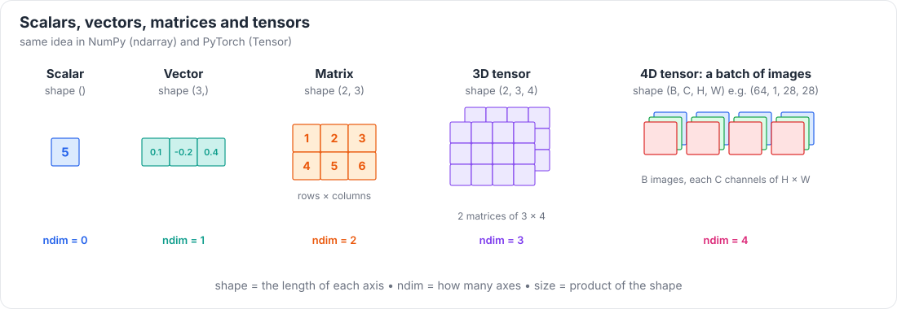
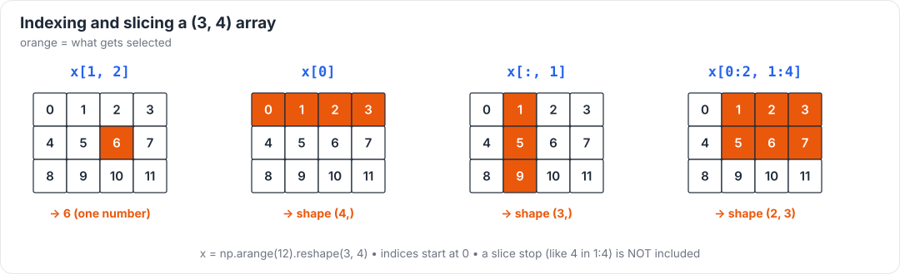
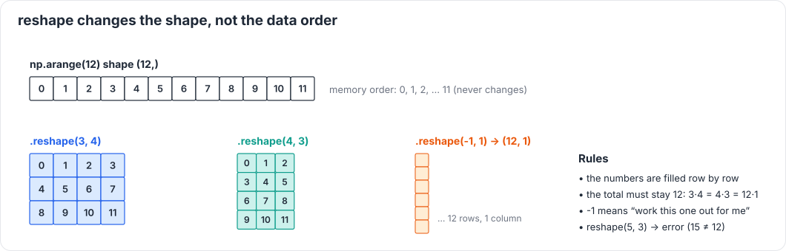
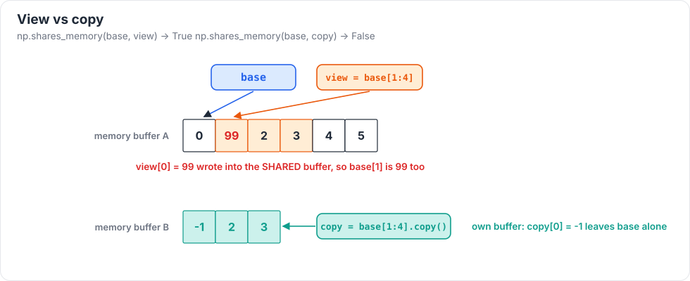
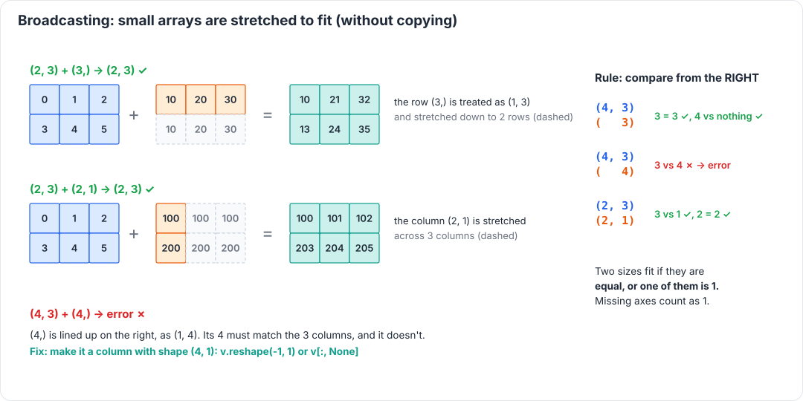
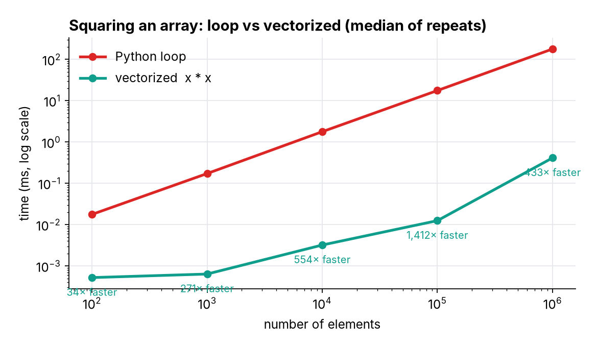
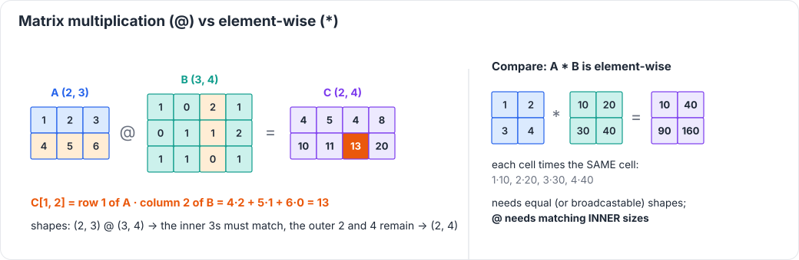
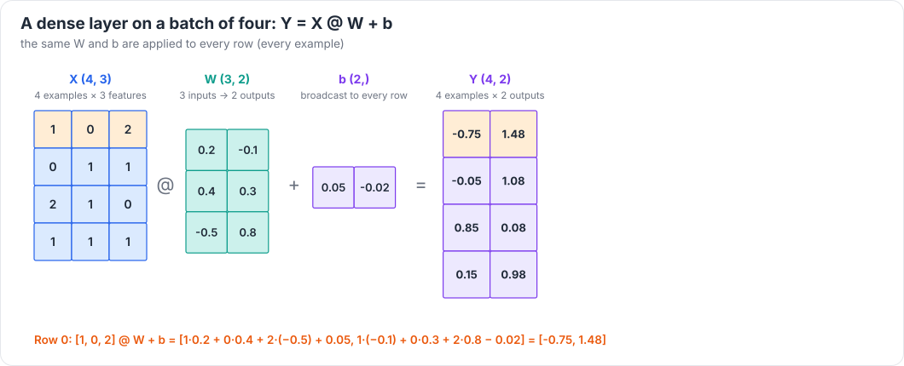
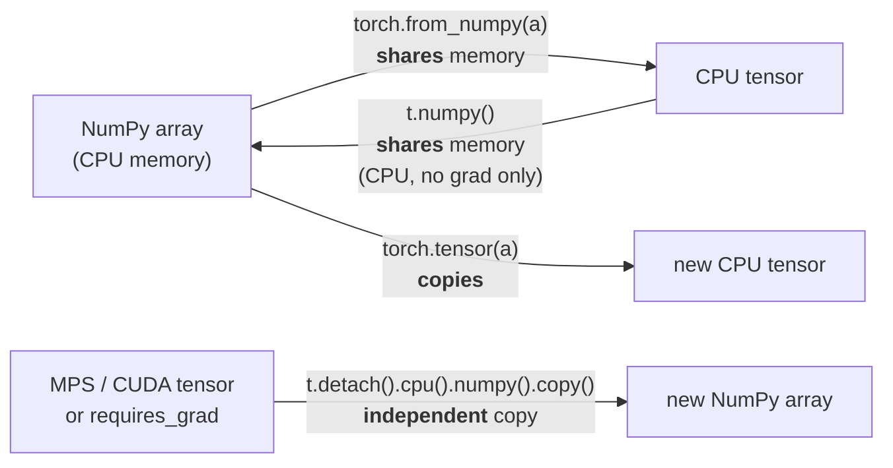

# 01 · NumPy and Tensors

> **Learning goal:** Build a reliable mental model of arrays and tensor operations that you can use in both deep learning and robotics.
>
> **Plan:** Day 001 · Read the ideas, work through the examples by hand, then complete `exercises/numpy_exercises.py` without looking up solutions.

## Why this chapter matters

Deep learning data and robotics measurements often start as numbers arranged in meaningful dimensions: a batch of observations, an image, a pose, a trajectory, or a table of sensor readings. NumPy gives us a clear way to represent and transform those numbers. The same ideas carry over to PyTorch tensors, where automatic differentiation and accelerators are added for model training.

The central habit in this chapter is to ask, before each operation:

1. What does each axis represent?
2. What is the shape before and after the operation?
3. What dtype and precision are being used?
4. Is this operation creating new data or sharing existing memory?

## 1. Arrays: numbers with structure

A NumPy array is an `ndarray`: a rectangular, n-dimensional block of elements, usually all represented using one dtype. The axes give the values structure; shape tells us the length of each axis.

```python
import numpy as np

# A 1D vector: three joint angles, for example
angles = np.array([0.1, -0.2, 0.4])

# A 2D array: rows could be samples, columns could be features
samples = np.array([[1.0, 2.0],
                    [3.0, 4.0]])

print(type(samples))  # numpy.ndarray
print(samples.shape)  # (2, 2)
print(samples.ndim)   # 2 axes
print(samples.size)   # 4 elements total
print(samples.dtype)  # commonly float64 here
```

The usual properties are:

- `shape`: a tuple of axis lengths. `(5, 3)` means 5 rows and 3 columns.
- `ndim`: the number of axes. A scalar has 0, a vector 1, a matrix 2.
- `size`: the total number of elements, equal to the product of the shape dimensions.
- `dtype`: the type used to represent each element, such as `int64`, `float32`, or `bool`.

A shape is not just bookkeeping. It is a compact statement of what data means. For a batch `X` with 4 examples and 3 input features, use shape `(4, 3)`. For 2D points from 10 time steps, shape `(10, 2)` could mean time by coordinate. Write down the axis meanings when a shape might be ambiguous.



**In plain words:** `ndim` counts how many index numbers you need to point at one element. A scalar needs none, a vector needs one (`v[2]`), a matrix needs two (`m[1, 2]`), and a batch of images needs four (`x[image, channel, row, column]`). The shape tells you how far each index can go.


## 2. Dtypes and numerical precision

NumPy arrays have a single dtype. The dtype affects memory use, representable range, rounding, and compatibility with later operations. Python floats commonly become NumPy `float64` by default, while deep learning models commonly use `float32` unless there is a reason to choose another precision.

```python
x64 = np.array([0.1, 0.2], dtype=np.float64)
x32 = x64.astype(np.float32)

print(x64.dtype, x64.nbytes)
print(x32.dtype, x32.nbytes)
print(x32.astype(np.float64))  # conversion back does not restore lost precision
```

Lower precision uses less memory and can be faster on some hardware, but it rounds values more coarsely and has a smaller representable range. Very large or very small values can overflow or underflow. Floating-point values are approximations, so use a tolerance when comparing computed results:

```python
np.allclose(actual, expected, rtol=1e-5, atol=1e-7)
```

Use integer dtypes for counts and indices, Boolean dtype for conditions, and an explicit floating dtype for numerical model inputs. Be deliberate about mixing dtypes: NumPy may promote values to a wider type, which can change memory use and results.

### Quick reference: common dtypes

| dtype | Bytes per number | Roughly how many exact decimal digits | Largest value | Typical use |
|---|---:|---:|---|---|
| `float16` | 2 | ~3 | 65,504 | memory-saving training on GPUs |
| `float32` | 4 | ~7 | ~3.4 × 10³⁸ | **default for deep learning** |
| `float64` | 8 | ~15–16 | ~1.8 × 10³⁰⁸ | NumPy's default, scientific computing |
| `int32` | 4 | exact | ~2.1 billion | indices, counts |
| `int64` | 8 | exact | ~9.2 × 10¹⁸ | NumPy/PyTorch default integers, class labels |
| `bool` | 1 | – | – | masks (`True` / `False`) |

**Why "use a tolerance" matters**, in one example:

```python
0.1 + 0.2 == 0.3                       # False!
0.1 + 0.2                              # 0.30000000000000004
np.isclose(0.1 + 0.2, 0.3)             # True
f"{np.float32(0.1):.20f}"              # '0.10000000149011611938' — float32 can't store 0.1 exactly
```

Computers store numbers in binary, and many simple decimals (like 0.1) have no exact binary form, just as 1/3 has no exact decimal form (0.333…). So tiny rounding errors are normal. Compare floats with `np.allclose` / `np.isclose`, never with `==`.


## 3. Indexing, slicing, and reshape

Indexing selects elements; slicing selects ranges along axes. NumPy uses zero-based indices, and slice endpoints stop before the end index.

```python
x = np.arange(12).reshape(3, 4)
# array([[ 0,  1,  2,  3],
#        [ 4,  5,  6,  7],
#        [ 8,  9, 10, 11]])

x[1, 2]      # row 1, column 2 -> 6
x[0]         # first row, shape (4,)
x[:, 1]      # second column, shape (3,)
x[0:2, 1:4]  # rows 0–1 and columns 1–3
```




A colon means “take this axis”; `:` by itself selects the whole axis. A slice often produces a view that shares memory with the original array, so changing the slice may change the source. Advanced indexing, such as selecting with a list of integer indices, generally creates a copy.

`reshape` changes how elements are arranged into axes without changing their order or count. The new dimensions must multiply to the same total size. One dimension may be `-1` to ask NumPy to infer it:

```python
flat = np.arange(12)
grid = flat.reshape(3, 4)
columns = flat.reshape(-1, 1)  # shape (12, 1), a column vector
```

`reshape` returns a view when possible and a copy when the current memory layout makes a view impossible. Do not rely on it always sharing memory or always copying; check with `np.shares_memory(a, b)` when that distinction matters.



**Mental model:** imagine the 12 numbers written on a long strip of paper. `reshape` only decides where to cut the strip into rows. It never reorders the numbers.


## 4. Views, copies, and mutation

A **view** has its own array metadata but refers to the same underlying data. A **copy** owns separate data. This distinction is important when you modify a slice, preprocess input, or pass arrays between functions.

```python
base = np.arange(6)
view = base[1:4]
copy = base[1:4].copy()

view[0] = 99  # also changes base[1]
copy[0] = -1  # base is unaffected

print(np.shares_memory(base, view))  # True
print(np.shares_memory(base, copy))  # False
```

Use `.copy()` when you need an independent array before in-place modification. Use a view when shared storage is intentional and you understand the consequences. A view can keep a much larger source allocation alive, even if the view is small.



**Rule of thumb:**

| Operation | Usually gives | So changing it… |
|---|---|---|
| basic slice `a[1:4]`, `a[:, 0]` | a **view** | …also changes `a` |
| `a.reshape(...)`, `a.T` | a view when possible | …may change `a` (check with `np.shares_memory`) |
| `a.copy()` | a **copy** | …never changes `a` |
| fancy indexing `a[[0, 2]]`, mask `a[a > 0]` | a **copy** | …never changes `a` |
| arithmetic `a + 1`, `a * 2` | a **new** array | …never changes `a` |


## 5. Boolean masks

A Boolean mask is an array of `True` and `False` values, often made by comparing an array with a threshold. It can filter values or select rows.

```python
readings = np.array([0.2, 1.8, -0.1, 2.4])
valid = readings >= 0
positive = readings[valid]
readings[readings > 2.0] = 2.0  # assign through a mask
```


For a 2D array, a row mask must have one Boolean value per row:

```python
points = np.array([[0.0, 0.0], [1.0, 2.0], [-1.0, 1.0]])
keep = points[:, 0] >= 0
kept_points = points[keep]
```

Combine conditions with elementwise operators `&` (and), `|` (or), and `~` (not). Put each comparison in parentheses because these operators have different precedence from comparisons:

```python
mask = (readings >= 0) & (readings < 2)
```

Do not use Python's `and` or `or` to combine array conditions; they expect one truth value rather than elementwise results.

## 6. Broadcasting: compatible shapes work together

Broadcasting lets NumPy apply an operation to arrays with compatible shapes without manually copying repeated values. Compare shapes from the **rightmost axis** moving left. Two dimensions are compatible when they are equal or when one of them is `1`. If one shape has fewer axes, imagine adding leading dimensions of `1`. Otherwise, the operation raises a shape error.

```python
matrix = np.arange(6).reshape(2, 3)  # (2, 3)
row = np.array([10, 20, 30])           # (3,)

matrix + row  # row acts across both rows; result shape (2, 3)
```

For column-wise offsets, make the singleton axis explicit:

```python
column = np.array([[100], [200]])  # (2, 1)
matrix + column                   # result shape (2, 3)
```

The singleton axis is expanded conceptually; NumPy does not need to materialize repeated copies just to perform the operation. Broadcasting is useful for normalizing features, adding per-feature biases, and applying coordinate-wise offsets.

A reliable check is to write down both input shapes and the output shape before running the code. For example, `(4, 3)` plus `(3,)` is compatible: compare `(4, 3)` with `(1, 3)`, giving `(4, 3)`. But `(4, 3)` plus `(4,)` is incompatible: compare `(4, 3)` with `(1, 4)` and the trailing dimensions `3` and `4` do not match.



### Broadcasting in three steps (do this on paper)

1. **Write the shapes right-aligned**, one above the other. Pad the shorter one on the left with 1s.
2. **Check each column from the right:** the two sizes must be equal, or one of them must be 1.
3. **The result size in each column** is the bigger of the two.

```text
   (4, 3)        (4, 3)        (2, 1, 5)
 + (1, 3)      + (1, 4)      + (   3, 1)   →  pad: (1, 3, 1)
   ------        ------        ---------
   (4, 3) ✓      3 vs 4 ✗      (2, 3, 5) ✓
```

The "stretching" is only conceptual: NumPy reuses the same memory instead of making copies, which is why broadcasting is both convenient and fast.


**Pause and predict:** The exercise file asks you to predict six broadcasting results before executing any of them. Record whether each operation succeeds and its resulting shape, then check your reasoning in Python.

## 7. Vectorization and timing

Vectorization means expressing an operation over whole arrays instead of writing a Python loop for every element. NumPy can run many elementwise operations in optimized native code, reducing Python overhead and making the intended math clearer.

```python
values = np.arange(1_000_000, dtype=np.float64)

# Vectorized
squared = values * values

# The same idea with a Python loop
squared_loop = np.empty_like(values)
for i in range(values.size):
    squared_loop[i] = values[i] * values[i]
```

Time both versions with `time.perf_counter()`. Run each several times, avoid including array construction in only one measurement, and compare medians rather than one sample:

```python
import time

values = np.arange(200_000, dtype=np.float32)

def square_loop(x):
    result = np.empty_like(x)
    for i in range(x.size):
        result[i] = x[i] * x[i]
    return result

def median_ms(function, x, repeats=5):
    samples = []
    for _ in range(repeats):
        start = time.perf_counter()
        result = function(x)
        samples.append(time.perf_counter() - start)
    return np.median(samples) * 1_000

loop_result = square_loop(values)
vector_result = values * values
assert np.allclose(loop_result, vector_result)
print(f"loop:      {median_ms(square_loop, values):.2f} ms")
print(f"vectorized:{median_ms(lambda x: x * x, values):.2f} ms")
```

The loop is expected to be slower for this simple elementwise operation, but exact ratios depend on array size, hardware, NumPy build, and other running work. Always verify results with `np.allclose` (or an appropriate exact comparison) so a fast implementation is still correct.



*Real measurement (Linux cloud CPU, NumPy, float32, median of repeats). Your Mac's numbers will differ, but the shape of the result is the same.* For 100,000 elements the loop took about 18 ms and the vectorized version about 0.01 ms, over 1,000× faster.

**Why is vectorized code so much faster?** In the loop, Python does a lot of work for *every* element: look up `x[i]`, create a Python number object, multiply, convert it back, store it. With `x * x`, Python makes **one** call, and NumPy then runs a tight loop in compiled C code over raw memory, often using CPU instructions that process several numbers at once. The math is identical; only the per-element overhead disappears.


Vectorization is not automatically better for every task: tiny arrays can be dominated by setup costs, and some algorithms are naturally iterative. The goal is to express the numerical work in array operations when that is clear and correct.

## 8. Linear algebra and `@`

For 2D arrays, `A @ B` performs matrix multiplication. If `A` has shape `(m, n)`, then `B` must have shape `(n, p)`, and the result has shape `(m, p)`. The inner dimensions must match. This is different from `A * B`, which multiplies corresponding elements element by element when the shapes allow it.

```python
A = np.ones((2, 3))
B = np.ones((3, 4))
C = A @ B
print(C.shape)  # (2, 4)
```

The entry at row `i`, column `j` is the dot product of row `i` of `A` and column `j` of `B`. For vectors, `@` computes a dot product; for batches and higher-dimensional arrays, NumPy follows its batched matrix multiplication rules. In this chapter, reason first with 2D shapes.



**Shape rule to memorize:** `(m, n) @ (n, p) → (m, p)`. The two inner numbers must match and "cancel out"; the outer numbers become the result's shape.


## 9. A dense layer for a batch of four

A dense (fully connected) layer applies the same learned weights to every example in a batch. Let `X` contain four examples, each with three input features. Let `W` map those features to two output features, and let `b` provide one offset per output feature:

- `X`: `(4, 3)` — four examples, three input features each
- `W`: `(3, 2)` — three input features mapped to two outputs
- `b`: `(2,)` — one bias per output feature
- `X @ W`: `(4, 2)`
- `X @ W + b`: `(4, 2)` because `(2,)` broadcasts across the four rows

```python
X = np.array([[1.0, 0.0, 2.0],
              [0.0, 1.0, 1.0],
              [2.0, 1.0, 0.0],
              [1.0, 1.0, 1.0]], dtype=np.float32)  # (4, 3)
W = np.array([[0.2, -0.1],
              [0.4,  0.3],
              [-0.5, 0.8]], dtype=np.float32)        # (3, 2)
b = np.array([0.05, -0.02], dtype=np.float32)        # (2,)

Y = X @ W + b
print(Y.shape)  # (4, 2)
```




*These are the real outputs of the code above:* `Y = [[-0.75, 1.48], [-0.05, 1.08], [0.85, 0.08], [0.15, 0.98]]`.

Read it row by row: each row of `Y` is one example's two output features. Every example uses the **same** `W` and `b`, which is exactly what makes a layer "learned once, applied to everything".

This same pattern appears in neural networks: matrix multiplication combines input features with weights, and broadcasting adds the bias. In robotics, the same shape reasoning helps with batches of states, coordinate transforms, sensor features, and trajectory data. The meaning of each axis depends on the problem, so label the axes before choosing an operation.

## 10. How NumPy relates to PyTorch tensors and autograd

NumPy and PyTorch both provide multi-dimensional arrays (NumPy `ndarray`; PyTorch `Tensor`) with shapes, dtypes, indexing, broadcasting, and matrix multiplication. Learning these ideas in NumPy makes tensor code easier to read because the same shape logic applies.

PyTorch tensors add features for model training, including device placement (CPU or accelerator) and automatic differentiation. A tensor with `requires_grad=True` can track operations and compute gradients for learning. NumPy arrays do not track a computation graph and do not provide autograd. NumPy is therefore excellent for array fundamentals, data inspection, and many numerical tasks; PyTorch is commonly used when training neural networks with gradients and accelerator support.

The APIs are similar but not identical. PyTorch may have different defaults, supported operations, device behavior, and in-place operation rules. When converting, be explicit about the boundary: `torch.from_numpy(array)` can share CPU memory with a compatible NumPy array, while `.numpy()` is available for suitable CPU tensors that do not require gradients. For GPU/MPS tensors or tensors participating in autograd, conversion usually involves moving to CPU and/or detaching first. Understand ownership and device before assuming two objects share data.

## 11. PyTorch tensors: from array structure to learning

A PyTorch `Tensor` is a typed, n-dimensional array. Like a NumPy array, it stores values in a rectangular shape; unlike a NumPy array, a tensor can live on a CPU or accelerator and can track operations for automatic differentiation. Each axis should still have a clear meaning: for a batch of images, for example, the axes might be batch, channel, height, and width.

### Dimensions and creation

The number of axes is the tensor's rank, available as `.ndim`. A scalar has no axes and shape `()`, a vector might have shape `(3,)`, a matrix might have shape `(2, 3)`, and a higher-dimensional tensor has three or more axes. Shape records the length of each axis; it does not describe what the values mean, so name the axes as you do with NumPy.

```python
import torch

scalar = torch.tensor(5.0)                              # shape ()
vector = torch.tensor([1, 2, 3], dtype=torch.float32)   # shape (3,)
matrix = torch.zeros((2, 3))                            # shape (2, 3)
uniform = torch.rand((2, 3))                            # uniform values in [0, 1)
normal = torch.randn((2, 3))                            # standard normal values
same_structure = torch.ones_like(matrix)
```

`torch.tensor(data)` copies the supplied values into a tensor and infers a dtype unless one is specified. Use `torch.zeros`, `torch.ones`, `torch.full`, `torch.rand`, and `torch.randn` when the desired values or random distribution are known. The `*_like` functions create a tensor with another tensor's shape and, by default, its dtype and device; pass an explicit `dtype` or `device` to override those properties.

### Shape, dtype, and device

These attributes answer different questions:

- `x.shape` gives the axis lengths, such as `(2, 3)`.
- `x.ndim` gives the number of axes.
- `x.numel()` gives the total number of elements, the product of the shape dimensions.
- `x.dtype` gives the representation used for each element, such as `torch.int64`, `torch.float32`, or `torch.float64`.
- `x.device` tells where the tensor's data lives.

```python
print(matrix.shape, matrix.dtype, matrix.device)
print(matrix.ndim, matrix.numel())
```

For a tensor's element data, `x.numel() * x.element_size()` gives its storage size in bytes; this does not include Python objects, allocator overhead, or other framework bookkeeping. A dtype conversion can change precision and memory use without changing the shape.

### CPU, CUDA, MPS, and `.to()`

CPU is the general-purpose processor. CUDA is PyTorch's backend for supported NVIDIA GPUs. MPS is the Apple Metal backend for supported Apple hardware and PyTorch builds. Check availability rather than assuming a particular accelerator exists:

```python
if torch.cuda.is_available():
    device = torch.device("cuda")
elif torch.backends.mps.is_available():
    device = torch.device("mps")
else:
    device = torch.device("cpu")
```

Create a tensor on a chosen device or move an existing one with `.to()`:

```python
x = torch.tensor([1, 2, 3])
x = x.to(device=device, dtype=torch.float32)
```

`.to()` returns a tensor with the requested device and/or dtype; assigning the result makes the variable refer to it. The original tensor is not changed in place. If it already has the requested properties, PyTorch may return the original tensor. Ordinary operations such as addition and matrix multiplication require their input tensors to be on compatible devices, so place model parameters and input data consistently. An accelerator may also support only a subset of operations, depending on the hardware and PyTorch version.

### NumPy conversion and shared memory

The NumPy bridge is a boundary between CPU array storage and PyTorch. For a compatible NumPy array, `torch.from_numpy(array)` creates a CPU tensor that shares the array's storage:

```python
import numpy as np
import torch

array = np.array([1.0, 2.0, 3.0], dtype=np.float32)
tensor = torch.from_numpy(array)
array[0] = 10.0  # tensor sees this change
tensor[1] = 20.0 # array sees this change
```

Because the storage is shared, either object's in-place edits are visible through the other. The tensor cannot resize that NumPy allocation. `torch.from_numpy` accepts CPU arrays with supported NumPy dtypes; it does not move an array to CUDA or MPS. Do not write through the tensor when the source NumPy array is read-only. Use `torch.tensor(array)` or `array.copy()` first when independent storage is required.




In the other direction, `tensor.numpy()` is available when the tensor is on the CPU, does not require gradients, and has a dtype and layout supported by NumPy. In that case, the returned array shares the tensor's storage, so mutations are visible in both directions. A CUDA or MPS tensor cannot directly expose its device memory as a NumPy array, and a tensor requiring gradients must be detached from autograd first:

```python
array_copy = tensor.detach().cpu().numpy().copy()
```

`.detach()` disconnects the value from its computation graph; `.cpu()` moves accelerator data to CPU when needed; the final `.copy()` ensures the NumPy result has independent storage. Without `.copy()`, a detached CPU tensor may still share memory with the resulting array. Moving data between an accelerator and CPU can take time and memory, so convert at clear points such as data loading, inspection, or exporting results.

### In-place operations and autograd

An in-place method changes the existing tensor. PyTorch commonly marks these methods with a trailing underscore: `x.add_(value)` updates `x`, while `x + value` creates a result and leaves `x` unchanged. An in-place edit can also affect other tensors that are views of or share storage with `x`.

Autograd records operations and saves some values needed to calculate gradients later. An in-place edit can overwrite a saved value and make the backward pass incorrect or trigger a runtime error. A leaf tensor with `requires_grad=True` generally cannot be modified in place while gradient tracking is active. Prefer out-of-place operations in a model's forward calculation. Optimizers handle parameter updates safely; if writing a manual update, perform it under `torch.no_grad()` so the update itself is not added to the graph.

### Connection to the NumPy neural network and backpropagation

The matrix shapes and broadcasting rules from the NumPy sections carry straight into PyTorch. The same batched layer has the form `Z = X @ W + b`: rows of `X` are examples, columns are features, and `b` broadcasts across the batch. A multi-layer model applies that pattern repeatedly with elementwise activations between layers.

In the NumPy backpropagation chapter, the `Z`, `A`, `W`, `b`, and `dW`/`db` arrays make each forward and backward formula visible. PyTorch uses tensors for the same values and can build a computation graph as those operations run. Mark learnable weights and biases with `requires_grad=True`; after computing a scalar loss, call `loss.backward()` to have autograd apply the chain rule and place gradients on the parameters. Gradients accumulate in `.grad`, so training code clears them before the next update. Comparing PyTorch gradients with the manual formulas in [`02 · Backpropagation by Hand`](../02-backprop-by-hand/README.md) connects autograd to the mathematics rather than treating it as a black box. The shapes, data types, and device locations still need to be checked just as carefully as in NumPy. Then practice these APIs in [`exercises/pytorch_tensors.py`](exercises/pytorch_tensors.py); keep the solutions in that exercise file.

## 12. Learning roadmap

1. **Read the shapes aloud.** For every array, name its axes and confirm `shape`, `ndim`, `size`, and `dtype`.
2. **Predict before running.** Work out indexing results, reshape dimensions, and all six broadcasting exercises by hand.
3. **Inspect memory behavior.** Make a slice, test `np.shares_memory`, mutate it, and explain what changed.
4. **Express the math.** Replace a simple elementwise loop with vectorized NumPy operations and compare results and timings.
5. **Track matrix dimensions.** Check each inner dimension for `@`; then derive the `(4, 3) @ (3, 2) + (2,)` dense layer.
6. **Connect the ideas to tensors.** Read the same shapes in PyTorch and note where device placement and autograd add new behavior.

## Check yourself

Before moving on, make sure you can explain:

- What each axis means for a sample batch and for a robotics measurement array.
- Why changing a view can change its source, and when to call `.copy()`.
- How to decide broadcasting compatibility from the trailing dimensions.
- Why `*` and `@` represent different operations.
- How a bias of shape `(2,)` becomes compatible with a layer output of shape `(4, 2)`.
- What PyTorch adds for training that a NumPy array does not provide.


<details>
<summary><b>Short answers (open after you've tried)</b></summary>

- **Axis meaning:** a sample batch `(N, F)` is examples × features. A robotics log `(T, 3)` could be time steps × (x, y, z). The numbers alone don't tell you; you name the axes.
- **View vs `.copy()`:** a view shares the same memory buffer, so writing through it writes into the source. Call `.copy()` before modifying a slice that you don't want to affect the original.
- **Broadcasting:** right-align the shapes; each pair of sizes must be equal or contain a 1 (missing axes count as 1).
- **`*` vs `@`:** `*` multiplies matching positions (shapes must be equal or broadcastable); `@` takes dot products of rows with columns (the inner sizes must match).
- **Bias `(2,)` with output `(4, 2)`:** right-aligned, `(2,)` becomes `(1, 2)`; the 2s match and the 1 stretches to 4 rows, so every example gets the same two biases.
- **What PyTorch adds:** devices (CPU, CUDA, MPS) and autograd (recording operations to compute gradients automatically). Shapes, dtypes and broadcasting work the same.

</details>

Then complete [`exercises/numpy_exercises.py`](exercises/numpy_exercises.py). It contains prompts and answer spaces only; write and run your own code as you work through them.

## References

- [NumPy beginner guide](https://numpy.org/doc/stable/user/absolute_beginners.html)
- [NumPy broadcasting](https://numpy.org/doc/stable/user/basics.broadcasting.html)
- [NumPy copies and views](https://numpy.org/doc/stable/user/basics.copies.html)
- [NumPy data types](https://numpy.org/doc/stable/user/basics.types.html)
- [NumPy `matmul`](https://numpy.org/doc/stable/reference/generated/numpy.matmul.html)
- [PyTorch tensors](https://pytorch.org/tutorials/beginner/basics/tensorqs_tutorial.html)
- [PyTorch tensor creation](https://docs.pytorch.org/docs/stable/generated/torch.tensor.html)
- [PyTorch Tensor `.to()`](https://docs.pytorch.org/docs/stable/generated/torch.Tensor.to.html)
- [PyTorch `torch.from_numpy`](https://docs.pytorch.org/docs/stable/generated/torch.from_numpy.html)
- [PyTorch Tensor `.numpy()`](https://docs.pytorch.org/docs/stable/generated/torch.Tensor.numpy.html)
- [PyTorch autograd mechanics](https://docs.pytorch.org/docs/stable/notes/autograd.html)
- [PyTorch MPS backend](https://docs.pytorch.org/docs/stable/notes/mps.html)
