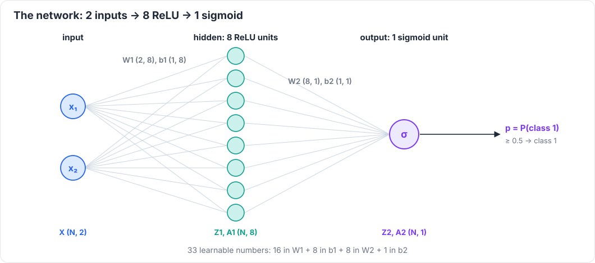
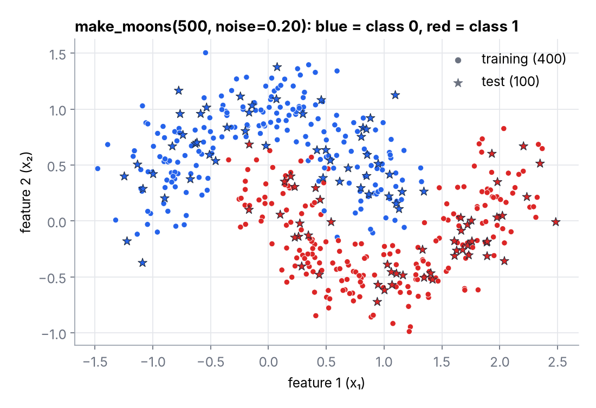
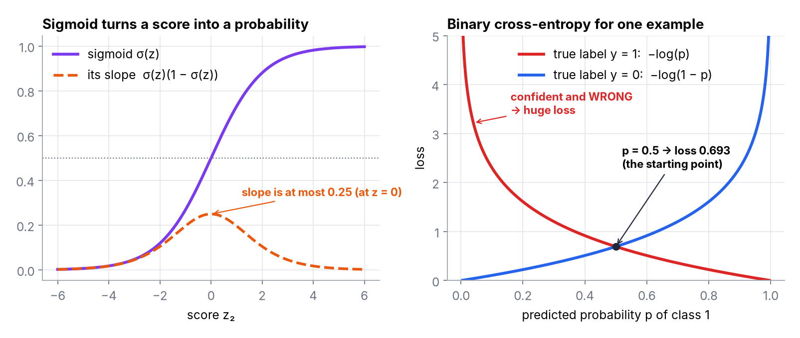
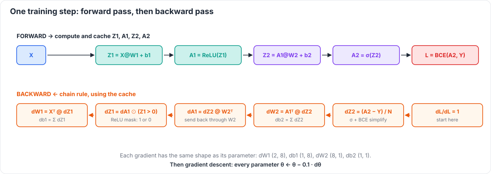
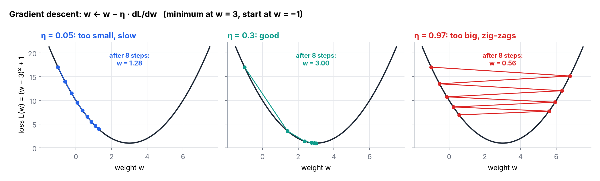
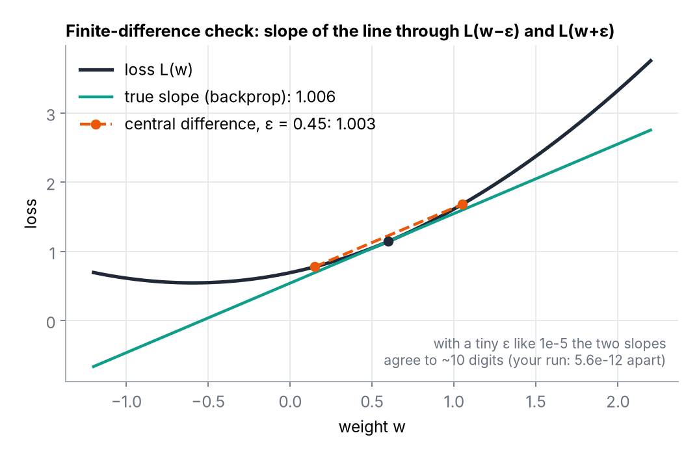
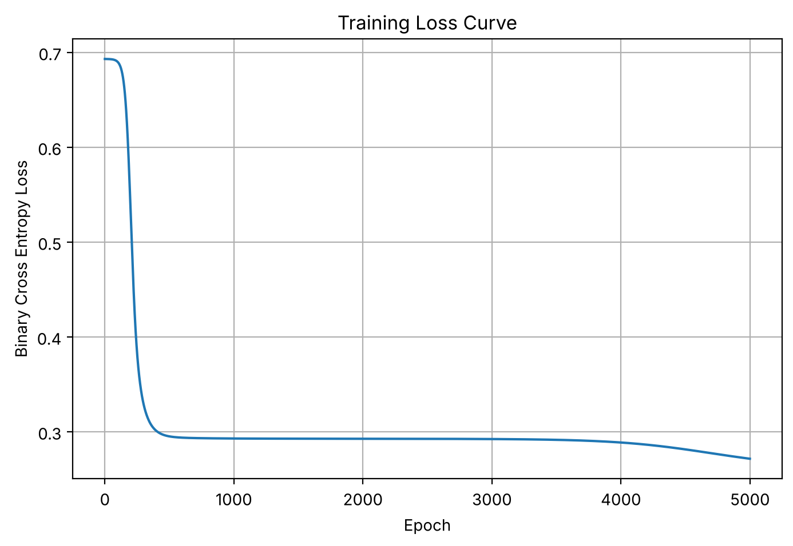
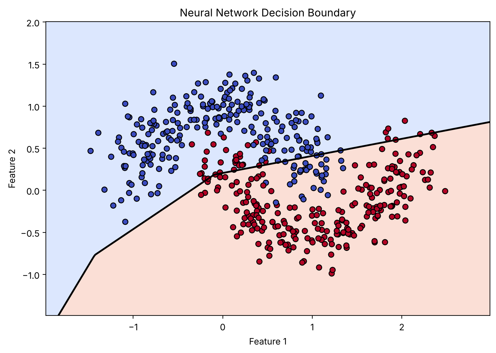
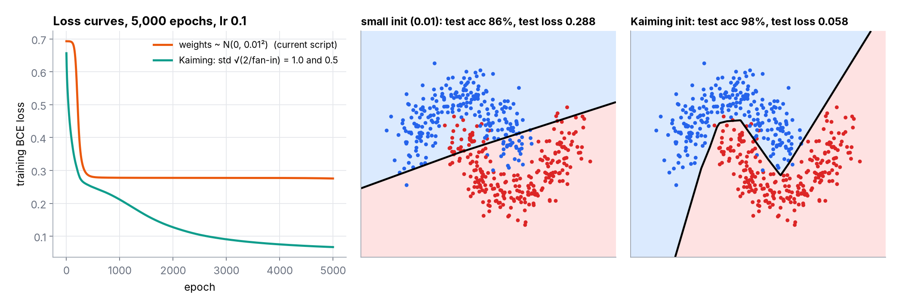

# 02 · Backpropagation by Hand

> Plan: Day 002

This chapter builds a small binary classifier with NumPy so each step of learning is visible: make predictions, measure their error, work out how each parameter affected that error, then nudge the parameters in a better direction. The implementation is in [`excercise/backprop-by-hand.py`](excercise/backprop-by-hand.py). The folder is named `excercise` in this repository.

## What this chapter explains

- How a two-layer neural network turns two input features into a probability.
- How the notation in the handwritten notes maps to the arrays in the Python code.
- How binary cross-entropy (BCE) and the chain rule produce the gradients.
- How full-batch gradient descent trains the network.
- How a finite-difference check gives an independent check of one handwritten gradient formula.
- How to read the loss curve, test metrics, and decision-boundary plot.

## The idea, intuitively

The two-moons dataset contains two interleaving, curved groups of points. The task is to decide which group a point belongs to from its two coordinates.

The network first makes eight simple learned measurements of each point in a hidden layer. ReLU keeps positive measurements and sets negative ones to zero. The output layer combines those eight values into one score, and sigmoid turns that score into a probability for class 1.

At the start, the weights are tiny and the biases are zero, so predictions are close to 0.5: the network is nearly guessing. BCE says how costly those probabilities are. Backpropagation works backward through the same calculations to find how the weights and biases should change. Gradient descent applies those changes repeatedly.

**One sentence per part:**
- each **hidden neuron** draws one straight line across the 2D plane and outputs "how far on the positive side of my line is this point" (ReLU cuts the negative side to 0);
- the **output neuron** adds those 8 measurements with its own weights into one score;
- **sigmoid** squashes the score into a probability between 0 and 1.

Because each hidden neuron contributes a straight-line "fold", the final boundary is made of straight pieces joined together, so it can bend around the moons if training finds good lines.

## The maths

### 1. Dataset and split

`make_moons` creates 500 two-dimensional examples with noise level 0.20 and `random_state=42`. Each row of `X` is one point with two coordinates; `y` contains its binary label (0 or 1). The noise makes the two curved classes overlap a little, so a perfect separation is not expected.

An 80/20 split gives 400 training samples and 100 test samples. `stratify=y` asks the split to preserve the class proportions. The network learns from the training set; the test set is held aside until evaluation.

*The real dataset (`make_moons(500, noise=0.20, random_state=42)`). Dots are the 400 training points and stars are the 100 test points. This picture uses `random_state=42` in the split so it's repeatable.* Notice the two classes overlap a little in the middle: even a perfect model would make a few mistakes there.

The data generator has a fixed seed, but the current `train_test_split` call does not pass `random_state`. Its shuffled split can therefore differ from run to run. The weights are initialized from a separate seeded NumPy generator, so they start the same way while the samples assigned to train and test can change. To make the split repeatable, add `random_state=42` to that call.

### 2. Your handwritten notation → the code

The notes often describe one neuron or one example with scalar symbols. The code handles a whole batch of examples and all neurons at once, so it adds array shapes and layer numbers.

| In the notes | In the code | Meaning |
|---|---|---|
| input feature `x` | `X` | A batch of input rows; each row has two features |
| preactivation `x_i` (or layer preactivation) | `Z1`, `Z2` | Weighted sum plus bias, before the activation |
| activation `a_i` | `A1`, `A2` | Output after ReLU or sigmoid |
| weight `w` | `W1`, `W2` | A matrix of weights between two layers |
| bias `b` | `b1`, `b2` | One bias per neuron, broadcast across the batch |
| delta `δ_i = ∂L/∂x_i` | `dZ1`, `dZ2` | Loss sensitivity to each preactivation |
| parameter gradients | `dW1`, `db1`, `dW2`, `db2` | Loss sensitivity to each weight and bias |

In this network, the subscript 1 means hidden layer and 2 means output layer. The code calls preactivations `Z`; that is the same role as the notes' preactivation `x_i`. It uses uppercase names because each value is a NumPy array. The name `Z` later used for the plotted mesh is a separate plotting variable, not `Z1` or `Z2`.

For one hidden neuron `j` and one sample, the notes' weighted sum can be written:

$$
z_j = x_1 w_{1j} + x_2 w_{2j} + b_j.
$$

For every sample and all eight hidden neurons together, the code writes the same calculation as:

$$
Z_1 = X W_1 + b_1.
$$

The `@` operator performs matrix multiplication. Rows are samples, so keeping samples in rows makes the result of the batch calculation easy to track.

### 3. Shapes are a shape check

Let `N` be the number of samples in the current batch. During training, `N = 400`.

| Value | Shape | Why |
|---|---:|---|
| `X_train` | `(400, 2)` | 400 rows, 2 input features |
| `y_train` | `(400,)` | One label per row; reshaped to a column for calculations |
| `Y` | `(400, 1)` | Column of target labels |
| `W1`, `b1` | `(2, 8)`, `(1, 8)` | 2 inputs feed 8 hidden neurons |
| `Z1`, `A1` | `(N, 8)` | One hidden preactivation and activation per neuron |
| `W2`, `b2` | `(8, 1)`, `(1, 1)` | 8 hidden activations feed 1 output neuron |
| `Z2`, `A2` | `(N, 1)` | One output score and probability per sample |
| `dW1`, `db1` | `(2, 8)`, `(1, 8)` | Gradients match `W1` and `b1` |
| `dW2`, `db2` | `(8, 1)`, `(1, 1)` | Gradients match `W2` and `b2` |

If a matrix multiplication fails, first check the inner dimensions. For example, `(N, 2) @ (2, 8)` produces `(N, 8)`. Biases have one row and broadcast across all `N` samples.

### 4. Forward pass: input to probability

The hidden layer calculates weighted sums and applies ReLU:

$$
Z_1 = XW_1 + b_1, \qquad A_1 = \operatorname{ReLU}(Z_1) = \max(0, Z_1).
$$

ReLU is applied element by element. Positive values pass through; zero and negative values become zero. This makes the overall network nonlinear while keeping the derivative simple: 1 where `Z1 > 0`, and 0 where `Z1 <= 0` in this implementation.

The output layer calculates one score, then uses sigmoid:

$$
Z_2 = A_1W_2 + b_2, \qquad
A_2 = \sigma(Z_2) = \frac{1}{1 + e^{-Z_2}}.
$$

`A2` is the predicted probability of class 1. A probability at or above 0.5 becomes class 1 at evaluation time; a probability below 0.5 becomes class 0.

The `forward_pass` function returns both `A2` and a cache containing `Z1`, `A1`, `Z2`, and `A2`. Backpropagation needs these exact intermediate values. Recomputing them once and passing the cache backward is also a reminder that the gradients belong to the parameters used in that forward pass.

### 5. Binary cross-entropy

For one sample with true label `y` and predicted probability `p`, BCE is:

$$
\ell = -\left[y\log(p) + (1-y)\log(1-p)\right].
$$

For `N` samples, the code averages those losses:

$$
L = \frac{1}{N}\sum_{i=1}^{N}
-\left[y_i\log(p_i) + (1-y_i)\log(1-p_i)\right].
$$

If the true label is 1, the loss is `-log(p)`. If the true label is 0, it is `-log(1-p)`. A confident correct prediction has a small loss; a confident wrong prediction has a large loss. With predictions near 0.5, the initial loss is near `-log(0.5) ≈ 0.693`.

**Read the right plot like this:** if the answer is class 1 (red curve), predicting p = 0.99 costs almost nothing, but predicting p = 0.01 costs about 4.6. BCE punishes being **confidently wrong** far more than being unsure. That's why it is a good training signal: the worst mistakes produce the biggest gradients.

The implementation clips probabilities to `[1e-12, 1 - 1e-12]` before taking logarithms. This avoids `log(0)`. Keep both details of the BCE expression straight: the entire sum has a leading negative sign, and the second term uses `(1 - y_true)`, not `(1 - y_pred)`.

### 6. Backpropagation: carry the loss backward

The delta for a preactivation is the derivative of the loss with respect to that preactivation. At the output, BCE paired with sigmoid simplifies neatly. For one sample:

$$
\frac{\partial \ell}{\partial p}
= -\frac{y}{p} + \frac{1-y}{1-p}
= \frac{p-y}{p(1-p)}, \qquad
\frac{\partial p}{\partial z_2}=p(1-p).
$$

Multiplying these two pieces gives:

$$
\frac{\partial \ell}{\partial z_2}
=
\frac{\partial \ell}{\partial p}
\frac{\partial p}{\partial z_2}
= p-y.
$$

The sigmoid derivative contributes `p(1-p)`; it cancels the matching denominator in the BCE derivative. Since this code's loss is averaged over `N` examples, the batch delta is:

$$
dZ_2 = \frac{A_2 - Y}{N}.
$$

Then the output parameter gradients are:

$$
dW_2 = A_1^\mathsf{T}dZ_2, \qquad
db_2 = \sum_{\text{samples}} dZ_2.
$$

To continue through the hidden layer, first send each output delta backward through `W2`, then apply the ReLU derivative mask:

$$
dA_1 = dZ_2 W_2^\mathsf{T}, \qquad
dZ_1 = dA_1 \odot (Z_1 > 0).
$$

Here `⊙` means element-by-element multiplication. The mask is 1 where a hidden preactivation is positive and 0 otherwise. Finally:

$$
dW_1 = X^\mathsf{T}dZ_1, \qquad
db_1 = \sum_{\text{samples}} dZ_1.
$$

This is the chain rule in code form: start at the loss, move backward through sigmoid/BCE, the output weights, ReLU, and the input-to-hidden weights. Each gradient has the same shape as the parameter it updates.

### Why `dZ2 = A2 − Y` makes sense (intuition)

The output delta is simply **prediction minus truth**:

| Situation | p (prediction) | y (truth) | p − y | What gradient descent does |
|---|---:|---:|---:|---|
| right and confident | 0.95 | 1 | −0.05 | tiny push: almost nothing to fix |
| unsure | 0.50 | 1 | −0.50 | medium push toward class 1 |
| wrong and confident | 0.05 | 1 | −0.95 | big push toward class 1 |
| wrong the other way | 0.90 | 0 | +0.90 | big push toward class 0 |

The sign says which direction to move; the size says how much the example is "complaining". Every other gradient in the network is this complaint, sent backward through the weights and the ReLU masks.

#### Average by `N` once

The code divides by `N` in `dZ2 = (A2 - Y) / N`. The later matrix products and sums combine each sample's contribution; they do not divide again. Do not divide `dW1`, `db1`, `dW2`, or `db2` by `N` a second time. Because this network has one output, `np.mean` in BCE is an average over the `N` samples.

### 7. Gradient descent

For each parameter `θ`, gradient descent uses:

$$
\theta \leftarrow \theta - \eta \frac{\partial L}{\partial \theta},
$$

where `η` is the learning rate. Here `η = 0.1`. A gradient points in the direction that increases the loss most quickly, so subtracting a small multiple moves in the direction that decreases it locally.

*Real computation on a simple bowl-shaped loss.* The same rule, `w ← w − η · slope`, behaves very differently depending on η: too small crawls, a good value arrives in a few steps, too large jumps back and forth across the valley (and even larger values diverge).

The code updates weights and biases in place with `parameter -= learning_rate * gradient`. Use the gradients from the matching forward pass, then calculate a new forward pass after the parameters change. Old cached activations or gradients describe the old parameter values.

## Implementation

### One training epoch

The script uses full-batch gradient descent: each epoch processes all 400 training samples together and makes one update.

1. Run `forward_pass` to get probabilities and a cache.
2. Calculate BCE for those probabilities.
3. Run `backward_pass` with that cache to get all four gradients.
4. Update `W1`, `b1`, `W2`, and `b2`.
5. Store the epoch's loss and occasionally print it.

The loop repeats this 5,000 times. `loss_history.append(loss)` must run inside the loop so there is one recorded value per epoch. In this script, `loss` was calculated just before the update, so the stored value describes the pre-update predictions even though the append line comes just after the update. The curve should trend downward overall, not necessarily at exactly the same rate every epoch.

One detail when reproducing the current script: its gradient-descent demonstration before the gradient check performs one update before the 5,000-epoch loop begins. The loop then performs 5,000 more updates. The initial printed training loss is measured before that demonstration update; the check and training use the updated parameters. Keep that order in mind when comparing runs.

### Finite-difference gradient check

Gradient checking is a debugging check, not a training step. For the one selected weight `W2[0, 0]`, the script temporarily adds and subtracts `ε = 1e-5`, computes the loss each time, restores the original weight, and estimates the derivative with a central difference:

$$
g_{\mathrm{numeric}} \approx
\frac{L(w+\epsilon) - L(w-\epsilon)}{2\epsilon}.
$$

It compares that estimate with the analytical `dW2[0, 0]` from a fresh forward and backward pass. Both methods use the same first 10 training examples and the same restored parameter values.

**Why the *central* difference?** The one-sided version `(L(w+ε) − L(w)) / ε` has an error that shrinks like ε. The central version `(L(w+ε) − L(w−ε)) / 2ε` cancels the first error term, so its error shrinks like ε². With ε = 1e-5, that's the difference between ~1e-5 and ~1e-10 accuracy, which is why your two numbers agreed to about 12 decimal places.

One observed run gave:

| Method | Gradient |
|---|---:|
| Finite difference | `-0.0007444278471435694` |
| Backpropagation | `-0.0007444278527429263` |

Their difference is about `5.6 × 10⁻¹²`, so this is an excellent match for that weight in that run. The split is not fixed, so another run can give different values.

The network has 33 scalar parameters in total: 16 in `W1`, 8 in `b1`, 8 in `W2`, and 1 in `b2`. We deliberately deferred checking all 33 so we could move on to training after seeing one clear example. This check is strong evidence for the tested output weight; it does not prove every gradient is correct. A full check would perturb each scalar parameter in turn and compare all analytical and numerical gradients.

Always restore the perturbed parameter and compute the analytical gradient using a fresh forward pass at the same parameters. Otherwise the two numbers would describe different models. Checks can also be less reliable when a probability is clipped or a ReLU preactivation sits exactly at its kink.

### Loss curve, evaluation, and decision boundary

`loss_history` stores one BCE value per epoch. In the observed run, the curve began near `0.693`, dropped quickly during early training, then improved more slowly and finished around `0.26` (about `0.262` in one run). Other runs have finished in roughly the `0.24–0.28` range. This flattening suggests learning has slowed; it does not mean the loss should reach zero.

*Your saved figure (`figures/backprop_loss_curve.png`).* Look at the shape: a sharp drop in the first ~300 epochs, then a long **flat plateau** around 0.29 from roughly epoch 500 to 4,000, and only then a slow second decline. A plateau like this usually means the optimizer is stuck in a flat region and the weights are changing very slowly, not that the model has finished learning. The follow-up experiment below tests this.

After training, the script runs a fresh forward pass on the 100 held-out test samples. It reports:

- **Test BCE loss: `0.366760`** — average probability penalty on the test examples.
- **Test accuracy: `79%`** — 79 of the 100 predictions matched the labels at the 0.5 threshold in the reported run.

Loss and accuracy answer different questions. Accuracy only checks whether the predicted class was right. BCE also reflects how confident the probability was. A loss of `0.366760` is not a 36.7% error rate.

For the decision-boundary plot, the script builds a 300-by-300 grid covering the feature range, with a 0.5 margin around the data. It flattens the 90,000 coordinate pairs, passes them through the trained network, and reshapes the probabilities back into a 300-by-300 surface. The shaded colors show predicted probabilities on each side; the black contour marks probability 0.5. The scatter points show all 500 original examples.

*Your saved figure (`figures/backprop_decision_boundary.png`).* The boundary is two straight pieces with one bend, which suggests that only a couple of the 8 hidden "lines" ended up doing useful work.

The observed boundary is almost straight even though the dataset is curved and this architecture can make nonlinear, piecewise-linear boundaries. That suggests the current fit may not have captured the moons' curved structure fully; underfitting is one possible explanation, not a conclusion from the plot alone. The result can depend on the random split, initialization, learning rate, and number of training steps. The script calls `plt.show()` to display the plots; it does not save them to the `figures/` directory.

### Follow-up experiment: was it underfitting? (real run)

To test the underfitting idea, we re-ran **your exact network and training loop** (same data, same 5,000 full-batch epochs, same learning rate 0.1) with the split fixed at `random_state=42`, changing **only** the starting weights:

| Starting weights | Final training loss | Test loss | Test accuracy |
|---|---:|---:|---:|
| `N(0, 0.01²)`: the current script | 0.275 | 0.288 | 86% |
| Kaiming: std = √(2 / fan-in), i.e. 1.0 for `W1` and 0.5 for `W2` | **0.067** | **0.058** | **98%** |

(With this fixed split the current script scores 86%; your recorded 79% came from a different random split. Same model, different test points.)

**Why tiny starting weights hurt so much:**
- With weights around 0.01, every hidden neuron's output is tiny, so the output score is nearly 0 for every point. The network starts out almost "blank".
- The gradient for `W1` is proportional to `W2` (look at `dA1 = dZ2 @ W2ᵀ`). If `W2` is tiny, `W1` gets tiny gradients and the hidden "lines" barely move. That's the long plateau.
- Kaiming starts each hidden neuron with a clearly different, reasonably sized line, so training can bend and position them right away, and the boundary curves around the moons.

So yes, the straight boundary was underfitting, and the cause was the **initialization**, not the architecture. The size rule √(2 / fan-in) is derived step by step in [Chapter 06, Part 2 → Weight initialization](../06-cnn/building-and-training-cnns.md#7-weight-initialization).

## Experiments & results

| Item | Current implementation / observed result |
|---|---|
| Dataset | 500 samples, 2 features, `noise=0.20` |
| Split | 400 train / 100 test, stratified; split seed not fixed |
| Network | 2 inputs → 8 ReLU units → 1 sigmoid output |
| Initialization | Weights sampled from `N(0, 0.01²)`; biases zero |
| Training | 5,000 full-batch epochs, learning rate `0.1`, plus the earlier demonstration update |
| Initial training loss | Approximately `0.693` |
| Final training loss | Around `0.26` in the reported loss-curve run; varies by run |
| Test result | Loss `0.366760`, accuracy `79%` in one captured run |
| Gradient check | One weight, `W2[0, 0]`; numerical and analytical values agreed to about `5.6e-12` |

Treat the test numbers as a recorded example, not a guaranteed output. The data-generation seed and weight-initialization seed are fixed, but the current split uses `random_state=None`. Add `random_state=42` to `train_test_split` to make that partition repeatable.

## Mistakes I made

These are useful checks when a run behaves unexpectedly:

- **BCE has the wrong sign or label term.** BCE needs a minus sign before the mean. Its second term is `(1 - y_true) * log(1 - y_pred)`. A negative loss is a warning that the formula is wrong.
- **The loss curve is empty or has the wrong length.** Initialize `loss_history = []` before the loop, then append the already-calculated `loss` once inside each epoch. After 5,000 epochs, expect 5,000 values.
- **A stale cache or gradient is reused.** Calculate a fresh forward pass after any parameter update; use the cache from that pass for backpropagation. Do not update parameters and then reuse gradients from the old values.
- **A gradient check compares different things.** Use the same samples and unchanged parameter values for both calculations. Restore the perturbed weight before computing the analytical gradient.
- **The batch average is applied twice.** The `/ N` is already in `dZ2`; do not add another division to the parameter gradients.
- **A matrix shape does not line up.** Track samples as rows and check inner dimensions around each `@`.
- **A result changes between runs.** The split is shuffled without a fixed `random_state`. Fix it when you want reproducible comparisons.
- **Loss is finite but training is unstable.** The clipped BCE protects the logarithms, but the direct sigmoid expression can overflow for very large negative scores. For this small assignment the scores start near zero; a more robust implementation can use a numerically stable sigmoid or a stable BCE-with-logits formula. Gradient checks are also sensitive near ReLU's nondifferentiable point at zero.

## Check yourself

1. If `X` has shape `(N, 2)` and `W1` has shape `(2, 8)`, why does `X @ W1` have shape `(N, 8)`?
2. Why does an initial prediction near 0.5 give BCE near 0.693?
3. Where does the `/ N` appear in backpropagation, and why should it not appear again in `dW1` or `dW2`?
4. What does the numerical check of `W2[0, 0]` tell us, and what does it not tell us?
5. Why can a model have 79% accuracy and a test loss of 0.366760 at the same time?
6. What does the black line in the decision-boundary figure represent?

<b>Short answers (open after you've tried)</b>

1. In `(N, 2) @ (2, 8)` the inner 2s match and disappear; the outer sizes N and 8 remain.
2. BCE for y = 1 is −log(p); with p ≈ 0.5 that's −log(0.5) = log 2 ≈ 0.693 (the same holds for y = 0, with −log(1 − p)).
3. Only in `dZ2 = (A2 − Y) / N`. Every later gradient is built from `dZ2` by matrix products and sums, so it already carries the 1/N; dividing again would make every gradient N times too small.
4. That the backprop formula for that one weight matches a numerical estimate at those parameters (strong evidence the code for that path is right). It does not prove that the other 32 gradients are correct.
5. Accuracy only counts right/wrong at the 0.5 threshold; BCE also measures how confident each prediction was. Correct-but-unsure predictions still add loss, and a few confident mistakes add a lot.
6. The set of points where the predicted probability is exactly 0.5: the line where the network switches its decision between the two classes.

## Run it with Pixi

The project-level `pixi.toml` already lists Python, NumPy, Matplotlib, and scikit-learn.

From the repository root, install the environment once if needed:

~~~bash
pixi install
~~~

Then run the assignment from its script directory:

~~~bash
cd 02-backprop-by-hand/excercise
pixi run python backprop-by-hand.py
~~~

The script prints shapes, training progress, and evaluation metrics, then displays the loss and decision-boundary plots. Depending on your Python session and plotting backend, you may need to close the first plot window to see the next one.

## Future experiments

Change one thing at a time and compare the loss curve, test BCE, accuracy, and boundary:

1. Add `random_state=42` to the split so comparisons use the same train and test examples.
2. Remove or reset after the one-time demonstration update to compare a clean 5,000-update baseline with the current 5,001-update sequence.
3. Try a hidden size of 16, or compare 8 hidden units with a different learning rate.
4. Compare learning rates such as `0.01`, `0.1`, and `0.5`; watch for slower learning or unstable loss.
5. Run several fixed seeds and compare the range of test results instead of trusting one split.
6. Add a complete finite-difference check for all 33 parameters, or compare the manual gradients with an automatic-differentiation library in a separate exercise.
7. Track training and test loss during training to see whether a more complex model improves the curved boundary or begins to overfit.

## References

- The implementation for this chapter: [`excercise/backprop-by-hand.py`](excercise/backprop-by-hand.py).
- Your handwritten forward-pass and backpropagation notes; the notation table above maps them to the code.
- [scikit-learn `make_moons`](https://scikit-learn.org/stable/modules/generated/sklearn.datasets.make_moons.html) and [`train_test_split`](https://scikit-learn.org/stable/modules/generated/sklearn.model_selection.train_test_split.html).
- [NumPy matrix multiplication (`@` / `matmul`)](https://numpy.org/doc/stable/reference/generated/numpy.matmul.html).

