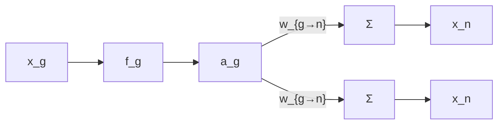

# Backward pass

1. Save activations from forward pass.
2. Backward pass computes deltas.
3. Update $w$ and $b$ using $\delta$ and $a$.

## Remember

- We do leverage dynamic programming to avoid redundant calculations which makes it feasible.
- All is based on partial derivative rule (chain rule).

Technically:

$$
\delta_i^j = \frac{\partial L^j}{\partial x_i^j}
$$

$$
\delta_i = \frac{1}{N}\sum_{j=1}^{N}\delta_i^j
$$

## Now for output layer $\delta$

$$
\delta_{i_{12}}^j
=
\frac{\partial L^j}{\partial x_{i_{12}}^j}
=
\frac{\partial}{\partial x_{i_{12}}^j}
\left(
\sum_{o \in \text{outputs}} (t_o^j-a_o^j)^2
\right)
$$

$$
=
-2\sum_{o \in \text{outputs}}
(t_o^j-a_o^j)
\cdot
\frac{\partial a_o^j}{\partial x_{i_{12}}^j}
$$

For the two output neurons, $i_{11}$ and $i_{12}$:

$$
=
-2\left\{
(t_{i_{11}}^j-a_{i_{11}}^j)
\cdot
\frac{\partial a_{i_{11}}^j}{\partial x_{i_{12}}^j}
+
(t_{i_{12}}^j-a_{i_{12}}^j)
\cdot
\frac{\partial a_{i_{12}}^j}{\partial x_{i_{12}}^j}
\right\}
$$

$a_{i_{11}}$ will be constant w.r.t. $x_{i_{12}}$, so derivative is zero.

$$
=
-2(t_{i_{12}}^j-a_{i_{12}}^j)\cdot f'_{i_{12}}(a_{i_{12}}^j)
$$

Now $f$ is activation, so derivative can vary.

Similarly, we can calculate for other output neurons.

## For any hidden layer $\delta$

The hidden layer impact the output through each of the next layer that it feeds into. So partial derivative of loss w.r.t. $x_g$ will be a sum over its contribution through each paths.

For the two paths shown:

$$
\delta_g^j
=
\frac{\partial L^j}{\partial x_g^j}
=
\left(
\frac{\partial L^j}{\partial x_{i_{11}}^j}
\cdot
\frac{\partial x_{i_{11}}^j}{\partial x_g^j}
\right)
+
\left(
\frac{\partial L^j}{\partial x_{i_{12}}^j}
\cdot
\frac{\partial x_{i_{12}}^j}{\partial x_g^j}
\right)
$$

$$
=
\sum_{n \in \text{next layer}}
\delta_n^j
\cdot
\frac{\partial x_n^j}{\partial x_g^j}
$$

From above graph:

$$
\frac{\partial x_n^j}{\partial a_g^j}=w_{g\to n}
\qquad\text{(since others constant)}
$$

and

$$
\frac{\partial x_n^j}{\partial x_g^j}
=
f'(a_g^j)\cdot w_{g\to n}
$$

$$
=
\sum_{n \in \text{next layer}}
\delta_n^j \cdot f'(a_g^j)\cdot w_{g\to n}
$$

Similar rules to all hidden neurons.

$$
\therefore\ \text{gradient descent }(\theta) = -\eta \nabla L
$$

Now that we have calculated activations and deltas we have to calculate derivatives of parameters.

$$
\nabla L =
\begin{bmatrix}
\frac{\partial L}{\partial w_{1\to 5}}\\
\vdots\\
\frac{\partial L}{\partial b_l}
\end{bmatrix}
$$

## Derivatives of parameters

$$
\frac{\partial L^j}{\partial w_{k\to l}}
=
\frac{\partial L^j}{\partial x_l^j}
\cdot
\frac{\partial x_l^j}{\partial w_{k\to l}}
$$

$$
=
\delta_l^j
\cdot
\frac{\partial}{\partial w_{k\to l}}
\left[
a_k^j w_{k\to l} + \cdots
\right]
$$

$$
=
\delta_l^j \cdot a_k^j
$$

Similarly:

$$
\frac{\partial L^j}{\partial b_l}
=
\delta_l^j \cdot 1
$$

Now:

$$
\frac{\partial L}{\partial w_{k\to l}}
=
\frac{1}{N}\sum_{j=1}^{N}\delta_l^j a_k^j
$$

$$
\frac{\partial L}{\partial b_l}
=
\frac{1}{N}\sum_{j=1}^{N}\delta_l^j
$$