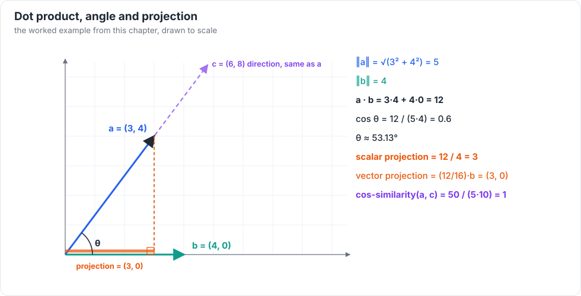
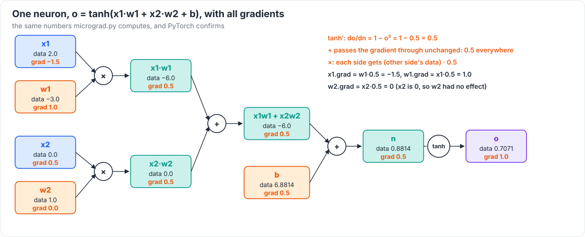
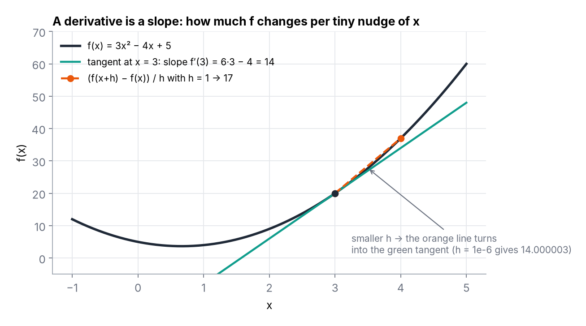
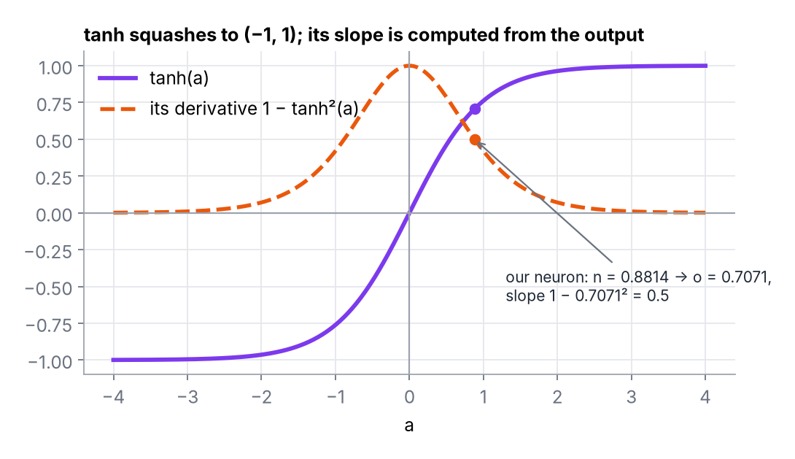
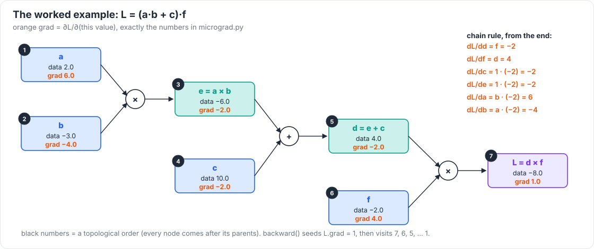
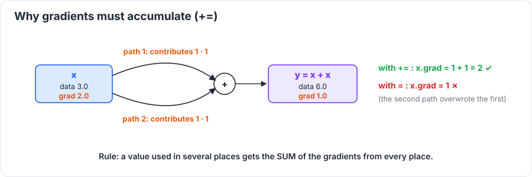
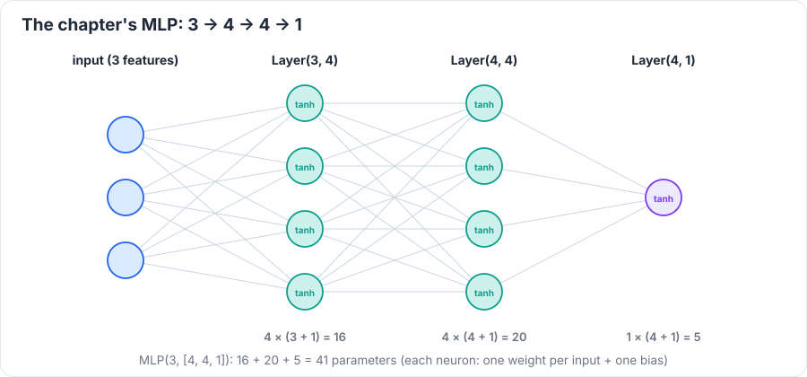
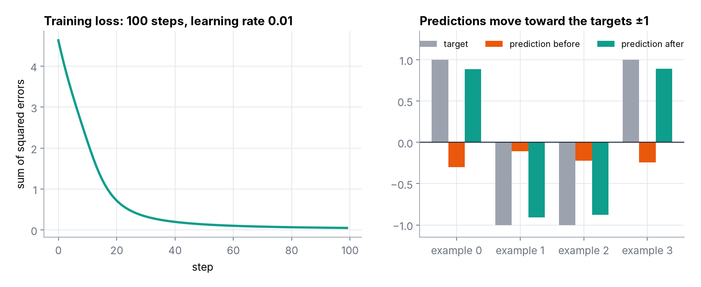
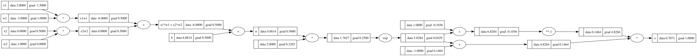

# 03 · micrograd — an Autograd Engine

> Plan: Days 003–004

This chapter builds a small reverse-mode automatic differentiation engine around scalar values. Each `Value` stores its number, its gradient, its parent values, and the local backward rule for the operation that created it. The implementation and examples are in [`micrograd/micrograd.py`](micrograd/micrograd.py).

## What this chapter explains

- How arithmetic creates a computation graph while producing the usual numerical result.
- How the chain rule turns local derivatives into gradients of a final scalar loss.
- The local derivatives for addition, multiplication, scalar powers, exponentials, and `tanh`.
- Why gradient contributions must accumulate with `+=` when a value is reused.
- How a reverse topological traversal runs each value's `_backward` closure.
- How an object-specific `_backward` closure resembles a Command in Java.
- How the scalar engine can build a neuron, layers, an MLP, and a tiny training loop.

## The idea, intuitively

Think of a forward pass as a recipe. Each `Value` is one number in the recipe, and each operation records which earlier values it used. For example, `c = a * b` calculates `c.data` and remembers that `a` and `b` are its parents. Chaining operations makes a directed computation graph.

After calculating a scalar result such as a loss `L`, backpropagation asks how sensitive `L` is to each earlier value. The gradient `v.grad` means `∂L/∂v`. Starting with `L.grad = 1`, the engine applies the chain rule backward through each operation. A value used along multiple paths receives the sum of all those paths' contributions.

This is reverse-mode differentiation: one forward calculation records the graph, then one backward traversal computes derivatives of the scalar result with respect to many inputs and parameters.

## The maths

### Vectors and magnitude

A vector is an ordered list of numbers. In machine learning, an input vector often stores the features of one example: for instance, `x = (area, bedrooms, age)`. Its components can be treated as coordinates in an `n`-dimensional space, even when they describe features rather than physical directions.

The Euclidean magnitude (length) of `x` is the square root of the sum of its squared components:

$$
\|\mathbf{x}\|_2 = \sqrt{\sum_{i=1}^{n} x_i^2}.
$$

For `x = (3, 4)`, this gives `||x||₂ = √(3² + 4²) = 5`. The zero vector has magnitude zero and no direction.

### Dot product and its geometry

For vectors of the same length, the dot product multiplies corresponding components and adds the products:

$$
\mathbf{a}\cdot\mathbf{b} = \sum_{i=1}^{n} a_i b_i.
$$

For `a = (3, 4)` and `b = (4, 0)`:

$$
\mathbf{a}\cdot\mathbf{b} = 3\cdot4 + 4\cdot0 = 12.
$$

The same quantity has a geometric form:

$$
\mathbf{a}\cdot\mathbf{b} = \|\mathbf{a}\|_2\,\|\mathbf{b}\|_2\cos\theta,
$$

where `θ` is the angle between two nonzero vectors. This explains the sign: a positive dot product means an acute angle, zero means perpendicular vectors, and a negative dot product means an obtuse angle. Its size also depends on both vector lengths. In the example, `||a||₂ = 5` and `||b||₂ = 4`, so `cos θ = 12 / (5 × 4) = 0.6` and `θ ≈ 53.13°`.

### Scalar and vector projection

Projection measures the part of `a` that lies along the direction of a nonzero vector `b`. The scalar projection is a signed length:

$$
\operatorname{comp}_{\mathbf{b}}(\mathbf{a})
= \frac{\mathbf{a}\cdot\mathbf{b}}{\|\mathbf{b}\|_2}
= \|\mathbf{a}\|_2\cos\theta.
$$

The vector projection includes that length and points along `b`:

$$
\operatorname{proj}_{\mathbf{b}}(\mathbf{a})
= \frac{\mathbf{a}\cdot\mathbf{b}}{\|\mathbf{b}\|_2^2}\,\mathbf{b}.
$$

Using `a = (3, 4)` and `b = (4, 0)`, the scalar projection is `12 / 4 = 3`, and the vector projection is `(12 / 16)(4, 0) = (3, 0)`. That is the horizontal component of `a`. A negative scalar projection means `a` points partly against `b`.

### Cosine similarity: the normalized dot product

The raw dot product changes when vector lengths change, even if their directions stay the same. Dividing by both lengths removes that scale:

$$
\operatorname{cosine\ similarity}(\mathbf{a},\mathbf{b})
= \frac{\mathbf{a}\cdot\mathbf{b}}
{\|\mathbf{a}\|_2\,\|\mathbf{b}\|_2}
= \cos\theta.
$$

For `a = (3, 4)` and `c = (6, 8)`, `a · c = 50`, while their magnitudes are `5` and `10`. Their cosine similarity is `50 / (5 × 10) = 1`: they point in the same direction, although one is twice as long. For nonzero vectors the score is between `−1` and `1`; it is undefined if either vector is zero. This is useful when comparing the direction of feature or embedding vectors independently of their magnitude.



**How to picture it:** the dot product asks "how much do these two arrows point the same way?", scaled by their lengths. Shine a light straight down onto `b`: the shadow of `a` is its projection, here 3 units long. For a neuron, `w · x` is large when the input `x` points in the direction the weights `w` "like", which is why a neuron is a pattern detector.


### A neuron is a dot product plus a bias

A neuron first computes a weighted sum, then can pass it through an activation function:

$$
z = \mathbf{w}\cdot\mathbf{x} + b
  = \sum_{i=1}^{n} w_i x_i + b,
\qquad
a = \tanh(z)\ \text{(for this chapter's neuron)}.
$$

Here `x` is the input feature vector, `w` is a same-length vector of learnable weights, `b` is a learnable scalar bias, and `z` is the pre-activation. For `x = (2, 3)`, `w = (0.5, 0.2)`, and `b = 1`:

$$
z = 0.5(2) + 0.2(3) + 1 = 1 + 0.6 + 1 = 2.6.
$$

In [`micrograd.py`](micrograd/micrograd.py), `Neuron.__call__` writes this sum as `sum((wi * xi for wi, xi in zip(self.w, x)), self.b)` and then calls `act.tanh()`. Each `wi * xi` and addition is a scalar `Value` operation, so the engine records the dot product as ordinary nodes in its computation graph and can backpropagate through the weights, inputs, and bias.

The same calculation in common tools looks like this:

```java
double[] x = {2.0, 3.0};
double[] w = {0.5, 0.2};
double b = 1.0;

double z = b;
for (int i = 0; i < x.length; i++) {
    z += w[i] * x[i];
}
// z == 2.6
```

```python
import numpy as np

x = np.array([2.0, 3.0])
w = np.array([0.5, 0.2])
b = 1.0
z = np.dot(w, x) + b  # 2.6
```

```python
import torch

x = torch.tensor([2.0, 3.0])
w = torch.tensor([0.5, 0.2], requires_grad=True)
b = torch.tensor(1.0, requires_grad=True)
z = torch.dot(w, x) + b
z.backward()  # PyTorch records the operations and computes gradients
```

NumPy and PyTorch operate on whole arrays or tensors; this chapter's engine builds the same weighted sum from scalar operations. For a batch and a whole layer, the corresponding expression is a matrix multiplication plus a bias, as developed in [Chapter 02](../02-backprop-by-hand/README.md).

The same neuron, drawn the way micrograd sees it: every `*`, `+` and `tanh` becomes a node, and backpropagation fills in each node's `grad`. These are the real values from the neuron example in `micrograd.py` (inputs `x1 = 2, x2 = 0`, weights `w1 = −3, w2 = 1`, bias `b = 6.8814`):




### What a derivative is (the first experiment in `micrograd.py`)

Before any classes, the script asks a simple question: **if I nudge the input by a tiny amount `h`, how much does the output move?**

$$
f'(x) \approx \frac{f(x+h) - f(x)}{h} \qquad \text{for a very small } h.
$$

For `f(x) = 3x² − 4x + 5` at `x = 3`, the script gets about **14**. Calculus gives the exact answer: `f′(x) = 6x − 4`, so `f′(3) = 14`. The derivative is the **slope** of the curve at that point, how steep it is there:



The script then does the same with **several inputs**: `d = a·b + c` with `a = 3, b = −2, c = 11`. Nudging one input at a time while holding the others fixed gives the **partial derivatives**:

| Nudge | `d` changes by about | So the partial derivative is |
|---|---|---|
| `c` by `h` | `1 · h` | ∂d/∂c = 1 |
| `a` by `h` | `b · h = −2h` | ∂d/∂a = b = −2 |
| `b` by `h` | `a · h = 3h` | ∂d/∂b = a = 3 |

Each partial derivative answers "if I wiggle only this input, how hard does the output react, and in which direction?" A **gradient** is the list of all of them. Backpropagation is just a fast, exact way to get every one at once, instead of nudging inputs one at a time.

### Local derivatives

For an operation with output `out` and parent `a`, the operation supplies a local derivative. During backpropagation, the contribution from this edge is the gradient already received by `out` multiplied by that local derivative:

$$
\Delta_a =
\frac{\partial L}{\partial out}\,
\frac{\partial out}{\partial a},
\qquad
\texttt{a.grad} \mathrel{+}= \Delta_a.
$$

| Operation | Output | Local derivative(s) |
|---|---|---|
| Addition | `out = a + b` | `∂out/∂a = 1`, `∂out/∂b = 1` |
| Multiplication | `out = a × b` | `∂out/∂a = b`, `∂out/∂b = a` |
| Scalar power | `out = a^p` | `∂out/∂a = p a^(p−1)` |
| Exponential | `out = exp(a) = e^a` | `∂out/∂a = e^a = out` |
| Hyperbolic tangent | `out = tanh(a)` | `∂out/∂a = 1 − tanh²(a) = 1 − out²` |

Here `p` is a constant numeric exponent, as required by the current `Value.__pow__` implementation.



Notice the `tanh` slope is largest (1) at 0 and almost 0 for large |a|. That's why saturated tanh neurons learn slowly: very little gradient passes through them.


#### Why each rule has that form

- **Addition:** if `out = a + b`, changing `a` by a small amount changes `out` by the same amount; the same is true for `b`. Thus both local slopes are `1`.
- **Multiplication:** hold `b` fixed and differentiate `a × b` with respect to `a`, giving `b`. Hold `a` fixed and differentiate with respect to `b`, giving `a`.
- **Power:** for `out = a^p` with fixed `p`, the power rule gives `p × a^(p−1)`.
- **Exponential:** the derivative of `e^a` is `e^a`, which is already the output `out`.
- **Tanh:** `d(tanh(a))/da = sech²(a)`. Since `sech²(a) = 1 − tanh²(a)`, the derivative can be calculated from the saved output as `1 − out²`.

### A complete worked example: L = (a·b + c)·f

This is the example from `micrograd.py`, with `a = 2, b = −3, c = 10, f = −2`. The forward pass computes `e = a·b = −6`, `d = e + c = 4`, `L = d·f = −8`. Backpropagation starts at the end with `L.grad = 1` and applies the local rules one step at a time:



| Step | Node | Rule used | Gradient |
|---:|---|---|---|
| 1 | `L` | start: ∂L/∂L | 1 |
| 2 | `d`, `f` | `L = d × f` → each side gets the *other* side's data | `d.grad = f = −2`, `f.grad = d = 4` |
| 3 | `e`, `c` | `d = e + c` → `+` copies the gradient | `e.grad = c.grad = −2` |
| 4 | `a`, `b` | `e = a × b` → other side's data × incoming grad | `a.grad = b · (−2) = 6`, `b.grad = a · (−2) = −4` |

**Sanity check with a nudge:** `a.grad = 6` predicts that increasing `a` by 0.0001 raises `L` by about 0.0006. The `lol()` function in the script does exactly this numerical check.


### Why gradients accumulate

Suppose `y = x + x`. The two input positions are two separate paths from `x` to `y`. With `y.grad = 1`, each addition edge contributes `1 × y.grad` to `x.grad`, so:

$$
\frac{\partial y}{\partial x}
= 1 + 1 = 2.
$$




The same rule applies when a value feeds separate operations. If a backward closure assigned `x.grad = contribution`, a later path would erase the earlier contribution. It must add instead:

```python
x.grad += local_derivative * out.grad
```

In the implementation, the operation closure performs this addition for each parent. This is why the multiplication closure also works when both operands refer to the same `Value`: it adds the left-position and right-position contributions to that one object's gradient.

Accumulation also explains why training code clears parameter gradients before a new backward pass. Contributions should add across paths within one graph, but stale gradients from a previous training step should not carry into the next one. In the MLP loop, each forward pass builds a fresh graph, so it clears the persistent parameter gradients. If you call `backward()` again on the same graph, clear all of that graph's gradients first.

## Implementation

### A `Value` and its operation

Each `Value` holds `data`, `grad`, `_prev` (its parent values), `_op` (a label for the operation), and `_backward` (initially a no-op). An operation converts numeric operands to `Value` objects when needed, computes the forward result, and creates a closure that knows how to propagate the result's gradient to its parents. For multiplication, the rule is:

```python
def _backward():
    self.grad += other.data * out.grad
    other.grad += self.data * out.grad
```

The addition, power, exponential, and `tanh` methods follow the same pattern with their own local derivatives. The closure is stored on the result, then called later by `backward()`.

### The Java Command pattern connection

The `_backward` closure is a deferred, operation-specific action. It captures the operands and output that it needs, and running it applies that operation's local chain-rule updates. That is the key idea behind the Command pattern: package an action and the context for executing it so it can be invoked later.

In Java, the same shape could be represented by a `Runnable` or a small `Command` interface stored on each output `Value`:

```java
out.backwardCommand = () -> {
    a.grad += b.data * out.grad;
    b.grad += a.data * out.grad;
};
```

Then the graph traversal would call `node.backwardCommand.run()`. The Python closure is not a separate command class, but it plays the same role: each result carries the backward action for the operation that created it.

### Running the backward pass

`backward()` first walks from the result to its parents and builds a topological ordering. A `visited` set ensures each distinct `Value` enters that ordering once, even if the graph branches and later rejoins. The result's gradient is seeded to `1.0`, because `∂L/∂L = 1`, and the ordering is traversed in reverse. Each node's `_backward()` then sends its contribution to earlier values.

**Topological order in plain words:** list the nodes so that every node appears *after* all the nodes it was computed from, like ordering the steps of a recipe so you never use an ingredient before it's prepared. `build_topo` gets this order with a depth-first search: it visits all of a node's parents first, then appends the node. Walking that list **backwards** guarantees that when a node's `_backward()` runs, its own `grad` is already complete, because every node that uses it came later in the list and has already sent its contribution. The black numbers in the worked-example figure above show one valid order.


The graph walk visits a shared node once; gradient accumulation still accounts for every incoming edge. These solve different problems: `visited` prevents redundant traversal, while `+=` preserves all derivative contributions.

### From scalars to a small neural network

`Neuron` combines weighted inputs and a bias, then applies `tanh`. `Layer` groups neurons, and `MLP` connects layers. Because their arithmetic uses `Value` operations, the same graph builder and `backward()` method calculate gradients for the network parameters. The script also includes manual examples, a graph renderer, and a PyTorch comparison.




Run the chapter script from the repository root with:

```bash
pixi run python 03-micrograd/micrograd/micrograd.py
```

## Experiments & results

The script builds a four-example toy dataset, creates an MLP with architecture `3 → 4 → 4 → 1`, computes a sum of squared errors, and performs 100 gradient-descent updates at learning rate `0.01`. It prints predictions after the updates. The MLP parameters use Python's random initialization without a fixed seed, so the printed predictions can differ between runs.

**A real run of the chapter's training loop** (same data, same MLP and loss, 100 steps at learning rate 0.01; Python's `random` seeded with 7 so the picture is repeatable):



| | Example 0 | Example 1 | Example 2 | Example 3 | Loss (sum of squared errors) |
|---|---:|---:|---:|---:|---:|
| target | 1.0 | −1.0 | −1.0 | 1.0 | – |
| before training | −0.30 | −0.11 | −0.22 | −0.24 | 4.63 |
| after 100 steps | 0.89 | −0.91 | −0.88 | 0.89 | 0.05 |

The tiny 41-parameter network learns to output close to ±1 for these four examples, using nothing but `Value` objects, the chain rule and `p.data += -0.01 * p.grad`. (Your own run will show different numbers, because the script doesn't seed `random`.)


The included [`micrograd/value_graph.svg`](micrograd/value_graph.svg) is a rendered computation graph. Graph nodes show a value's label, data, and gradient; operation nodes make the arithmetic between values visible.

<details>
<summary><b>Show the rendered graph (large)</b></summary>



</details>


## Mistakes I made

- **Overwriting a gradient instead of adding to it.** A reused value can receive contributions by more than one edge. Use `+=` inside each operation's backward rule.
- **Calling backward rules in the wrong order.** A node must receive the gradient from later operations before its own closure propagates to its parents. Build a topological ordering and traverse it in reverse.
- **Forgetting the starting gradient.** For a scalar objective `L`, set `L.grad = 1.0` before the reverse traversal.
- **Reusing stale gradients between backward passes.** The training loop builds a fresh graph and clears persistent parameter gradients before each pass. If reusing the same graph, clear all its node gradients; keep the within-graph `+=` behavior.
- **Treating the exponent as another differentiable `Value`.** This implementation supports only integer or floating-point scalar powers, not a variable exponent.
- **Differentiating `tanh` as if its input were the output.** The closure uses the saved output: `1 - out.data * out.data`.

- **(Spotted while adding these notes)** In the "single step optimization" part of `micrograd.py`, the lines `b.grad += 0.01*b.grad`, `c.grad += …` and `d.grad += …` update the *gradients* instead of the *data*. Only `a.data` is actually nudged. To nudge all inputs, they should read `b.data += 0.01 * b.grad`, and so on. (Also, `d` is computed from the others, so only the leaves `a, b, c, f` should be nudged.)


## Check yourself

1. For `out = a * b`, why is the derivative with respect to `a` equal to `b`?
2. If `y = x + x` and `y.grad = 1`, how many contributions reach `x.grad`, and what is their sum?
3. What information does each operation's `_backward` closure capture?
4. Why does `backward()` build a topological order before invoking closures?
5. What is the difference between the `visited` set and using `+=` for gradients?
6. How does storing a `_backward` closure on each `Value` resemble the Command pattern in Java?
7. For `a = (3, 4)` and `b = (4, 0)`, calculate their dot product and the scalar and vector projections of `a` onto `b`.
8. Why does cosine similarity stay the same if a nonzero vector is multiplied by a positive scale, and when is cosine similarity undefined?
9. For `x = (2, 3)`, `w = (0.5, 0.2)`, and `b = 1`, calculate the neuron's pre-activation `z`.

<details>
<summary><b>Short answers (open after you've tried)</b></summary>

1. Holding `b` fixed, `a × b` is a straight line in `a` with slope `b`.
2. Two contributions (one per input position), each `1 × 1`, so `x.grad = 2`.
3. The operand `Value`s and the output `out` (for their `.data` and `.grad`), plus any constants such as the exponent in `__pow__`.
4. A node may only pass gradient to its parents after it has received gradient from **every** node that uses it. Reverse topological order guarantees that.
5. `visited` stops a shared node from being listed twice; `+=` makes sure every edge into it still adds its contribution.
6. Each output stores a small object (the closure) that knows how to perform its own backward step later, just as a Command object wraps an action to `run()` later.
7. `a · b = 12`; scalar projection `= 12 / 4 = 3`; vector projection `= (12 / 16)(4, 0) = (3, 0)`.
8. Scaling a vector by `k > 0` scales both the dot product and the length by `k`, which cancels in the ratio. It's undefined when either vector is zero (division by a zero length).
9. `z = 0.5·2 + 0.2·3 + 1 = 2.6`.

</details>


## References

- The chapter implementation: [`micrograd/micrograd.py`](micrograd/micrograd.py).
- The rendered graph: [`micrograd/value_graph.svg`](micrograd/value_graph.svg).
- [Chapter 02: Backpropagation by Hand](../02-backprop-by-hand/README.md) for the chain-rule foundation used here.
- NCERT Class 12, [Vector Algebra](https://ncert.nic.in/textbook.php), for the vector-algebra foundation.
