# Chapter 20 — Matplotlib Essentials

> **Topic:** Scientific Visualization with Python  
> **Focus:** Figure, Axes, plotting, subplots, training curves, and saving experiment visualizations  
> **Learning principle:** Every experiment produces a plot.

---

## 1. Introduction

Matplotlib is a Python visualization library used to create static, animated, and interactive visualizations.

In Deep Learning, visualization is not just about making graphs look attractive. It helps us understand what is happening inside our experiments.

For example:

- Is the model learning?
- Is the loss decreasing?
- Is the model overfitting?
- Is validation performance improving?
- How does changing a hyperparameter affect the results?
- How do two different experiments compare?

Instead of looking only at numerical outputs, we can visualize the behavior of our models.

### Why Matplotlib in Deep Learning?

Throughout our Deep Learning journey, we will use visualization to:

1. Understand mathematical functions.
2. Visualize datasets and distributions.
3. Observe training and validation loss.
4. Detect potential overfitting.
5. Compare model performance.
6. Track reinforcement learning rewards.
7. Compare experimental configurations.

**Our rule: Every experiment should produce a meaningful visualization whenever the experiment generates data that can be visualized.**

---

# 2. Installation and Import

Matplotlib can be installed using pip:

```bash
pip install matplotlib
```

In our Pixi environment, we can add it using:

```bash
pixi add matplotlib
```

Import the plotting interface:

```python
import matplotlib.pyplot as plt
```

`pyplot` provides functions for creating and manipulating visualizations.

The conventional alias is `plt`.

---

# 3. Understanding Matplotlib's Object Model

Before plotting, we need to understand three important concepts:

1. Figure
2. Axes
3. Axis

These terms sound similar but represent different things.

## 3.1 Figure

A Figure is the complete visualization container.

Think of it as a sheet of paper on which one or more graphs are drawn.

A Figure controls:

- Overall width and height.
- Background.
- Arrangement of graphs.
- Figure-level layout.
- Saving the complete visualization.

Example:

```python
fig = plt.figure(figsize=(8, 5))
```

Here, we create a Figure with a width of 8 inches and a height of 5 inches.

## 3.2 Axes

An Axes is an individual plotting area inside a Figure.

It is where we actually visualize our data.

An Axes controls:

- Plotted data.
- Graph title.
- X and Y labels.
- Legends.
- Grid lines.
- Axis limits and ticks.

A single Figure can contain multiple Axes.

For example, a Figure may contain:

- One graph showing training loss.
- Another graph showing validation loss.
- Another graph showing training accuracy.

Each graph has its own Axes object.

## 3.3 Axis

An Axis represents an individual dimension of an Axes.

For a conventional two-dimensional graph:

- X-axis represents the horizontal dimension.
- Y-axis represents the vertical dimension.

Axis objects manage ticks, tick labels, scales, and other dimension-related properties.

### Relationship

```text
Figure
│
├── Axes 1
│   ├── X Axis
│   └── Y Axis
│
├── Axes 2
│   ├── X Axis
│   └── Y Axis
│
└── Axes 3
    ├── X Axis
    └── Y Axis
```

Remember:

**Figure = Entire visualization**

**Axes = Individual graph**

**Axis = X or Y dimension of a graph**

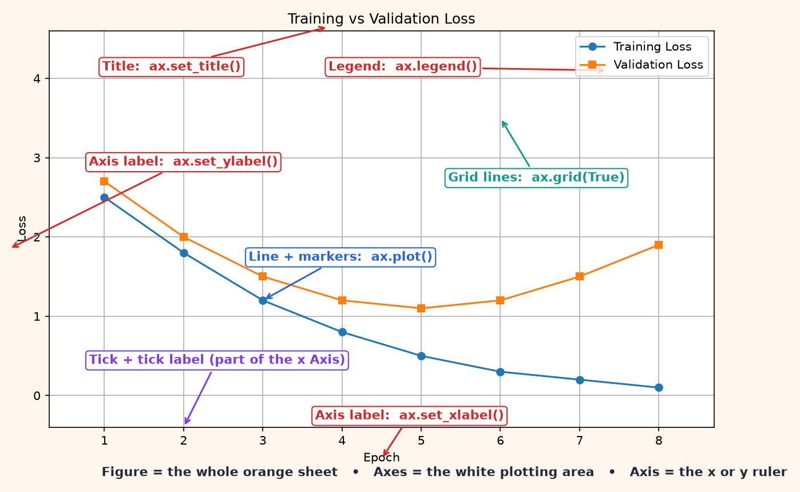

*Every labelled part above is a separate object you control from code: the Figure (`fig`), the Axes (`ax`), and things you add to the Axes.*


---

# 4. Creating a Figure and Axes

The most important Matplotlib function for our workflow is:

```python
fig, ax = plt.subplots()
```

This function creates:

- A Figure object.
- An Axes object inside that Figure.

It returns both objects.

Example:

```python
import matplotlib.pyplot as plt

fig, ax = plt.subplots()

print(type(fig))
print(type(ax))
```

The returned objects are instances of:

- `matplotlib.figure.Figure`
- `matplotlib.axes._axes.Axes`

The exact internal class representation may vary across Matplotlib versions.

### Why use `fig, ax`?

We can explicitly control the entire visualization and the individual plotting area.

This becomes especially useful when our experiments contain multiple graphs.

---

# 5. Two Ways to Create Plots

Matplotlib provides two commonly used interfaces.

## 5.1 Pyplot Interface

```python
import matplotlib.pyplot as plt

epochs = [1, 2, 3, 4, 5]
loss = [2.5, 1.8, 1.2, 0.8, 0.5]

plt.plot(epochs, loss)
plt.title("Training Loss")
plt.xlabel("Epoch")
plt.ylabel("Loss")

plt.show()
```

This is a state-based interface.

Matplotlib manages the current Figure and Axes for us.

It is convenient for quick plots.

## 5.2 Object-Oriented Interface

```python
import matplotlib.pyplot as plt

epochs = [1, 2, 3, 4, 5]
loss = [2.5, 1.8, 1.2, 0.8, 0.5]

fig, ax = plt.subplots()

ax.plot(epochs, loss)

ax.set_title("Training Loss")
ax.set_xlabel("Epoch")
ax.set_ylabel("Loss")

plt.show()
```

Here, we explicitly work with the Figure and Axes objects.

Both versions above draw exactly the same picture:

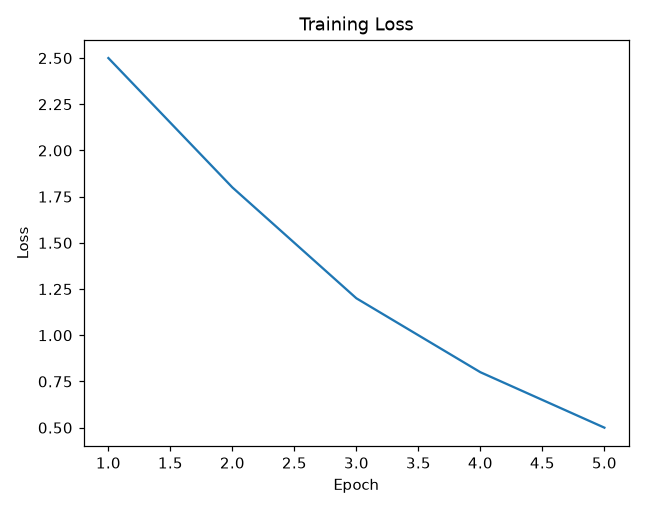


### Our convention

For Deep Learning experiments, we will primarily use the object-oriented interface.

Reasons:

1. Explicit control over individual graphs.
2. Easier management of multiple Axes.
3. Better organization of experiment visualizations.
4. Easier reuse of plotting functions.
5. Less dependence on implicit current-plot state.

---

# 6. Basic Line Plotting

The most common plotting function is:

```python
ax.plot(x, y)
```

It plots Y-values against X-values.

Example:

```python
epochs = [1, 2, 3, 4, 5]

loss = [2.5, 1.8, 1.2, 0.8, 0.5]

fig, ax = plt.subplots()

ax.plot(epochs, loss)

plt.show()
```

Mathematically, the points being plotted are:

$$
(1,2.5), (2,1.8), (3,1.2), (4,0.8), (5,0.5)
$$

The X-coordinate represents the epoch.

The Y-coordinate represents the corresponding loss.

Matplotlib connects the points with lines.

## 6.1 Customizing a Plot

```python
fig, ax = plt.subplots(figsize=(8, 5))

ax.plot(
    epochs,
    loss,
    color="blue",
    marker="o",
    linestyle="-",
    label="Training Loss"
)

ax.set_title("Training Loss Over Epochs")
ax.set_xlabel("Epoch")
ax.set_ylabel("Loss")

ax.legend()
ax.grid(True)

plt.show()
```


The customized version looks like this:

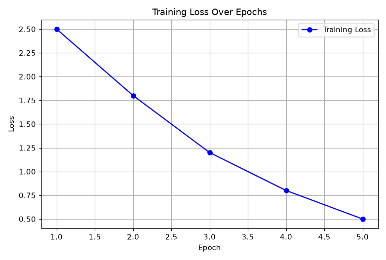

### Important arguments

| Argument | Purpose |
|---|---|
| `figsize` | Figure dimensions in inches |
| `color` | Line color |
| `marker` | Shape displayed at each data point |
| `linestyle` | Style of connecting line |
| `label` | Name associated with a plotted dataset |
| `legend()` | Displays labels in a legend |
| `grid(True)` | Displays background grid lines |

### Common marker styles

| Marker | Appearance |
|---|---|
| `"o"` | Circle |
| `"s"` | Square |
| `"^"` | Triangle |
| `"x"` | Cross |
| `"+"` | Plus |

### Common line styles

| Style | Appearance |
|---|---|
| `"-"` | Solid |
| `"--"` | Dashed |
| `"-."` | Dash-dot |
| `":"` | Dotted |

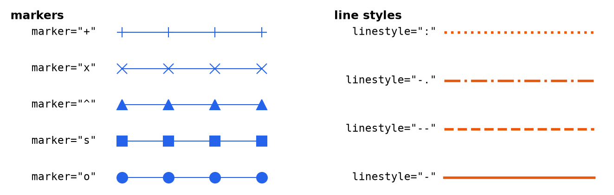


---

# 7. Labels, Titles, and Legends

A meaningful graph should communicate what the data represents.

## Title

```python
ax.set_title("Training Loss Over Epochs")
```

Describes what the graph represents.

## X-axis label

```python
ax.set_xlabel("Epoch")
```

Describes the horizontal dimension.

## Y-axis label

```python
ax.set_ylabel("Loss")
```

Describes the vertical dimension.

## Legend

Suppose we plot two datasets:

```python
ax.plot(epochs, train_loss, label="Training Loss")
ax.plot(epochs, val_loss, label="Validation Loss")

ax.legend()
```

The legend identifies which curve represents which dataset.

Without a legend, two curves may be difficult to distinguish.

---

# 8. Subplots — Multiple Graphs in One Figure

A Figure does not need to contain only one graph.

We can create multiple Axes using:

```python
fig, axes = plt.subplots(rows, columns)
```

The two arguments define the layout.

## 8.1 One Row, Two Columns

```python
fig, axes = plt.subplots(1, 2)
```

Creates:

```text
Figure
│
├── Axes 0
└── Axes 1
```

Access the individual graphs using:

```python
axes[0]
axes[1]
```

Example:

```python
fig, axes = plt.subplots(1, 2, figsize=(12, 4))

axes[0].plot(epochs, train_loss)
axes[0].set_title("Training Loss")

axes[1].plot(epochs, train_accuracy)
axes[1].set_title("Training Accuracy")

plt.tight_layout()
plt.show()
```

## 8.2 Two Rows, One Column

```python
fig, axes = plt.subplots(2, 1)
```

Creates two vertically arranged graphs.

```text
Figure
│
├── Axes 0
│
└── Axes 1
```

## 8.3 Two Rows, Two Columns

```python
fig, axes = plt.subplots(2, 2)
```

Creates four graphs.

The Axes collection is two-dimensional:

```python
axes[0, 0]
axes[0, 1]
axes[1, 0]
axes[1, 1]
```


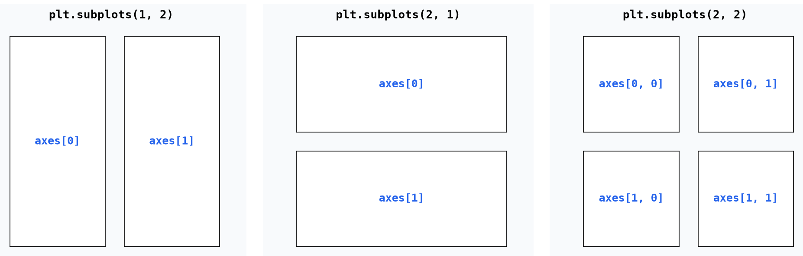

*What each layout creates, and how to reach each Axes.* `plt.subplots(1, 2)` and `plt.subplots(2, 1)` return a 1D array (`axes[0]`), while `plt.subplots(2, 2)` returns a 2D array (`axes[0, 1]`). Tip: `for ax in axes.flat:` loops over every Axes, whatever the layout.

### Important Python connection

The returned `axes` object is an array-like collection of Axes objects.

We access individual graphs using normal Python indexing.

Matplotlib is not introducing a new indexing mechanism here.

### Important: `tight_layout()`

When multiple graphs are arranged in one Figure, titles and labels can overlap.

```python
plt.tight_layout()
```

This automatically adjusts subplot spacing to reduce overlaps.

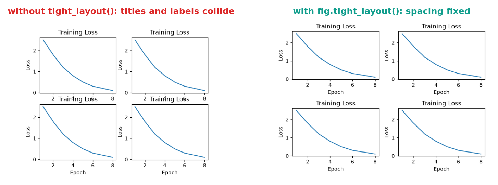

*Real output: the same 2 × 2 figure without and with `tight_layout()`.* (`fig.tight_layout()` and `plt.tight_layout()` do the same job; the `fig.` version is the object-oriented style this chapter prefers.)


---

# 9. Training vs Validation Curves

This is one of the most important applications of Matplotlib in Deep Learning.

When training a neural network, we commonly track:

- Training loss.
- Validation loss.
- Training accuracy.
- Validation accuracy.

Visualizing these metrics helps us understand how our model behaves during training.

## 9.1 Training Loss

Training loss measures the error produced by the model on the training dataset.

For a dataset containing $N$ samples:

$$
L_{train} =
\frac{1}{N}
\sum_{i=1}^{N}
\ell(f_\theta(x_i), y_i)
$$

Where:

- $N$ is the number of training samples.
- $f_\theta$ represents the model.
- $\theta$ represents model parameters.
- $x_i$ is an input sample.
- $y_i$ is its target.
- $\ell$ is the loss function.

During training, model parameters are updated to reduce the training objective.

## 9.2 Validation Loss

Validation loss measures the model's error on a separate dataset that is not used for parameter updates.

$$
L_{val} =
\frac{1}{M}
\sum_{i=1}^{M}
\ell(f_\theta(x_i), y_i)
$$

Where $M$ is the number of validation samples.

The distinction:

| Training | Validation |
|---|---|
| Used to update parameters | Used to evaluate performance |
| Model learns from this data | Model is evaluated on this data |
| Measures training fit | Helps assess generalization |

Validation data should not be used for gradient-based parameter updates.

## 9.3 Plotting Both Curves

```python
epochs = [1, 2, 3, 4, 5, 6, 7, 8]

train_loss = [
    2.5, 1.8, 1.2, 0.8,
    0.5, 0.3, 0.2, 0.1
]

val_loss = [
    2.7, 2.0, 1.5, 1.2,
    1.1, 1.2, 1.5, 1.9
]

fig, ax = plt.subplots(figsize=(8, 5))

ax.plot(
    epochs,
    train_loss,
    marker="o",
    label="Training Loss"
)

ax.plot(
    epochs,
    val_loss,
    marker="s",
    label="Validation Loss"
)

ax.set_title("Training vs Validation Loss")
ax.set_xlabel("Epoch")
ax.set_ylabel("Loss")

ax.legend()
ax.grid(True)

plt.show()
```

Both curves are plotted on the same Axes.

This allows us to compare their behavior directly.

---

# 10. Understanding Overfitting Through Visualization

Consider the following hypothetical experiment:

| Epoch | Training Loss | Validation Loss |
|---|---:|---:|
| 1 | 2.5 | 2.7 |
| 2 | 1.8 | 2.0 |
| 3 | 1.2 | 1.5 |
| 4 | 0.8 | 1.2 |
| 5 | 0.5 | 1.1 |
| 6 | 0.3 | 1.2 |
| 7 | 0.2 | 1.5 |
| 8 | 0.1 | 1.9 |

Observe the behavior:

1. Training loss keeps decreasing.
2. Validation loss initially decreases.
3. Validation loss reaches its minimum at epoch 5.
4. Validation loss starts increasing afterward.

This is a common indication of overfitting.

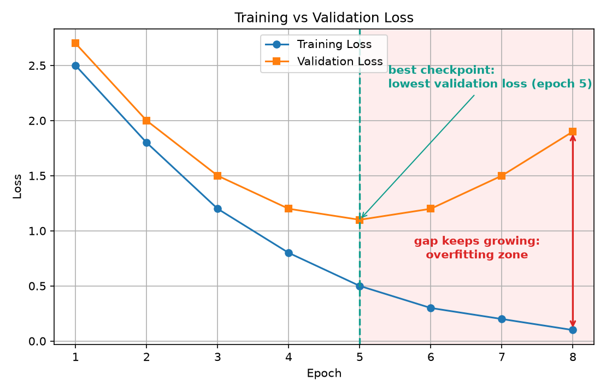

*The table above, plotted.* The moment the two curves start to **separate** (validation going up while training keeps going down) is the moment the model starts memorizing instead of learning.


## What is overfitting?

Overfitting happens when a model fits the training data increasingly well but fails to generalize effectively to unseen data.

The model may start learning patterns specific to the training dataset rather than patterns that generalize.

### How visualization helps

Without a graph, we might only observe:

```text
Final training loss = 0.1
```

This could make us believe that the model is performing exceptionally well.

But the validation curve reveals that validation loss has increased to 1.9.

The two metrics tell different stories.

### Best validation checkpoint

In this example, the lowest validation loss occurs at epoch 5.

This can help us select an appropriate model checkpoint.

However, validation loss alone does not prove overfitting. We should also consider:

- Dataset quality.
- Data leakage.
- Metric selection.
- Model architecture.
- Training configuration.
- Evaluation methodology.

---

# 11. Saving Visualizations Using `savefig()`

Displaying a graph is useful during development, but experiments should also produce persistent artifacts.

Matplotlib provides:

```python
fig.savefig("filename.png")
```

This saves the Figure to disk.

## 11.1 Basic Example

```python
fig, ax = plt.subplots()

ax.plot(epochs, train_loss)

ax.set_title("Training Loss")
ax.set_xlabel("Epoch")
ax.set_ylabel("Loss")

fig.savefig("training_loss.png")
plt.show()
```

## 11.2 Important `savefig()` Arguments

```python
fig.savefig(
    "training_loss.png",
    dpi=150,
    bbox_inches="tight"
)
```

### `dpi`

DPI means dots per inch.

It controls the resolution of the saved image.

Higher DPI generally produces a sharper image and a larger file.

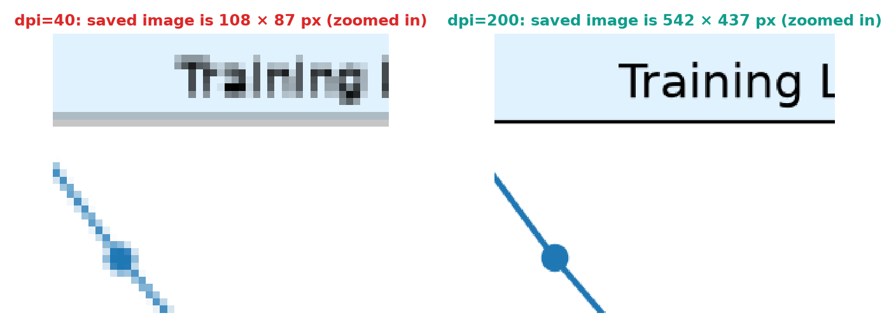

*Real output: the same small figure saved at two dpi values, zoomed in.* Since dpi is "dots per inch", a `figsize=(8, 5)` figure at `dpi=150` becomes 8·150 × 5·150 = **1200 × 750 pixels**.


### `bbox_inches="tight"`

Reduces unnecessary whitespace around the saved visualization.

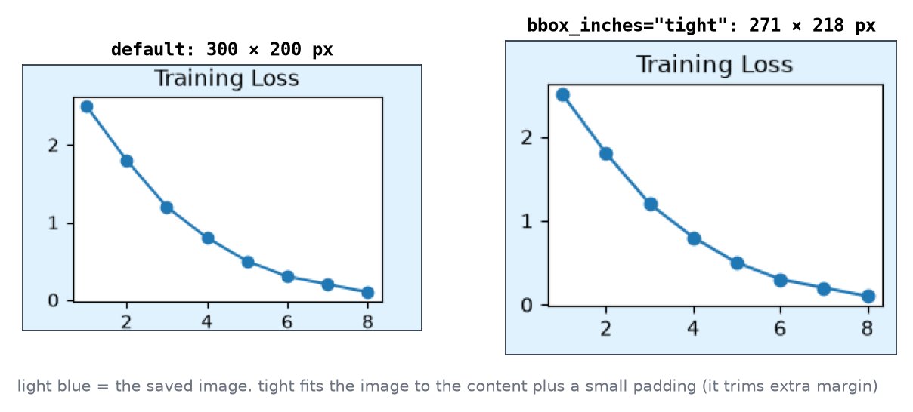

*Real output.* `bbox_inches="tight"` measures where your content actually is and fits the saved image to it, plus a small padding. It also rescues labels that would otherwise be cut off at the edge.


### Supported formats

Matplotlib supports formats including:

- PNG
- JPG/JPEG
- PDF
- SVG

For our experiment visualizations, PNG is a convenient default.

---

# 12. Managing Output Directories with pathlib

We should keep experiment outputs organized.

Python's `pathlib` provides an object-oriented way to work with filesystem paths.

```python
from pathlib import Path

output_dir = Path("outputs")

output_dir.mkdir(exist_ok=True)
```

This creates an `outputs` directory if it does not already exist.

Now save the visualization:

```python
fig.savefig(
    output_dir / "training_loss.png",
    dpi=150,
    bbox_inches="tight"
)
```

The `/` operator joins paths.

It is not ordinary mathematical division in this context.

It is an overloaded operator provided by `pathlib`.

## Verifying the output

```python
output_file = output_dir / "training_loss.png"

print(output_file.exists())
```

If the file exists, the result is:

```text
True
```

---

# 13. Displaying and Closing Figures

## `plt.show()`

```python
plt.show()
```

Displays the visualization.

## `plt.close(fig)`

```python
plt.close(fig)
```

Closes a specific Figure and releases its plotting resources.

This is especially useful when generating many visualizations programmatically.

For example:

```python
fig, ax = plt.subplots()

ax.plot(epochs, train_loss)

fig.savefig("training_loss.png")

plt.show()
plt.close(fig)
```

A useful distinction:

- `show()` displays the Figure.
- `savefig()` saves the Figure.
- `close()` closes the Figure.

---

# 14. Complete Deep Learning Visualization Example

This example combines the major concepts covered in this chapter.

```python
from pathlib import Path
import matplotlib.pyplot as plt

# Experiment data

epochs = [1, 2, 3, 4, 5, 6, 7, 8]

train_loss = [
    2.5, 1.8, 1.2, 0.8,
    0.5, 0.3, 0.2, 0.1
]

val_loss = [
    2.7, 2.0, 1.5, 1.2,
    1.1, 1.2, 1.5, 1.9
]

train_accuracy = [
    45, 55, 65, 72, 80, 85, 89, 93
]

val_accuracy = [
    43, 53, 63, 70, 76, 75, 71, 67
]

# Create output directory

output_dir = Path("outputs")
output_dir.mkdir(exist_ok=True)

# Create two vertically arranged Axes

fig, axes = plt.subplots(2, 1, figsize=(9, 8))

# Loss graph

axes[0].plot(
    epochs,
    train_loss,
    marker="o",
    label="Training Loss"
)

axes[0].plot(
    epochs,
    val_loss,
    marker="s",
    label="Validation Loss"
)

axes[0].set_title("Training vs Validation Loss")
axes[0].set_xlabel("Epoch")
axes[0].set_ylabel("Loss")
axes[0].legend()
axes[0].grid(True)

# Accuracy graph

axes[1].plot(
    epochs,
    train_accuracy,
    marker="o",
    label="Training Accuracy"
)

axes[1].plot(
    epochs,
    val_accuracy,
    marker="s",
    label="Validation Accuracy"
)

axes[1].set_title("Training vs Validation Accuracy")
axes[1].set_xlabel("Epoch")
axes[1].set_ylabel("Accuracy (%)")
axes[1].legend()
axes[1].grid(True)

# Adjust layout

fig.tight_layout()

# Save visualization

fig.savefig(
    output_dir / "complete_training_report.png",
    dpi=150,
    bbox_inches="tight"
)

# Display and close

plt.show()
plt.close(fig)
```

### What can we interpret?

From these hypothetical curves:

- Training loss keeps decreasing.
- Validation loss reaches its minimum at epoch 5.
- Training accuracy keeps increasing.
- Validation accuracy peaks at epoch 5 and declines afterward.

Together, these observations suggest that the model may be overfitting after epoch 5.

This is the figure your run of this exact code saved (`outputs/complete_training_report.png`, copied into `figures/` so it's tracked):

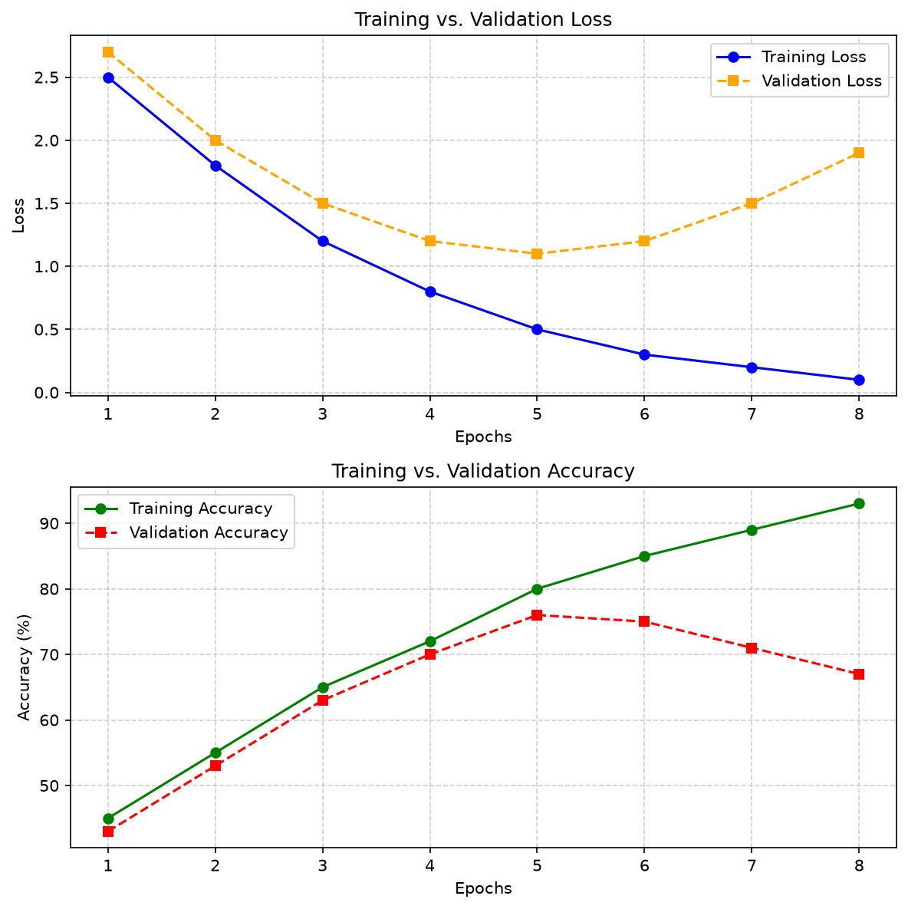


---


## 14.1 Bonus: other plot types used in this repository

Line plots are not the only tool. These show up in later chapters (decision boundaries, weight histograms, feature maps, benchmarks):

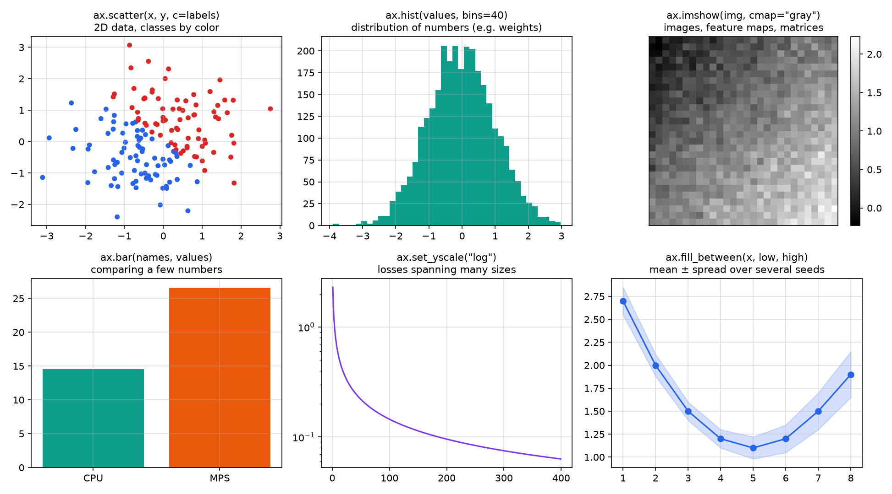

```python
fig, axes = plt.subplots(2, 3, figsize=(13, 7))

axes[0, 0].scatter(x, y, c=labels)            # points, colored by class (Ch. 02 two-moons)
axes[0, 1].hist(values, bins=40)              # distribution of numbers (weights, activations)
im = axes[0, 2].imshow(img, cmap="gray")      # images, feature maps, matrices (Ch. 06)
fig.colorbar(im, ax=axes[0, 2])               # the color scale for imshow
axes[1, 0].bar(["CPU", "MPS"], [14.5, 26.6])  # a few numbers side by side (Ch. 04 benchmark)
axes[1, 1].plot(steps, loss)
axes[1, 1].set_yscale("log")                  # losses that span 2.3 → 0.0001
axes[1, 2].plot(x, mean)
axes[1, 2].fill_between(x, mean - std, mean + std, alpha=0.2)  # mean ± spread over seeds

fig.tight_layout()
```

**When to use a log scale:** whenever the values you care about span several powers of ten (like a loss going from 2.3 to 0.0001). On a normal axis everything after the first few epochs looks flat; on a log axis you can still see whether it's improving.

---

# 15. Common Mistakes and Important Distinctions

| Mistake or confusion | Correct understanding |
|---|---|
| Confusing Figure and Axes | Figure is the container; Axes is the plotting area |
| Confusing Axes and Axis | Axes is the graph; Axis is its X or Y dimension |
| Using `plt.plot()` everywhere | Prefer explicit Axes methods for organized experiments |
| Forgetting `legend()` | Labels alone do not display a legend |
| Plotting different scales together | Consider separate Axes when scales are substantially different |
| Forgetting `tight_layout()` | Subplot labels may overlap |
| Only calling `show()` | Save important experiment visualizations too |
| Never closing Figures | Close Figures when generating many plots |
| Looking only at training loss | Evaluate validation behavior as well |

---

# 16. How We Will Use Matplotlib in Future Chapters

Matplotlib will become a regular part of our Deep Learning experiments.

| Area | What we can visualize |
|---|---|
| NumPy | Mathematical functions and arrays |
| Neural networks | Training and validation loss |
| Classification | Accuracy and decision boundaries |
| Optimization | Loss across iterations |
| PyTorch | Training metrics and device benchmarks |
| Reinforcement Learning | Episode rewards and average rewards |
| Hyperparameter tuning | Performance across configurations |

### Our experiment convention

Whenever an experiment produces useful numerical history, we should consider producing a visualization.

A good experiment record should contain:

1. Experiment configuration.
2. Numerical results.
3. Visualization.
4. Interpretation of observations.

A plot without context is often difficult to reproduce or interpret.

---

# 17. Chapter Summary

The key concepts covered:

| Concept | Purpose |
|---|---|
| Figure | Complete visualization container |
| Axes | Individual plotting area |
| Axis | Individual dimension |
| `plt.subplots()` | Creates Figure and Axes |
| `ax.plot()` | Plots data |
| `set_title()` | Sets graph title |
| `set_xlabel()` | Sets X-axis label |
| `set_ylabel()` | Sets Y-axis label |
| `legend()` | Displays dataset labels |
| `grid()` | Displays grid lines |
| `tight_layout()` | Adjusts layout spacing |
| `fig.savefig()` | Saves the visualization |
| `plt.show()` | Displays the visualization |
| `plt.close()` | Closes the Figure |

---

# 18. Further Reading

Official Matplotlib documentation:

- [Matplotlib User Guide](https://matplotlib.org/stable/users/index.html)
- [Pyplot Tutorial](https://matplotlib.org/stable/tutorials/pyplot.html)
- [Figure and Axes](https://matplotlib.org/stable/users/explain/figure/index.html)
- [Subplots](https://matplotlib.org/stable/gallery/subplots_axes_and_figures/subplots_demo.html)
- [Saving Figures](https://matplotlib.org/stable/users/explain/figure/saving.html)

---


