# Convolution to Convolutional Neural Networks (CNNs)
## From Mathematical Foundations to Deep Learning

> **Learning objective:** Understand convolution from its mathematical roots, how it works in probability and signal processing, how computers calculate it efficiently, and finally how Convolutional Neural Networks use it to learn visual features from images.

This chapter connects three major ideas:

1. **Convolution as a mathematical operation** — combining two sequences of numbers.
2. **Convolution as a computational operation** — processing signals and images efficiently.
3. **Convolution as a learning mechanism** — allowing neural networks to learn visual patterns.

The goal is not just to know what a CNN does, but to understand why it works.

---

# Table of Contents

1. [Prerequisites and Big Picture](#1-prerequisites-and-big-picture)
2. [Discrete Linear Convolution](#2-discrete-linear-convolution)
3. [Where Does Convolution Appear?](#3-where-does-convolution-appear)
4. [Convolution in Probability](#4-convolution-in-probability)
5. [Continuous Convolution](#5-continuous-convolution)
6. [Convolution and Polynomial Multiplication](#6-convolution-and-polynomial-multiplication)
7. [Matrix Representation: Toeplitz Matrix](#7-matrix-representation-toeplitz-matrix)
8. [Why Direct Convolution Can Be Slow](#8-why-direct-convolution-can-be-slow)
9. [Complex Numbers and the Unit Circle](#9-complex-numbers-and-the-unit-circle)
10. [Roots of Unity](#10-roots-of-unity)
11. [DFT and FFT](#11-dft-and-fft)
12. [Fast Convolution Using FFT](#12-fast-convolution-using-fft)
13. [From 1D to 2D Convolution](#13-from-1d-to-2d-convolution)
14. [Image Processing Using Kernels](#14-image-processing-using-kernels)
15. [From Traditional Computer Vision to CNNs](#15-from-traditional-computer-vision-to-cnns)
16. [Why Fully Connected Networks Are Not Ideal for Images](#16-why-fully-connected-networks-are-not-ideal-for-images)
17. [Convolution Layer: The Core of CNNs](#17-convolution-layer-the-core-of-cnns)
18. [CNN Tensor Shapes and Multiple Filters](#18-cnn-tensor-shapes-and-multiple-filters)
19. [Parameters vs Hyperparameters](#19-parameters-vs-hyperparameters)
20. [Stride, Padding and Output Dimensions](#20-stride-padding-and-output-dimensions)
21. [Receptive Fields](#21-receptive-fields)
22. [Why CNNs Need Nonlinearities](#22-why-cnns-need-nonlinearities)
23. [Pooling Layers](#23-pooling-layers)
24. [Translation Equivariance](#24-translation-equivariance)
25. [How a Complete CNN Works](#25-how-a-complete-cnn-works)
26. [CNN vs MLP: Parameter Comparison](#26-cnn-vs-mlp-parameter-comparison)
27. [Practical PyTorch Implementation](#27-practical-pytorch-implementation)
28. [CNN Architecture Evolution](#28-cnn-architecture-evolution)
29. [CNNs Beyond Images](#29-cnns-beyond-images)
30. [Important Concepts to Remember](#30-important-concepts-to-remember)
31. [Practice Questions and Knowledge Check](#31-practice-questions-and-knowledge-check)
32. [Further Learning Roadmap](#32-further-learning-roadmap)

---

# 1. Prerequisites and Big Picture

Before understanding CNNs, we need to connect them to what we already know about mathematics and neural networks.

### 1.1 What is a neural network?

A neural network is a mathematical function that learns a relationship between inputs and outputs.

A simple neuron computes:

$$
y = w_1x_1+w_2x_2+\cdots+w_nx_n+b
$$

Or, more compactly:

$$
y = w^Tx+b
$$

Where:

- $x$ = input values
- $w$ = learnable weights
- $b$ = bias
- $y$ = output

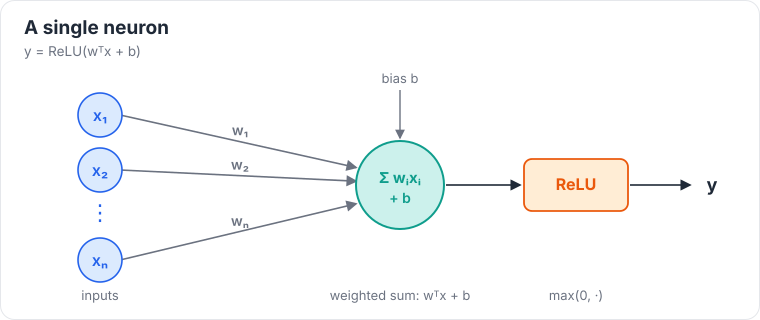

An activation function such as ReLU introduces nonlinearity:

$$
ReLU(x)=\max(0,x)
$$

A multilayer neural network combines many such operations.

### 1.2 How does a neural network learn?

The learning process consists of:

1. Forward propagation.
2. Calculate predictions.
3. Calculate loss.
4. Backpropagation.
5. Update weights using an optimizer.
6. Repeat.

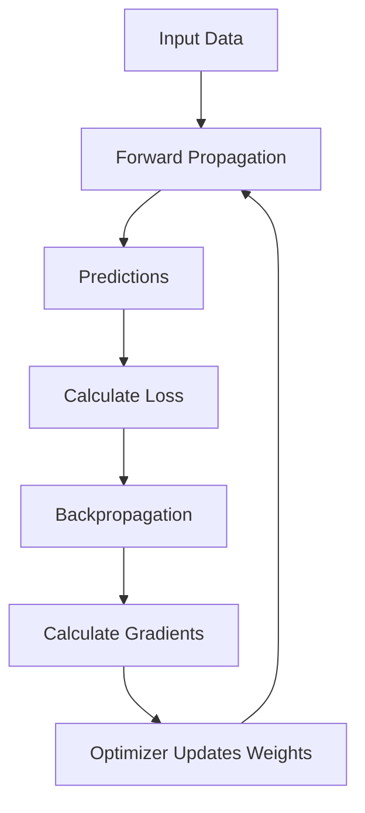

CNNs use the same learning process.

The major difference is the architecture and the way weights are organized.

Instead of connecting every input pixel to every neuron, CNNs use small learnable filters that move across an image.

To understand why this works, let's first understand convolution itself.

---

# 2. Discrete Linear Convolution

## 2.1 What is convolution?

Suppose we have two lists of numbers.

```python
A = [1, 2, 3]
B = [4, 5]
```

We already know how to add or multiply lists element by element.

But convolution is another way to combine two sequences.

It takes two sequences and produces a third sequence.

The mathematical definition is:

$$
C[n]=\sum_{k=-\infty}^{\infty}A[k]B[n-k]
$$

For finite sequences, we only calculate the overlapping positions.

If the first sequence has length $N$ and the second has length $M$, the full convolution has length:

$$
\boxed{N+M-1}
$$

For example:

$$
N=3,\quad M=2
$$

$$
Output=3+2-1=4
$$

## 2.2 The three-step intuition

Convolution can be understood through three operations:

1. Flip one sequence.
2. Slide it across the other sequence.
3. Multiply overlapping values and add them.

This is commonly described as:

**Flip → Slide → Multiply and Add**

![Flip, slide, multiply and add for [1,2,3] * [4,5]](assets/conv1d_slide.svg)

### Visual example

```text
A = [1, 2, 3]
B = [4, 5]

Flip B:

B = [5, 4]
```

Now slide the filter across the input.

**Position 1**

```text
A:  1   2   3
B:  4

1 × 4 = 4
```

**Position 2**

```text
A:  1   2   3
B:  5   4

(1 × 5) + (2 × 4)
= 5 + 8
= 13
```

**Position 3**

```text
A:  1   2   3
B:      5   4

(2 × 5) + (3 × 4)
= 10 + 12
= 22
```

**Position 4**

```text
A:  1   2   3
B:          5

3 × 5 = 15
```

Final output:

$$
\boxed{[4,13,22,15]}
$$

This is discrete linear convolution.

## 2.3 Another example: Two sequences of length 3

Let:

$$
A=[1,2,3]
$$

$$
B=[4,5,6]
$$

The output length is:

$$
3+3-1=5
$$

Calculations:

| Position | Calculation | Result |
|---|---|---:|
| 1 | $1\times4$ | 4 |
| 2 | $1\times5+2\times4$ | 13 |
| 3 | $1\times6+2\times5+3\times4$ | 28 |
| 4 | $2\times6+3\times5$ | 27 |
| 5 | $3\times6$ | 18 |

Final result:

$$
\boxed{[4,13,28,27,18]}
$$

Notice that convolution combines every possible overlapping pair.

## 2.4 Another way to visualize convolution: Multiplication grid

We can arrange all pairwise multiplications in a grid.

For:

$$
A=[1,2,3],\quad B=[4,5,6]
$$

| | 4 | 5 | 6 |
|---|---:|---:|---:|
| 1 | 4 | 5 | 6 |
| 2 | 8 | 10 | 12 |
| 3 | 12 | 15 | 18 |

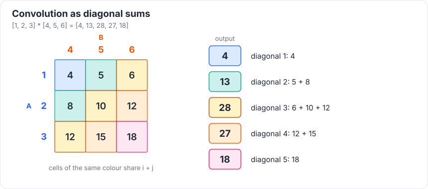

Now add along the diagonals:

```text
4

5 + 8

6 + 10 + 12

12 + 15

18
```

Therefore:

$$
[4,13,28,27,18]
$$

This diagonal interpretation becomes important when we study probability and polynomial multiplication.

---

# 3. Where Does Convolution Appear?

Convolution is not just a deep learning concept.

It appears in several different mathematical and practical fields.

## 3.1 Signal processing

Suppose we have a noisy signal:

```text
Original signal:

[10, 12, 50, 11, 13, 12, 55, 14]
```

The sudden spikes might represent noise.

We can smooth the signal by applying a moving average.

For example, use:

$$
B=\left[\frac13,\frac13,\frac13\right]
$$

Each output is the average of three neighbouring values.

This reduces sharp fluctuations.

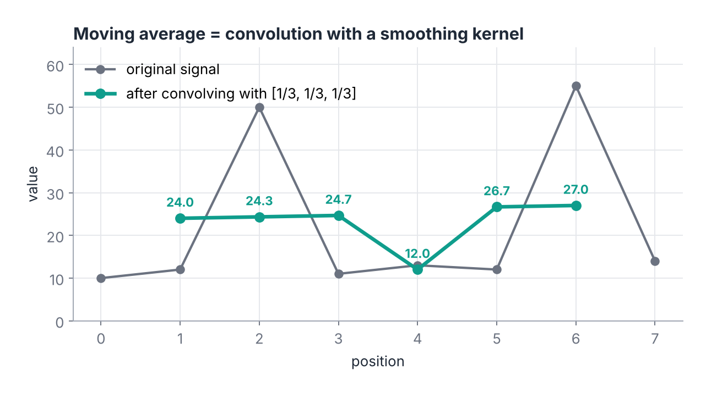

This is convolution.

## 3.2 Image processing

An image is a two-dimensional grid of pixel values.

We can move a small matrix over the image to:

- Blur an image.
- Detect edges.
- Sharpen an image.
- Detect certain patterns.

This small matrix is called a kernel or filter.

## 3.3 Probability

If we have two independent random variables and want the probability distribution of their sum, convolution gives us the answer.

We will derive this later.

## 3.4 Polynomial multiplication

Multiplying two polynomials is mathematically equivalent to convolving their coefficient lists.

## 3.5 Differential equations

Convolution also appears in linear systems and solutions to certain differential equations, particularly when describing how an input signal produces an output through a system's response.

### The common idea

In all these cases, we have:

- One sequence or function representing input.
- Another sequence or function representing a filter, distribution, or system response.
- A combination of overlapping contributions.

The context changes, but the underlying mathematical operation remains related.

---

# 4. Convolution in Probability

This is one of the most interesting connections.

## 4.1 Start with a simple dice problem

Imagine rolling two standard six-sided dice.

We want to calculate the probability of getting every possible sum.

Possible sums:

$$
2,3,4,\ldots,12
$$

There are:

$$
6\times6=36
$$

equally likely outcomes.

We can arrange the outcomes in a grid.

| Die 1 \ Die 2 | 1 | 2 | 3 | 4 | 5 | 6 |
|---|---|---|---|---|---|---|
| 1 | 2 | 3 | 4 | 5 | 6 | 7 |
| 2 | 3 | 4 | 5 | 6 | 7 | 8 |
| 3 | 4 | 5 | 6 | 7 | 8 | 9 |
| 4 | 5 | 6 | 7 | 8 | 9 | 10 |
| 5 | 6 | 7 | 8 | 9 | 10 | 11 |
| 6 | 7 | 8 | 9 | 10 | 11 | 12 |

Notice that equal sums appear along diagonals.

For example, the sum 7 appears six times.

Therefore:

$$
P(X+Y=7)=\frac6{36}=\frac16
$$

## 4.2 Represent a random variable using a probability distribution

A fair die has this probability distribution:

$$
A=
\left[
\frac16,\frac16,\frac16,\frac16,\frac16,\frac16
\right]
$$

The second die has the same distribution:

$$
B=
\left[
\frac16,\frac16,\frac16,\frac16,\frac16,\frac16
\right]
$$

We want the probability distribution of their sum.

We can obtain it by convolving these two distributions.

$$
C=A*B
$$

The resulting probabilities correspond to sums 2 through 12:

$$
C=
\left[
\frac1{36},
\frac2{36},
\frac3{36},
\frac4{36},
\frac5{36},
\frac6{36},
\frac5{36},
\frac4{36},
\frac3{36},
\frac2{36},
\frac1{36}
\right]
$$

Notice the triangular pattern.

```text
Sum       Number of outcomes

 2              *
 3             **
 4            ***
 5           ****
 6          *****
 7         ******
 8          *****
 9           ****
10            ***
11             **
12              *
```

The reason is that there are more combinations that produce middle sums than extreme sums.

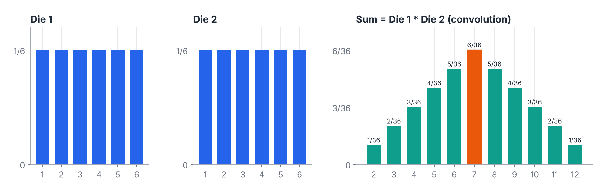

## 4.3 A simpler example using marbles

Suppose a bag contains:

- 2 red marbles.
- 1 blue marble.

The probability of red is:

$$
P(R)=\frac23
$$

The probability of blue is:

$$
P(B)=\frac13
$$

We draw twice, with replacement.

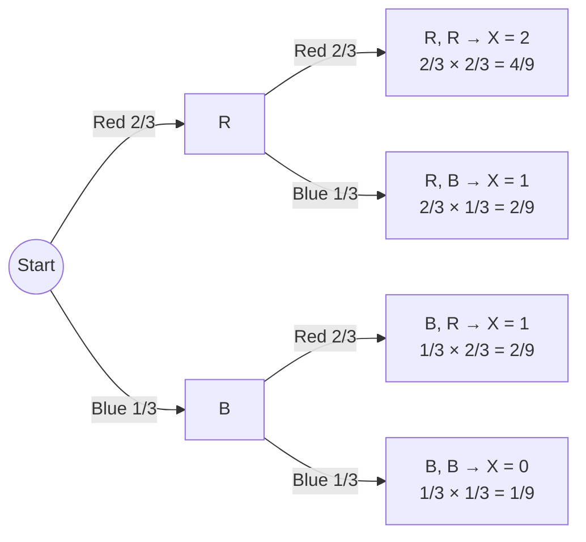

Let $X$ represent the number of red marbles drawn.

Possible values:

$$
X=0,1,2
$$

**Case 1: No red marbles**

Both draws must be blue.

$$
P(X=0)=\frac13\times\frac13=\frac19
$$

**Case 2: Exactly one red marble**

There are two possibilities:

- Red, then blue.
- Blue, then red.

$$
P(X=1)=
\frac23\times\frac13+
\frac13\times\frac23
$$

$$
P(X=1)=\frac49
$$

**Case 3: Two red marbles**

$$
P(X=2)=\frac23\times\frac23
$$

$$
P(X=2)=\frac49
$$

Final distribution:

$$
\boxed{
\left[\frac19,\frac49,\frac49\right]
}
$$

Now look at the original single-draw distribution:

$$
A=\left[\frac13,\frac23\right]
$$

Convolve it with itself:

$$
A*A=
\left[\frac19,\frac49,\frac49\right]
$$

Exactly the same result!

## 4.4 Random variables and convolution

A random variable converts an outcome into a numerical value.

A probability distribution describes how likely each possible numerical value is.

For two independent random variables:

$$
Z=X+Y
$$

The probability distribution of $Z$ is the convolution of the probability distributions of $X$ and $Y$.

$$
\boxed{P_Z=P_X*P_Y}
$$

This connection is useful in probability, statistics, and signal processing.

---

# 5. Continuous Convolution

So far, we have worked with discrete lists of numbers.

But what happens when our variables are continuous?

For example:

- Height.
- Temperature.
- Time.
- Distance.
- Velocity.

There are infinitely many possible values.

## 5.1 Why do we need integration?

For a discrete random variable, we can calculate probabilities by adding individual probabilities.

For a continuous random variable, the probability of obtaining one exact value is generally zero.

Instead, we use a Probability Density Function (PDF).

A PDF represents probability density.

The total area under its curve must equal 1.

$$
\int_{-\infty}^{\infty}f(x)\,dx=1
$$

To calculate the probability that a value lies between $a$ and $b$:

$$
P(a\leq X\leq b)
=
\int_a^b f(x)\,dx
$$

## 5.2 Continuous convolution formula

In the discrete case, we used summation:

$$
C[n]=\sum_k A[k]B[n-k]
$$

For continuous functions, summation becomes integration:

$$
\boxed{
(f*g)(z)=
\int_{-\infty}^{\infty}
f(x)g(z-x)\,dx
}
$$

The basic intuition remains the same:

- Flip one function.
- Slide it across the other.
- Multiply overlapping values.
- Integrate the product.

## 5.3 Example: Adding two random decimals

Suppose we independently select two random numbers:

$$
X\sim Uniform(0,1)
$$

$$
Y\sim Uniform(0,1)
$$

Each has a flat probability density:

$$
f(x)=
\begin{cases}
1 & 0\leq x\leq1\\
0 & \text{otherwise}
\end{cases}
$$

We want the distribution of:

$$
Z=X+Y
$$

The possible values of $Z$ range from 0 to 2.

The resulting probability density is triangular.

<svg viewBox="0 0 640 300" width="100%" xmlns="http://www.w3.org/2000/svg">
  <path d="M65 245 H585 M65 245 V28" stroke="currentColor" stroke-width="1.5" fill="none"/>
  <path d="M65 245 L325 65 L585 245" stroke="#16A394" stroke-width="3" fill="none"/>
  <path d="M65 245 L325 65 L585 245 Z" fill="#16A394" opacity="0.15"/>
  <path d="M65 245 V252 M325 245 V252 M585 245 V252" stroke="currentColor"/>
  <text x="65" y="270" text-anchor="middle" fill="currentColor" font-size="13">0</text>
  <text x="325" y="270" text-anchor="middle" fill="currentColor" font-size="13">1</text>
  <text x="585" y="270" text-anchor="middle" fill="currentColor" font-size="13">2</text>
  <text x="325" y="294" text-anchor="middle" fill="currentColor" font-size="13">Sum Z = X + Y</text>
  <text x="38" y="35" fill="currentColor" font-size="12">Density</text>
  <text x="337" y="52" fill="#16A394" font-size="13">Maximum density = 1</text>
</svg>

Why does this happen?

- A sum close to 0 has very few possible combinations.
- A sum close to 1 has many possible combinations.
- A sum close to 2 again has very few possible combinations.

For example:

$$
0.2+0.8=1
$$

$$
0.5+0.5=1
$$

$$
0.9+0.1=1
$$

There are many combinations around the middle.

This is why the distribution rises and then falls.

**Key takeaway:** Convolution is the mathematical operation used to combine independent distributions when calculating the distribution of their sum.

---

# 6. Convolution and Polynomial Multiplication

This is another important connection.

Consider two polynomials:

$$
A(x)=1+2x+3x^2
$$

$$
B(x)=4+5x+6x^2
$$

Let's multiply them.

$$
A(x)B(x)=
(1+2x+3x^2)(4+5x+6x^2)
$$

Expanding:

$$
=4+5x+6x^2
$$

$$
+8x+10x^2+12x^3
$$

$$
+12x^2+15x^3+18x^4
$$

Combining like terms:

$$
=4+13x+28x^2+27x^3+18x^4
$$

Final coefficients:

$$
\boxed{[4,13,28,27,18]}
$$

Compare this with our earlier convolution:

$$
[1,2,3]*[4,5,6]
$$

The result was:

$$
[4,13,28,27,18]
$$

Exactly the same!

## 6.1 Why does this happen?

Consider:

$$
A(x)=a_0+a_1x+a_2x^2
$$

$$
B(x)=b_0+b_1x+b_2x^2
$$

When we multiply them, the coefficient of $x^n$ becomes:

$$
c_n=\sum_k a_kb_{n-k}
$$

This is precisely the convolution formula.

Therefore:

$$
\boxed{
\text{Polynomial multiplication}
=
\text{Convolution of coefficients}
}
$$

This connection becomes extremely important when we study FFT.

---

# 7. Matrix Representation: Toeplitz Matrix

So far, we have calculated convolution by sliding and multiplying.

But computers can represent this operation using matrix multiplication.

This is where linear algebra enters.

## 7.1 Convert convolution into matrix multiplication

Consider:

$$
A=[1,2,3]
$$

$$
B=[4,5]
$$

The convolution is:

$$
[4,13,22,15]
$$

We can construct a matrix from the second sequence:

$$
\begin{bmatrix}
4&0&0\\
5&4&0\\
0&5&4\\
0&0&5
\end{bmatrix}
$$

Multiply it by:

$$
\begin{bmatrix}
1\\
2\\
3
\end{bmatrix}
$$

Result:

$$
\begin{bmatrix}
4&0&0\\
5&4&0\\
0&5&4\\
0&0&5
\end{bmatrix}
\begin{bmatrix}
1\\
2\\
3
\end{bmatrix}
=
\begin{bmatrix}
4\\
13\\
22\\
15
\end{bmatrix}
$$

This matrix is a Toeplitz matrix.

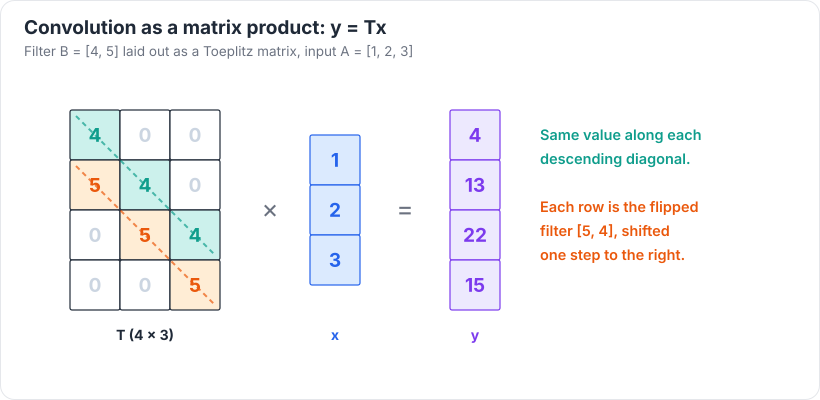

## 7.2 What is a Toeplitz matrix?

A Toeplitz matrix is a matrix in which each descending diagonal from left to right contains the same value.

The matrix is constructed by arranging shifted versions of the filter.

This allows convolution to be represented as a linear transformation.

In other words:

$$
\boxed{y=Tx}
$$

Where:

- $T$ = Toeplitz matrix constructed from the filter.
- $x$ = input sequence.
- $y$ = convolution output.

### Why is this useful?

It connects convolution to linear algebra.

It also helps us understand how convolution can be implemented using matrix operations, which are highly optimized on modern hardware.

A practical implementation technique used in some convolution algorithms is `im2col`, which rearranges image patches into columns so that convolution can be performed using matrix multiplication.

---

# 8. Why Direct Convolution Can Be Slow

Suppose we have two sequences, each containing $N$ numbers.

Direct convolution requires approximately:

$$
O(N^2)
$$

operations.

Why?

Because every element in the first sequence can interact with every element in the second sequence.

The number of pairwise combinations grows quadratically.

For example:

| Sequence length | Approximate pairwise operations |
|---:|---:|
| 10 | 100 |
| 100 | 10,000 |
| 1,000 | 1,000,000 |
| 10,000 | 100,000,000 |
| 100,000 | 10,000,000,000 |

This becomes expensive for large signals.

There is a much faster approach using the Fast Fourier Transform.

But first, we need to understand complex numbers.

---

# 9. Complex Numbers and the Unit Circle

## 9.1 What is a complex number?

A complex number has two parts:

$$
z=a+bi
$$

Where:

- $a$ = real part.
- $b$ = imaginary part.
- $i$ = imaginary unit.

The imaginary unit is defined as:

$$
\boxed{i^2=-1}
$$

Complex numbers can be represented geometrically on a two-dimensional plane.

```text
                  Imaginary axis
                       |
                       |
                       |       z = a + bi
                       |      /
                       |     /
                       |    /
                       |   /
    -------------------+---------------- Real axis
                       |
                       |
```

The horizontal axis represents real values.

The vertical axis represents imaginary values.

## 9.2 Multiplication by i represents rotation

Consider the number:

$$
z=1
$$

Multiply it by $i$:

$$
1\times i=i
$$

Multiply again:

$$
i\times i=i^2=-1
$$

Again:

$$
-i
$$

And again:

$$
(-i)i=-i^2=1
$$

Therefore:

```text
1 → i → -1 → -i → 1
```

Every multiplication by $i$ rotates the point by 90 degrees counter-clockwise.

Importantly, the distance from the origin stays the same.

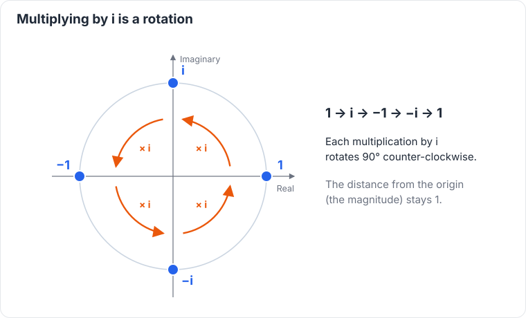

## 9.3 Euler's formula

A powerful mathematical relationship is:

$$
\boxed{
e^{i\theta}=\cos\theta+i\sin\theta
}
$$

This allows us to represent rotation using complex exponentials.

For example:

$$
e^{i0}=1
$$

$$
e^{i\pi/2}=i
$$

$$
e^{i\pi}=-1
$$

$$
e^{i3\pi/2}=-i
$$

These values lie on a circle with radius 1, called the unit circle.

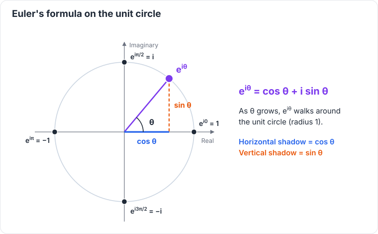

### Why does this matter?

FFT uses special complex numbers located at equally spaced positions around this circle.

These numbers are called roots of unity.

---

# 10. Roots of Unity

## 10.1 What are roots of unity?

An N-th root of unity is a complex number that satisfies:

$$
z^N=1
$$

For example, consider:

$$
z^4=1
$$

The four solutions are:

$$
1,\quad i,\quad -1,\quad -i
$$

All four values lie on the unit circle.

They are evenly spaced.

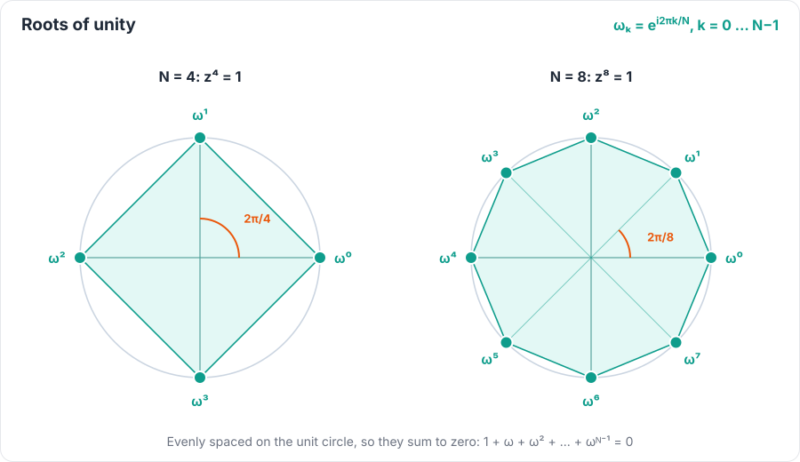

## 10.2 General formula

The N-th roots of unity are:

$$
\boxed{
\omega_k=e^{i2\pi k/N}
}
$$

Where:

$$
k=0,1,2,\ldots,N-1
$$

The fundamental root is:

$$
\omega=e^{i2\pi/N}
$$

All other roots can be generated using its powers:

$$
1,\omega,\omega^2,\ldots,\omega^{N-1}
$$

And:

$$
\boxed{\omega^N=1}
$$

## 10.3 Three important properties

### Property 1: Powers cycle around the unit circle

Because:

$$
\omega^N=1
$$

Higher powers simply repeat the same rotations.

They do not grow infinitely large.

### Property 2: Squaring creates symmetry

For an even number of roots, opposite points on the circle become identical after squaring.

For example:

$$
1^2=1
$$

$$
(-1)^2=1
$$

$$
i^2=-1
$$

$$
(-i)^2=-1
$$

This symmetry is extremely useful in FFT.

It allows us to split calculations into smaller problems.

### Property 3: The roots sum to zero

For $N>1$:

$$
\boxed{
1+\omega+\omega^2+\cdots+\omega^{N-1}=0
}
$$

The points are evenly distributed around the circle, so their directions cancel out.

For four roots:

$$
1+i-1-i=0
$$

### Why are roots of unity important?

They provide special evaluation points for polynomials.

The symmetry of these points allows the FFT algorithm to calculate polynomial evaluations much faster than direct computation.

---

# 11. DFT and FFT

Now we can understand the fast method for calculating convolution.

## 11.1 What is DFT?

DFT stands for Discrete Fourier Transform.

It transforms a sequence of numbers into another sequence representing its frequency components.

For a sequence $x[n]$ of length $N$:

$$
\boxed{
X[k]=
\sum_{n=0}^{N-1}
x[n]e^{-i2\pi kn/N}
}
$$

For each frequency index $k$, we calculate a weighted sum of the original sequence.

Another way to understand this is polynomial evaluation.

Consider a polynomial:

$$
P(x)=a_0+a_1x+a_2x^2+\cdots
$$

DFT evaluates this polynomial at specially selected complex points: the roots of unity.

These evaluations give us a frequency-domain representation.

## 11.2 What is FFT?

FFT stands for Fast Fourier Transform.

It is not a different mathematical transform.

It is an efficient algorithm for computing the DFT.

The standard direct DFT requires:

$$
O(N^2)
$$

operations.

FFT reduces this to:

$$
\boxed{O(N\log N)}
$$

The famous Cooley–Tukey FFT algorithm uses a divide-and-conquer strategy.

It splits the original sequence into:

- Even-indexed elements.
- Odd-indexed elements.

It then calculates smaller transforms and combines their results.

## 11.3 Why does splitting help?

Suppose we have:

$$
x=[x_0,x_1,x_2,x_3,x_4,x_5,x_6,x_7]
$$

Split into:

```text
Original sequence
        |
        |
  -----------------
  |               |
Even indices    Odd indices
  |               |
x0,x2,x4,x6    x1,x3,x5,x7
  |               |
Smaller DFTs and combinations
        |
        |
    Final DFT
```

The roots of unity have symmetry that allows the same intermediate calculations to be reused.

This reduces the total work.

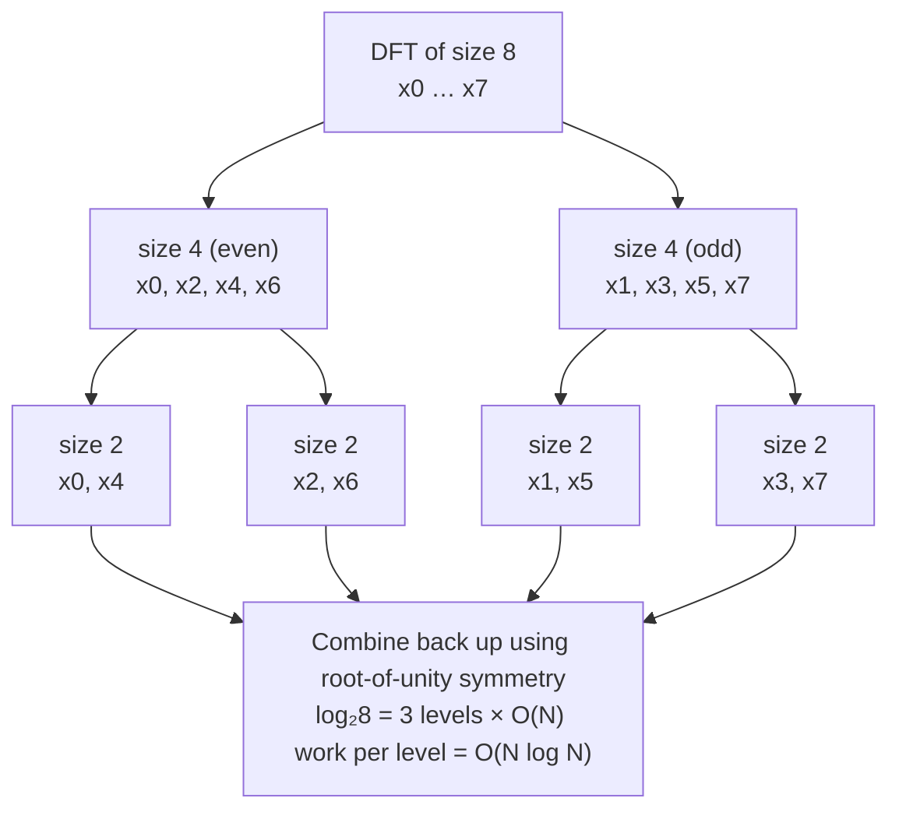

## 11.4 Complexity comparison

| Algorithm | Time complexity |
|---|---|
| Direct DFT | $O(N^2)$ |
| FFT | $O(N\log N)$ |

For large inputs, this is a major improvement.

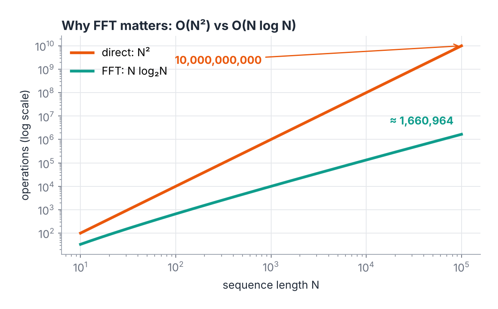

---

# 12. Fast Convolution Using FFT

Now we combine everything.

Remember:

$$
\text{Polynomial multiplication}
=
\text{Convolution}
$$

Also:

$$
\text{Multiplying polynomial values}
=
\text{Multiplying their evaluations pointwise}
$$

This gives us a fast method for convolution.

## 12.1 The FFT convolution pipeline

There are four main steps.

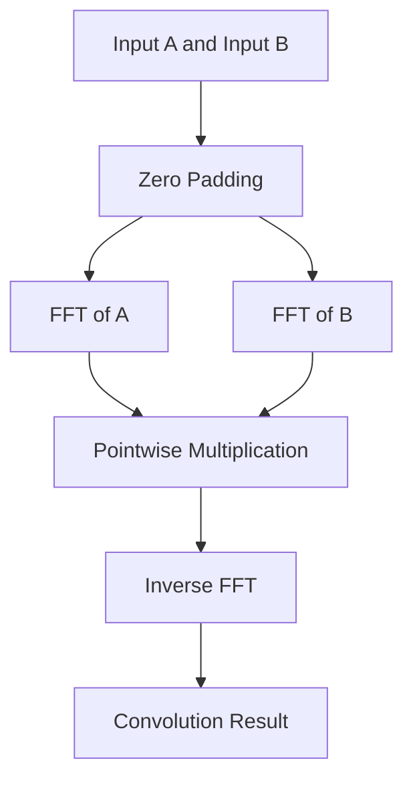

### Step 1: Zero padding

Suppose:

$$
A=[1,2,3]
$$

$$
B=[4,5]
$$

The full convolution length must be:

$$
3+2-1=4
$$

We pad the sequences with zeros to at least length 4:

$$
A=[1,2,3,0]
$$

$$
B=[4,5,0,0]
$$

This prevents circular wrap-around from corrupting the desired linear convolution.

### Step 2: Apply FFT

Transform both sequences:

$$
A'=FFT(A)
$$

$$
B'=FFT(B)
$$

Now we have their frequency-domain representations.

### Step 3: Pointwise multiplication

Multiply corresponding elements:

$$
C'[k]=A'[k]B'[k]
$$

This is much simpler than performing the sliding multiplication directly.

### Step 4: Inverse FFT

Transform the result back:

$$
C=IFFT(C')
$$

We obtain:

$$
\boxed{C=[4,13,22,15]}
$$

This is exactly the same result as direct convolution.

## 12.2 Why is it faster?

The complexity becomes:

- FFT of A: $O(N\log N)$
- FFT of B: $O(N\log N)$
- Pointwise multiplication: $O(N)$
- Inverse FFT: $O(N\log N)$

Overall:

$$
\boxed{O(N\log N)}
$$

Instead of:

$$
O(N^2)
$$

## 12.3 Practical Python example

```python
import numpy as np
from scipy.signal import fftconvolve

A = np.random.rand(100_000)
B = np.random.rand(100_000)

# Direct convolution
direct = np.convolve(A, B)

# FFT-based convolution
fast = fftconvolve(A, B)

# Compare results
print(np.allclose(direct, fast))
```

The result should be:

```text
True
```

There may be tiny floating-point differences due to numerical precision.

**Important distinction:** FFT convolution is particularly useful for sufficiently large signals. For small kernels, direct convolution is often faster because FFT has additional overhead.

---

# 13. From 1D to 2D Convolution

Now we move toward CNNs.

Until now, we have worked with lists.

But images are not lists.

Images are two-dimensional grids of pixel values.

## 13.1 What is an image?

A grayscale image can be represented as a matrix.

For example:

$$
I=
\begin{bmatrix}
10&20&30&40&50\\
15&25&35&45&55\\
20&30&40&50&60\\
25&35&45&55&65\\
30&40&50&60&70
\end{bmatrix}
$$

Each number represents pixel intensity.

For a typical 8-bit grayscale image:

$$
0\leq pixel\ value\leq255
$$

Where:

- 0 = black.
- 255 = white.
- Values in between = shades of gray.

A colour image usually has three channels:

- Red.
- Green.
- Blue.

Therefore, an RGB image is represented using three matrices stacked together.

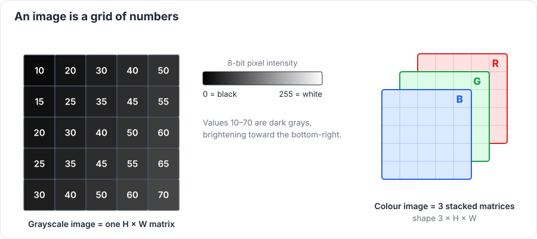

## 13.2 What is a 2D kernel?

A kernel is a small matrix that moves across the image.

For example:

$$
K=
\begin{bmatrix}
1&0&-1\\
1&0&-1\\
1&0&-1
\end{bmatrix}
$$

It can respond strongly to vertical intensity changes.

## 13.3 How does 2D convolution work?

Suppose the input image is:

$$
I=
\begin{bmatrix}
1&2&3&4\\
5&6&7&8\\
9&10&11&12\\
13&14&15&16
\end{bmatrix}
$$

And the kernel is:

$$
K=
\begin{bmatrix}
1&0\\
0&-1
\end{bmatrix}
$$

Place the kernel over the top-left 2 × 2 region:

$$
\begin{bmatrix}
1&2\\
5&6
\end{bmatrix}
$$

Multiply corresponding elements and add:

$$
(1\times1)+(2\times0)+(5\times0)+(6\times-1)
$$

$$
=1-6=-5
$$

Move the kernel one position to the right and repeat.

Continue until every valid position has been processed.

The result is a new matrix called the feature map or activation map.

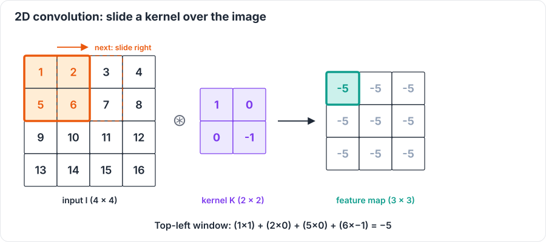

**The same principle applies as in 1D convolution. The only difference is that now we slide in two spatial dimensions.**

---

# 14. Image Processing Using Kernels

Before CNNs learned their own filters, computer vision engineers manually designed kernels.

Let's understand some examples.

## 14.1 Box blur

A box blur averages neighbouring pixels.

A 3 × 3 kernel can be:

$$
K=
\frac19
\begin{bmatrix}
1&1&1\\
1&1&1\\
1&1&1
\end{bmatrix}
$$

Each output pixel becomes the average of the surrounding 3 × 3 region.

Effect:

- Sharp changes become smoother.
- Neighbouring colours blend.
- The image becomes blurred.

## 14.2 Gaussian blur

A Gaussian blur gives more importance to the centre pixel and less importance to distant pixels.

Example:

$$
K=
\frac1{16}
\begin{bmatrix}
1&2&1\\
2&4&2\\
1&2&1
\end{bmatrix}
$$

The centre has the highest weight.

This produces a smoother, more natural blur.

## 14.3 Edge detection

An edge detector identifies places where pixel intensity changes sharply.

Example vertical edge kernel:

$$
K=
\begin{bmatrix}
-1&0&1\\
-1&0&1\\
-1&0&1
\end{bmatrix}
$$

Over a flat region, the positive and negative contributions approximately cancel.

At a vertical boundary, they do not cancel, so the output becomes large.

A horizontal edge detector can use:

$$
K=
\begin{bmatrix}
-1&-1&-1\\
0&0&0\\
1&1&1
\end{bmatrix}
$$

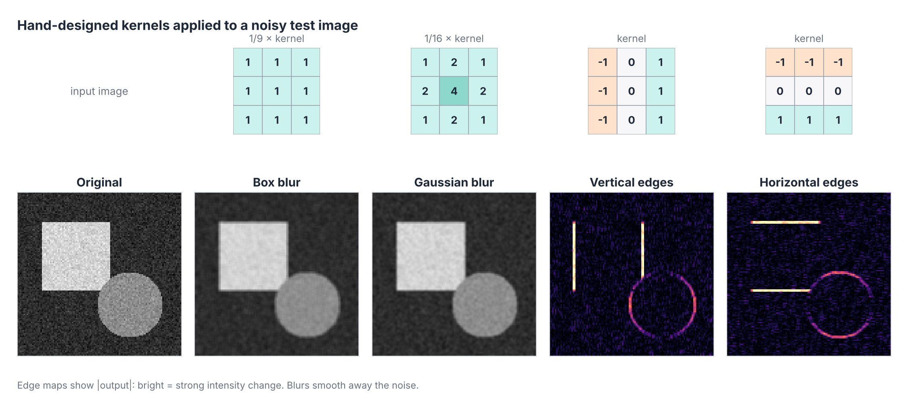

## 14.4 Summary of traditional image kernels

| Kernel | Purpose |
|---|---|
| Box blur | Smooth an image |
| Gaussian blur | Natural-looking blur |
| Edge detection | Detect sharp changes |
| Sharpening | Enhance details |
| Emboss | Create a raised appearance |

### The connection to CNNs

In traditional image processing:

**Humans design the kernel values.**

In CNNs:

**The network learns the kernel values from training data.**

This is one of the biggest differences between traditional computer vision and deep learning.

---

# 15. From Traditional Computer Vision to CNNs

Before deep learning became popular, computer vision systems commonly followed a two-stage approach.

## 15.1 Traditional approach: Hand-crafted features

Humans designed algorithms to extract useful information from images.

Examples:

### Color histograms

Count how many pixels belong to different colour ranges.

This helps describe the colour distribution of an image.

However, it does not preserve the spatial arrangement of those colours.

### Histogram of Oriented Gradients (HOG)

Measures the directions of edges in local image regions.

It helps represent shapes and object boundaries.

After extracting features, engineers combined them into a large vector and trained a classifier.

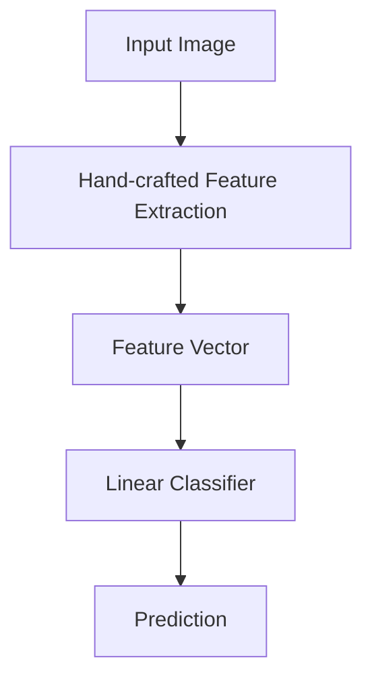

The weakness was that humans had to design the feature extraction process.

## 15.2 End-to-end learning

Deep learning changed this.

Instead of manually designing features, we can train the complete network using data.

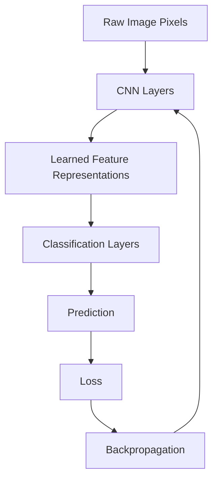

Every layer learns jointly through backpropagation.

The network learns which features are useful for the final task.

---

# 16. Why Fully Connected Networks Are Not Ideal for Images

We already know how an MLP works.

Let's understand why CNNs are better suited to images.

## 16.1 What happens when we use an MLP?

Consider a 32 × 32 RGB image.

It contains:

$$
32\times32\times3=3072
$$

values.

An MLP flattens the image into a vector:

$$
x\in\mathbb{R}^{3072}
$$

Then a fully connected layer connects all 3072 values to every output neuron.

For example, if there are 10 output classes:

$$
W\in\mathbb{R}^{10\times3072}
$$

Every output neuron has a separate weight for every input pixel.

## 16.2 What is the problem?

There are two major problems.

**Problem 1: Spatial structure**

Flattening removes the explicit 2D structure.

The network is no longer directly aware that one pixel is beside another.

It can learn spatial relationships, but it has no built-in preference for nearby pixels interacting.

**Problem 2: Too many parameters**

Large images produce huge input vectors.

Fully connected layers can therefore require enormous numbers of weights.

CNNs solve these problems through:

1. Local connectivity.
2. Weight sharing.

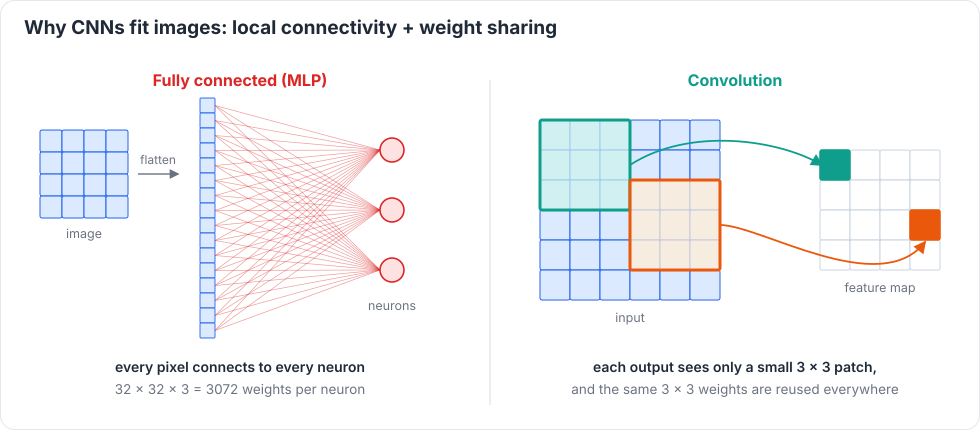

---

# 17. Convolution Layer: The Core of CNNs

Now we reach the most important concept.

## 17.1 Fully connected layer vs convolution layer

In a fully connected layer, a neuron receives information from the entire input.

In a convolution layer, a filter looks at a small local region.

For example, a 32 × 32 RGB image has:

$$
3\times32\times32
$$

values.

A fully connected layer might use a 3072-element weight vector for each output neuron.

A convolution layer instead uses a small filter.

For example:

$$
3\times5\times5
$$

This means:

- 3 channels deep.
- 5 pixels high.
- 5 pixels wide.

**Important:** The spatial dimensions of a filter are small, but its depth must match the complete input channel depth.

## 17.2 How does one filter work?

Suppose the input is:

$$
X\in\mathbb{R}^{3\times32\times32}
$$

And the filter is:

$$
W\in\mathbb{R}^{3\times5\times5}
$$

At one spatial position:

1. Take the corresponding 3 × 5 × 5 input region.
2. Multiply every input value by its corresponding filter weight.
3. Add all the products.
4. Add a learnable bias.

Mathematically:

$$
y=\sum_{c=1}^{3}\sum_{i=1}^{5}\sum_{j=1}^{5}
W_{cij}X_{cij}+b
$$

This produces one scalar.

Move the filter across the image and repeat.

The resulting values form a 2D activation map.

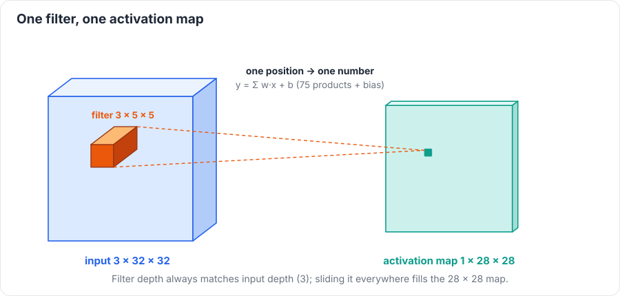

## 17.3 What if we have multiple filters?

One filter detects one type of pattern.

Suppose we have six filters.

Each filter moves across the entire image.

We obtain six separate activation maps.

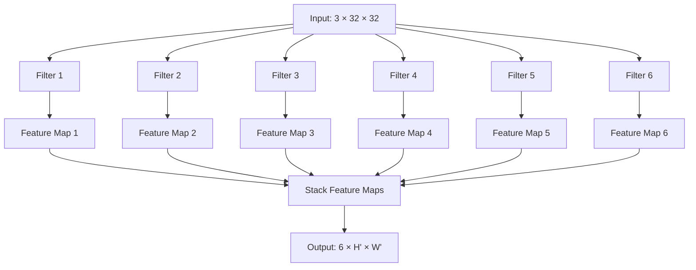

The output now has six channels.

Each channel corresponds to the response of one learned filter.

---

# 18. CNN Tensor Shapes and Multiple Filters

In PyTorch, convolution layers commonly use the following tensor layout:

$$
(N,C,H,W)
$$

Where:

- $N$ = batch size.
- $C$ = number of channels.
- $H$ = image height.
- $W$ = image width.

For example:

$$
X\in\mathbb{R}^{32\times3\times224\times224}
$$

This represents:

- 32 images.
- 3 colour channels.
- Height 224.
- Width 224.

## 18.1 Filter tensor shape

For a convolution layer:

$$
W\in\mathbb{R}^{C_{out}\times C_{in}\times K_H\times K_W}
$$

Where:

- $C_{out}$ = number of filters.
- $C_{in}$ = number of input channels.
- $K_H$ = filter height.
- $K_W$ = filter width.

For example:

$$
W\in\mathbb{R}^{6\times3\times5\times5}
$$

This means six filters, each containing:

$$
3\times5\times5=75
$$

weights.

The convolution output has shape:

$$
(N,C_{out},H',W')
$$

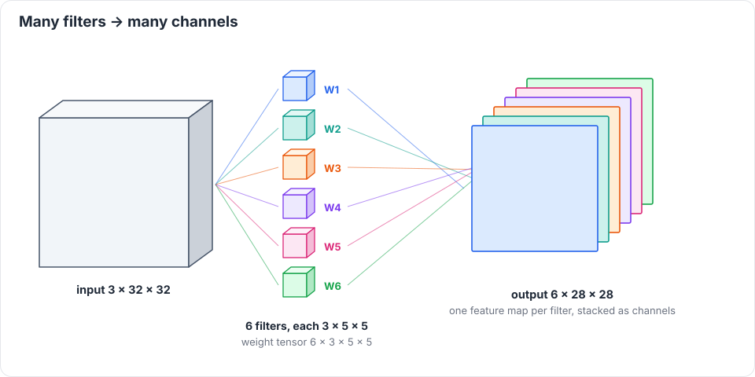

## 18.2 Why do we stack feature maps?

Each filter learns a different visual pattern.

One might respond to vertical edges.

Another might respond to horizontal edges.

Another might respond to colour combinations or textures.

Stacking them allows the next layer to use all these representations.

---

# 19. Parameters vs Hyperparameters

This distinction is important in deep learning.

## Parameters

Parameters are values learned during training.

In CNNs, these include:

- Filter weights.
- Biases.

They are updated through backpropagation and optimization.

## Hyperparameters

Hyperparameters are selected by the model designer.

Examples:

- Number of filters.
- Kernel size.
- Stride.
- Padding.
- Number of layers.
- Learning rate.
- Batch size.

| Parameters | Hyperparameters |
|---|---|
| Learned by training | Chosen by developer |
| Filter weights | Number of filters |
| Bias values | Kernel size |
| Updated by optimizer | Stride and padding |

## 19.1 Why must filters start with different values?

Suppose we initialize six filters with exactly the same values.

They would calculate the same outputs.

They would receive identical gradients.

Therefore, they would continue learning the same feature.

This defeats the purpose of having multiple filters.

Random initialization breaks this symmetry and allows filters to learn different patterns.

---

# 20. Stride, Padding and Output Dimensions

These control the spatial size of the output feature map.

## 20.1 Stride

Stride determines how far the filter moves at each step.

**Stride = 1**

```text
Filter positions:

[1] [2] [3] [4] ...
```

Move one pixel at a time.

**Stride = 2**

```text
Filter positions:

[1]    [3]    [5] ...
```

Move two pixels at a time.

Larger stride generally produces smaller feature maps.

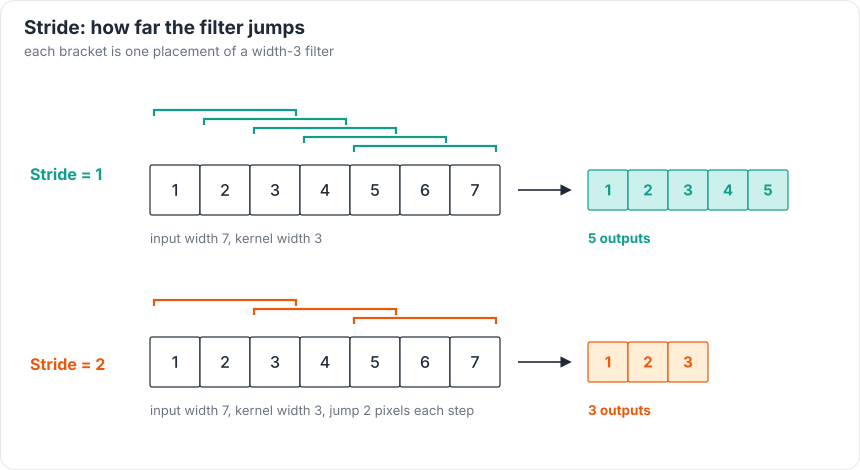

## 20.2 Padding

Without padding, a filter cannot extend beyond the image boundary.

For example, a 3 × 3 filter on a 5 × 5 image produces:

$$
5-3+1=3
$$

Therefore, output dimensions are:

$$
3\times3
$$

Every convolution reduces spatial dimensions unless padding is used.

Zero padding solves this by adding zeros around the image.

For a 3 × 3 kernel, padding 1 adds one zero layer around the image.

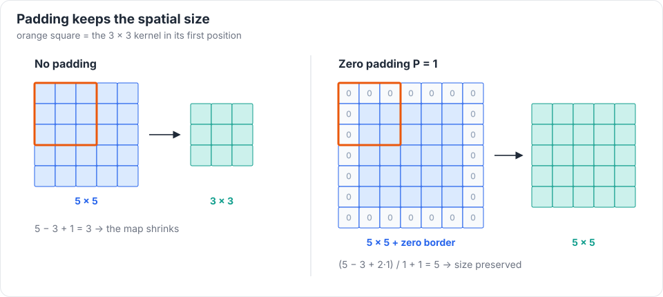

## 20.3 General output formula

For a convolution with:

- Input width $W$.
- Kernel width $K$.
- Padding $P$.
- Stride $S$.

The output width is:

$$
\boxed{
W'=\left\lfloor
\frac{W-K+2P}{S}
\right\rfloor+1
}
$$

Similarly, for height:

$$
\boxed{
H'=\left\lfloor
\frac{H-K_H+2P_H}{S_H}
\right\rfloor+1
}
$$

The floor operation is important when the division does not produce an integer.

For odd-sized kernels and stride 1, choosing:

$$
P=\frac{K-1}{2}
$$

preserves spatial dimensions.

For example:

| Kernel | Padding |
|---|---:|
| 3 × 3 | 1 |
| 5 × 5 | 2 |
| 7 × 7 | 3 |

## 20.4 Worked example

Input:

$$
28\times28
$$

Kernel:

$$
3\times3
$$

Stride:

$$
S=2
$$

Padding:

$$
P=1
$$

Output:

$$
W'=
\left\lfloor
\frac{28-3+2}{2}
\right\rfloor+1
$$

$$
=\lfloor13.5\rfloor+1
$$

$$
\boxed{14}
$$

Output shape:

$$
14\times14
$$

---

# 21. Receptive Fields

This is one of the most important CNN concepts.

## 21.1 What is a receptive field?

A receptive field is the region of the original input image that influences a particular output neuron.

Suppose the first convolution layer uses a 3 × 3 filter.

Each output value sees a 3 × 3 region of the original image.

Therefore:

$$
RF_1=3\times3
$$

Now add another 3 × 3 convolution layer with stride 1.

Each neuron in the second layer sees a 3 × 3 region of the previous feature map.

But every previous feature-map value already represents a 3 × 3 region of the original image.

Therefore, the effective receptive field becomes:

$$
RF_2=5\times5
$$

A third 3 × 3 layer produces:

$$
RF_3=7\times7
$$

### Visual intuition

```text
Original image
      |
      v
Conv Layer 1
3 × 3 receptive field
      |
      v
Conv Layer 2
5 × 5 effective receptive field
      |
      v
Conv Layer 3
7 × 7 effective receptive field
```

With stride 1, each additional 3 × 3 convolution increases the receptive field by two pixels in each dimension.

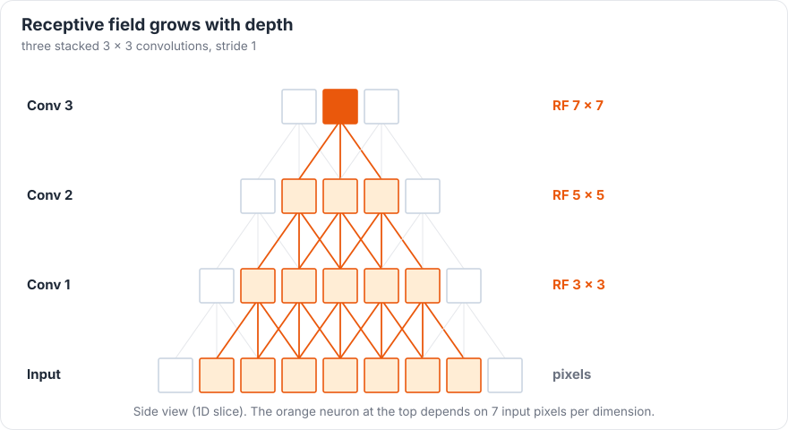

## 21.2 Why does this matter?

Early layers detect local patterns.

Deeper layers can combine information from larger areas.

This helps the network understand increasingly complex visual structures.

For example:

- Early layers: edges and colours.
- Middle layers: textures and simple shapes.
- Deeper layers: object parts and larger structures.

## 21.3 Receptive field with stride

When strides are greater than 1, receptive fields grow faster.

A useful general formula is:

$$
r_l=r_{l-1}+(k_l-1)j_{l-1}
$$

$$
j_l=j_{l-1}s_l
$$

Where:

- $r_l$ = receptive field at layer $l$.
- $j_l$ = spacing between adjacent layer outputs measured in input pixels.
- $k_l$ = kernel size.
- $s_l$ = stride.

Initialize:

$$
r_0=1,\quad j_0=1
$$

For two 3 × 3 convolutions:

**First layer:**

$$
r_1=1+(3-1)(1)=3
$$

**Second layer, stride 1:**

$$
r_2=3+(3-1)(1)=5
$$

If the second layer has stride 2:

$$
r_2=3+(3-1)(1)=5
$$

But the spacing becomes:

$$
j_2=1\times2=2
$$

This spacing causes later layers to cover the original image more rapidly.

---

# 22. Why CNNs Need Nonlinearities

This connects directly to your MLP and backpropagation knowledge.

Convolution is a linear operation.

Suppose we stack two convolution layers without any activation function.

The combination of these linear operations can be represented as another linear operation.

Therefore, simply stacking convolution layers without nonlinearities does not give us the full expressive power of a deep network.

We need activation functions such as ReLU.

$$
ReLU(x)=\max(0,x)
$$

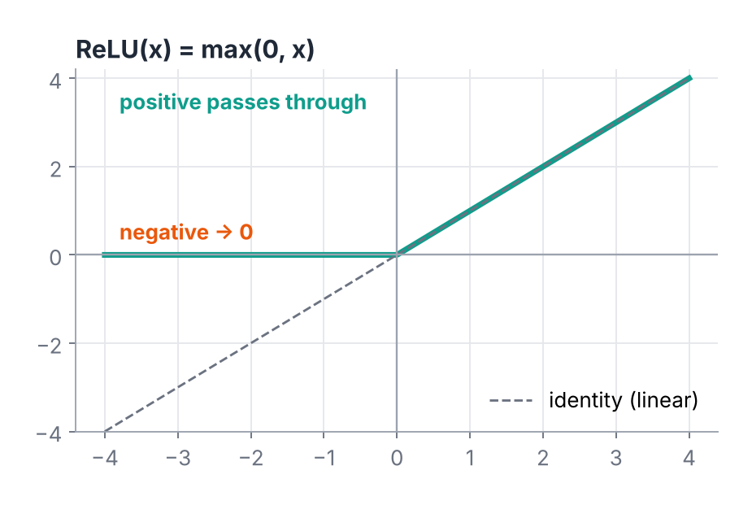

A typical pattern is:

```text
Input
  |
  v
Convolution
  |
  v
ReLU
  |
  v
Convolution
  |
  v
ReLU
  |
  v
Pooling
```

The nonlinear activation allows the network to learn more complex relationships.

---

# 23. Pooling Layers

Convolution extracts features.

Pooling reduces the spatial dimensions of feature maps.

## 23.1 Why do we need pooling?

Suppose a convolution layer produces:

$$
64\times224\times224
$$

Processing such large feature maps through many more layers can be expensive.

Pooling reduces their height and width.

For example:

$$
64\times224\times224
$$

becomes:

$$
64\times112\times112
$$

The number of channels remains unchanged.

## 23.2 Max pooling

A common operation is 2 × 2 max pooling with stride 2.

Consider:

$$
X=
\begin{bmatrix}
1&3&2&4\\
5&6&1&2\\
7&2&8&3\\
4&9&5&6
\end{bmatrix}
$$

Divide it into four 2 × 2 regions.

```text
1  3 | 2  4
5  6 | 1  2
-----+-----
7  2 | 8  3
4  9 | 5  6
```

Take the maximum from each region.

Top-left:

$$
\max(1,3,5,6)=6
$$

Top-right:

$$
\max(2,4,1,2)=4
$$

Bottom-left:

$$
\max(7,2,4,9)=9
$$

Bottom-right:

$$
\max(8,3,5,6)=8
$$

Output:

$$
\boxed{
\begin{bmatrix}
6&4\\
9&8
\end{bmatrix}
}
$$

The original matrix was 4 × 4.

The output is 2 × 2.

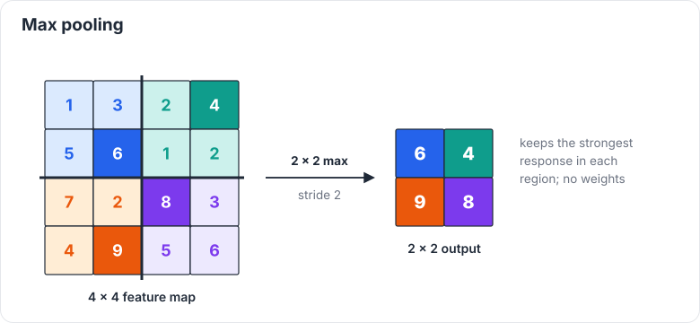

## 23.3 Types of pooling

| Pooling | Operation |
|---|---|
| Max pooling | Keep maximum value |
| Average pooling | Calculate average |
| Anti-aliased pooling | Reduce resolution while reducing aliasing effects |

## 23.4 Does pooling have learnable parameters?

Ordinary max pooling has no learnable parameters.

It simply selects the maximum value.

This makes it a cheap way to reduce spatial dimensions.

Max pooling is nonlinear because taking a maximum is not a linear operation.

Average pooling is a linear operation.

## 23.5 Typical CNN pattern

A common architecture looks like:

```text
Input Image
    |
    v
Convolution
    |
    v
ReLU
    |
    v
Convolution
    |
    v
ReLU
    |
    v
Max Pooling
    |
    v
Convolution
    |
    v
ReLU
    |
    v
Max Pooling
    |
    v
Flatten
    |
    v
Fully Connected Layers
    |
    v
Classification
```

---

# 24. Translation Equivariance

This is a mathematical property that helps explain why convolution works well for images.

## 24.1 What is translation?

Translation means shifting an image.

For example, suppose we have an image of a cat.

We move the cat slightly to the right.

The object is still a cat, but its position changes.

## 24.2 What does equivariance mean?

An operation is translation equivariant if shifting the input causes the output to shift correspondingly.

In simple terms:

**Shift the image first, then apply convolution.**

Or:

**Apply convolution first, then shift the feature map.**

Ignoring boundary effects, the results correspond.

Mathematically:

$$
Conv(T(x))=T(Conv(x))
$$

Where $T$ represents a spatial translation.

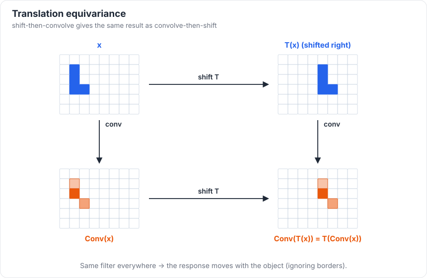

## 24.3 Why does convolution have this property?

Because the same filter is reused at every image location.

If a filter detects a vertical edge in one location, it can detect the same edge somewhere else.

The filter does not need to be relearned for every position.

This is one of the main benefits of weight sharing.

## 24.4 Equivariance vs invariance

These two concepts are related but different.

| Property | Meaning |
|---|---|
| Equivariance | Output changes correspondingly when input moves |
| Invariance | Output stays unchanged when input moves |

Convolution naturally provides translation equivariance, not complete translation invariance.

Pooling and global aggregation can provide some degree of positional tolerance or invariance, but ordinary pooling does not guarantee perfect translation invariance.

---

# 25. How a Complete CNN Works

Now combine all the concepts.

Imagine that we want to classify an image as a cat or a dog.

The image enters the CNN as a tensor.

For an RGB image:

$$
X\in\mathbb{R}^{3\times224\times224}
$$

### Stage 1: Initial feature extraction

The first convolution layers learn low-level patterns.

Examples:

- Edges.
- Colours.
- Simple gradients.
- Basic textures.

### Stage 2: Intermediate features

Deeper layers combine these patterns.

Examples:

- Corners.
- Curves.
- Repeated textures.
- Simple shapes.

### Stage 3: Complex features

Even deeper layers can respond to larger visual structures.

Examples:

- Eyes.
- Ears.
- Wheels.
- Object parts.

### Stage 4: Classification

The final feature representation is used to predict a class.

For example:

```text
Cat: 0.92
Dog: 0.06
Car: 0.02
```

These values represent predicted class probabilities after applying softmax.

### Complete architecture

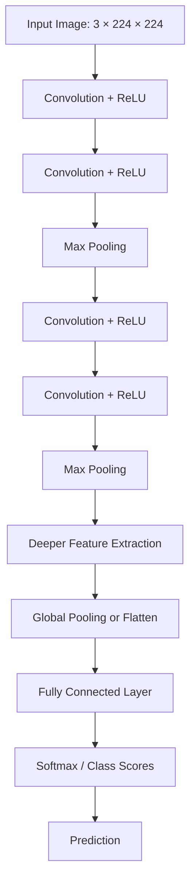

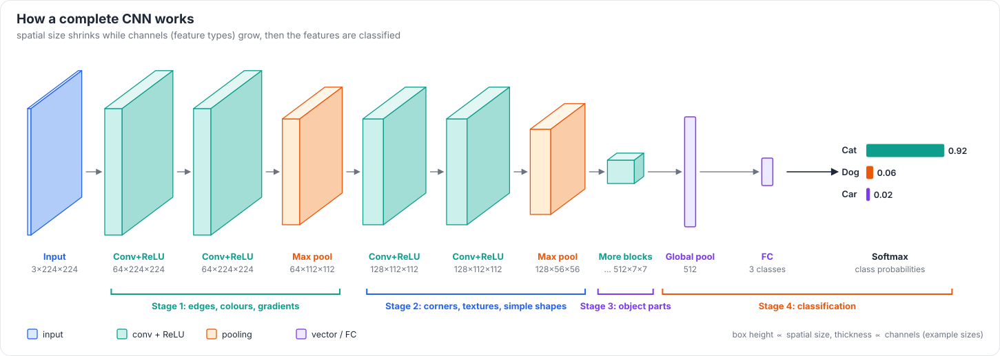

The exact architecture varies between CNN models.

Some use many convolution blocks. Others use global average pooling rather than flattening the entire feature map.

---

# 26. CNN vs MLP: Parameter Comparison

Let's understand why CNNs need fewer parameters for image processing.

Suppose we have a 224 × 224 RGB image.

Input size:

$$
224\times224\times3=150,528
$$

Imagine connecting this to 1,000 neurons in an MLP.

Number of weights:

$$
150,528\times1,000
$$

$$
=150,528,000
$$

That is over 150 million weights, excluding biases.

Now consider a CNN layer with:

- 3 input channels.
- 10 filters.
- 5 × 5 kernel size.

Each filter contains:

$$
3\times5\times5=75
$$

weights.

Including one bias:

$$
75+1=76
$$

For ten filters:

$$
10\times76=760
$$

Only 760 learnable parameters!

This is a dramatic reduction.

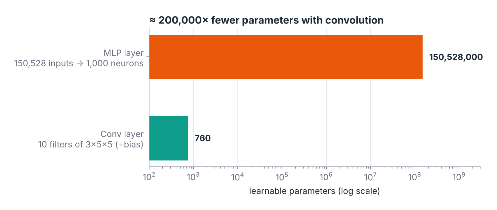

### Comparison

| Property | MLP | CNN |
|---|---|---|
| Input representation | Usually flattened | Spatial tensor |
| Connectivity | Fully connected | Local connectivity |
| Weight sharing | No | Yes |
| Spatial structure | Not explicitly preserved by flattening | Preserved |
| Parameters | Often very large | Often much smaller |
| Best suited for | General vector data | Spatial data such as images |

**Important:** CNNs do not always have fewer parameters than every possible MLP. The advantage comes from using a suitable architecture and sharing weights across image locations.

---

# 27. Practical PyTorch Implementation

Theory becomes useful when we implement it.

Your Day 007 task focuses on this.

## 27.1 Understanding `conv2d`

PyTorch provides:

```python
import torch.nn.functional as F

output = F.conv2d(
    input,
    weight,
    bias=None,
    stride=1,
    padding=0
)
```

The main arguments:

| Argument | Meaning |
|---|---|
| input | Input image tensor |
| weight | Learnable filter weights |
| bias | Optional bias |
| stride | Movement of filter |
| padding | Border padding |

PyTorch's `conv2d` performs cross-correlation rather than mathematically flipped convolution.

This distinction is explained below.

## 27.2 Mathematical convolution vs deep learning convolution

In pure mathematical convolution, we flip the kernel before sliding it.

In most deep learning libraries, including PyTorch, the kernel is not flipped.

The operation is technically cross-correlation.

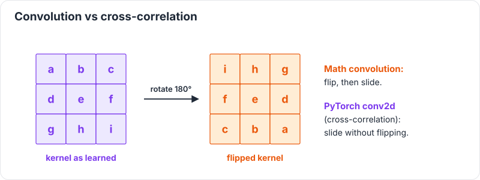

However, the operation is commonly called convolution in deep learning.

Why is this acceptable?

Because the kernel weights are learned.

A network can learn the appropriate flipped version of a filter if that is what the task requires.

The distinction matters when manually checking numerical results.

## 27.3 Implementing a simple 2D convolution using Python loops

A simplified educational implementation:

```python
def conv2d_simple(image, kernel):
    image_height, image_width = image.shape
    kernel_height, kernel_width = kernel.shape

    output_height = image_height - kernel_height + 1
    output_width = image_width - kernel_width + 1

    output = [[0 for _ in range(output_width)]
              for _ in range(output_height)]

    for i in range(output_height):
        for j in range(output_width):

            total = 0

            for ki in range(kernel_height):
                for kj in range(kernel_width):

                    total += (
                        image[i + ki][j + kj]
                        * kernel[ki][kj]
                    )

            output[i][j] = total

    return output
```

This is a simplified valid-padding, stride-1 cross-correlation implementation.

It helps us understand what happens inside a convolution operation.

## 27.4 A simple CNN in PyTorch

```python
import torch
import torch.nn as nn
import torch.nn.functional as F


class SimpleCNN(nn.Module):

    def __init__(self):

        super().__init__()

        self.conv1 = nn.Conv2d(
            in_channels=1,
            out_channels=16,
            kernel_size=3,
            padding=1
        )

        self.conv2 = nn.Conv2d(
            in_channels=16,
            out_channels=32,
            kernel_size=3,
            padding=1
        )

        self.pool = nn.MaxPool2d(
            kernel_size=2,
            stride=2
        )

        self.fc = nn.Linear(
            32 * 7 * 7,
            10
        )

    def forward(self, x):

        x = F.relu(self.conv1(x))
        x = self.pool(x)

        x = F.relu(self.conv2(x))
        x = self.pool(x)

        x = torch.flatten(x, start_dim=1)

        x = self.fc(x)

        return x
```

For a 28 × 28 grayscale image:

```text
Input:
1 × 28 × 28

Conv1:
16 × 28 × 28

Max Pool:
16 × 14 × 14

Conv2:
32 × 14 × 14

Max Pool:
32 × 7 × 7

Flatten:
1568

Fully Connected:
10 outputs
```

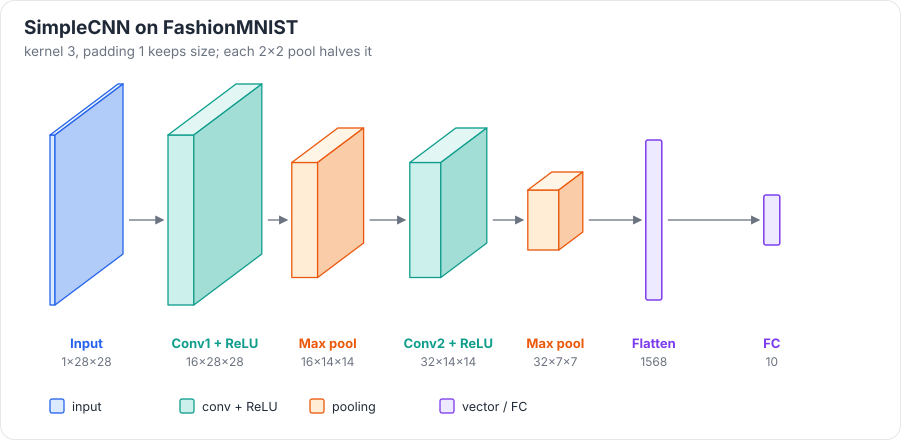

The model predicts one of ten FashionMNIST classes.

Notice that the training loop is essentially the same as an MLP.

```python
for images, labels in train_loader:

    optimizer.zero_grad()

    outputs = model(images)

    loss = criterion(outputs, labels)

    loss.backward()

    optimizer.step()
```

The optimizer updates both convolutional filters and fully connected weights.

---

# 28. CNN Architecture Evolution

Understanding CNN history helps explain why modern architectures look the way they do.

## 28.1 LeNet-5 (1998)

Yann LeCun and colleagues developed LeNet for handwritten digit recognition.

It used:

- Convolution.
- Subsampling/pooling.
- Fully connected layers.

It demonstrated that learned convolutional features could work very effectively for image recognition.

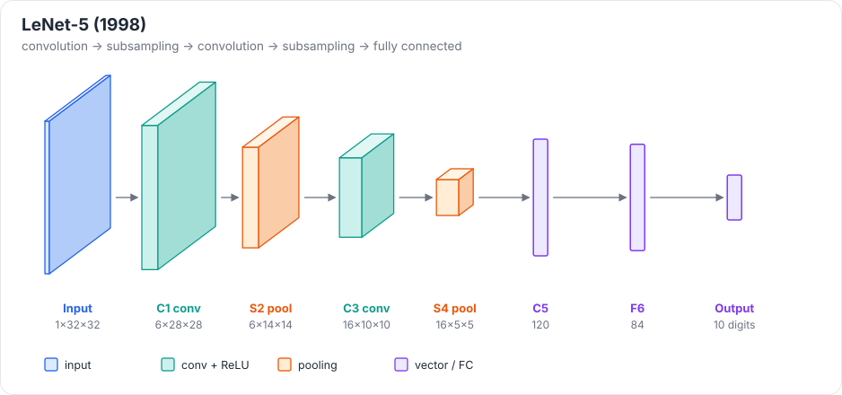

## 28.2 AlexNet (2012)

AlexNet was a major turning point in computer vision.

Important factors included:

- Large ImageNet dataset.
- GPU acceleration.
- Deep convolutional architecture.
- ReLU activations.
- Dropout.
- Data augmentation.

It helped establish deep CNNs as a dominant approach to image classification.

## 28.3 VGG

VGG explored deeper architectures using repeated small 3 × 3 convolution filters.

Its design emphasized simplicity and depth.

## 28.4 ResNet

As networks became deeper, training them became more difficult.

ResNet introduced residual connections.

Instead of learning only:

$$
H(x)
$$

A residual block learns:

$$
\boxed{F(x)+x}
$$

The input can bypass some layers through a shortcut connection.

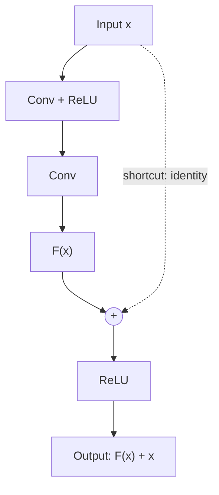

This helps gradients flow through very deep networks.

## 28.5 Vision Transformers

Vision Transformers adapted the Transformer architecture to image data.

Instead of relying only on convolution filters, they divide images into patches and use attention mechanisms.

CNNs remain important because:

- They are computationally efficient in many settings.
- They provide useful visual inductive biases.
- They are widely deployed.
- They are used in hybrid CNN-Transformer architectures.

### Historical timeline

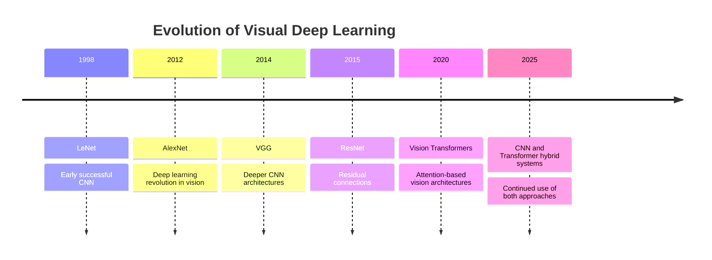

---

# 29. CNNs Beyond Images

CNNs are not limited to two-dimensional photographs.

The same idea works with different types of data.

| Type | Convolution | Example |
|---|---|---|
| 1D | Moves along one dimension | Audio, time series |
| 2D | Moves across height and width | Images |
| 3D | Moves across three spatial dimensions | Videos, medical volumes |

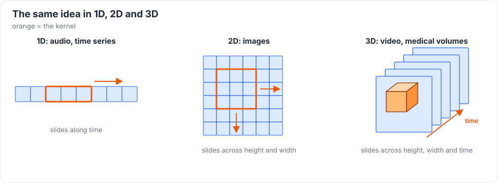

## 29.1 1D convolution

Imagine audio represented as a sequence of amplitude values.

A filter can move across the sequence to identify local patterns.

Applications:

- Speech processing.
- Audio classification.
- Sensor data.
- Time-series forecasting.

## 29.2 2D convolution

Used for ordinary images.

The filter moves across:

- Height.
- Width.

## 29.3 3D convolution

Used for data with three spatial or spatiotemporal dimensions.

For example, a video contains frames over time.

A 3D convolution can process:

- Frame height.
- Frame width.
- Time.

This allows the model to learn both spatial and temporal patterns.

### Connection to robotics

CNNs are particularly relevant to embodied AI and robotics because robots interact with visual environments.

Possible applications include:

- Visual perception.
- Object recognition.
- Scene understanding.
- Camera-based obstacle detection.
- Visual feature extraction.
- Robot navigation.

CNNs can act as visual feature extractors within larger robotic learning systems.

---

# 30. Important Concepts to Remember

This section is intended for future revision.

## Mathematical foundations

| Concept | Remember |
|---|---|
| Discrete convolution | Flip, slide, multiply and add |
| Output length | $N+M-1$ for full convolution |
| Probability convolution | Distribution of the sum of independent random variables |
| Continuous convolution | Uses integration instead of summation |
| Polynomial multiplication | Equivalent to coefficient convolution |
| Toeplitz matrix | Matrix representation of convolution |
| Complex numbers | Numbers of the form $a+bi$ |
| Unit circle | Complex numbers with magnitude 1 |
| Roots of unity | Solutions to $z^N=1$ |
| DFT | Converts a sequence into frequency-domain values |
| FFT | Efficient algorithm for computing DFT |
| FFT convolution | FFT → pointwise multiplication → inverse FFT |

## CNN foundations

| Concept | Remember |
|---|---|
| CNN | Neural network architecture suited to spatial data |
| Kernel/filter | Learnable weights applied to local regions |
| Feature map | Output generated by applying a filter |
| Channels | Separate input or feature-map planes |
| Stride | Number of pixels moved per step |
| Padding | Extra border values added around input |
| Receptive field | Original input region influencing an output |
| Pooling | Reduces spatial dimensions |
| Weight sharing | Reuse the same filter across positions |
| Local connectivity | Each output uses a local input region |
| Translation equivariance | Shifting input shifts corresponding feature responses |
| Backpropagation | Learns filter weights through gradients |

---

# 31. Practice Questions and Knowledge Check

Try answering these without looking at the notes.

## Part A: Mathematical convolution

**Q1.** What is convolution? Explain the flip, slide, multiply and add process.

**Q2.** If two sequences have lengths 5 and 4, what will be the length of their full convolution?

**Q3.** Calculate:

$$
[1,2,3]*[4,5]
$$

**Q4.** Why is polynomial multiplication equivalent to convolution?

## Part B: Probability and FFT

**Q5.** Why does the probability distribution of the sum of two independent random variables involve convolution?

**Q6.** What is the difference between a discrete probability distribution and a continuous probability density?

**Q7.** Why does continuous convolution use integration?

**Q8.** What is a Toeplitz matrix?

**Q9.** Why is direct convolution computationally expensive for large sequences?

**Q10.** What is the difference between DFT and FFT?

**Q11.** Why do roots of unity help FFT?

**Q12.** Explain the four steps of FFT-based convolution.

## Part C: CNN fundamentals

**Q13.** Why are CNNs better suited to images than ordinary fully connected networks?

**Q14.** What is a kernel or filter?

**Q15.** Why must the depth of a convolution filter match the input channel depth?

**Q16.** What happens when we increase the number of filters?

**Q17.** What is the difference between parameters and hyperparameters?

**Q18.** Why should different filters have different initial weights?

**Q19.** What is the difference between stride and padding?

**Q20.** Why do we use ReLU between convolution layers?

**Q21.** What is a receptive field?

**Q22.** Why does max pooling reduce spatial dimensions?

**Q23.** What is translation equivariance?

**Q24.** Why is convolution called cross-correlation in PyTorch?

## Part D: Numerical problems

**Q25.** Calculate the output dimensions for:

- Input: 28 × 28
- Kernel: 3 × 3
- Padding: 1
- Stride: 2

**Q26.** An input has three channels. A convolution layer has 16 filters, each of size 3 × 3.

How many learnable parameters does the layer have, including biases?

**Q27.** A 3 × 3 convolution is followed by another 3 × 3 convolution. Both have stride 1.

What is the effective receptive field of the second layer?

**Q28.** A 4 × 4 feature map is processed using 2 × 2 max pooling with stride 2.

What is the output size?

---

# 32. Further Learning Roadmap

This chapter gives you the mathematical and conceptual foundation of CNNs.

The next steps should be practical.

## Stage 1: Understand the convolution operation

- [ ] Understand 1D convolution.
- [ ] Calculate convolution manually.
- [ ] Understand 2D convolution.
- [ ] Implement convolution using Python loops.
- [ ] Compare with PyTorch's `F.conv2d`.

## Stage 2: Build your first CNN

- [ ] Understand input and output tensor shapes.
- [ ] Build a two-convolution CNN.
- [ ] Train on FashionMNIST.
- [ ] Use PyTorch MPS on your Mac.
- [ ] Compare parameter counts against an MLP.
- [ ] Compare accuracy against your previous MLP.

## Stage 3: Understand CNN architectures

- [ ] Study LeNet.
- [ ] Study AlexNet.
- [ ] Study VGG.
- [ ] Study ResNet.
- [ ] Understand residual connections.
- [ ] Experiment with transfer learning.

## Stage 4: Move toward computer vision

- [ ] Image classification.
- [ ] Object detection.
- [ ] Image segmentation.
- [ ] Feature extraction.
- [ ] CNN vs Vision Transformer.

## Stage 5: Connect to robotics

- [ ] Understand visual perception.
- [ ] Learn how image features are used by robotic systems.
- [ ] Explore visual representations for robot learning.
- [ ] Study how CNN-based perception can connect to reinforcement learning and vision-language-action systems.

---

# Final Mental Model

If you remember only one diagram from this entire chapter, remember this:

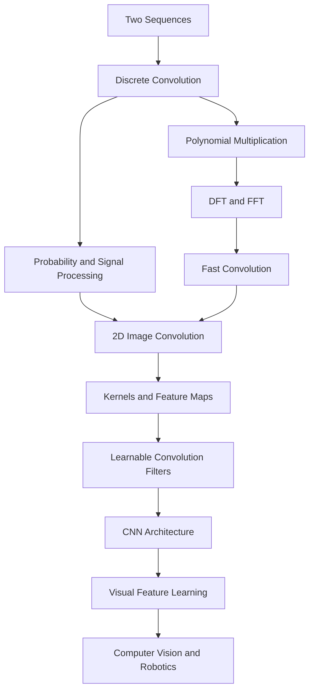

The complete journey is:

1. Convolution is a mathematical operation that combines overlapping contributions.
2. It appears in probability, signal processing, and polynomial multiplication.
3. FFT makes large convolution calculations more efficient.
4. Images can be processed using two-dimensional kernels.
5. CNNs make these kernels learnable.
6. Backpropagation teaches filters to recognize useful visual patterns.
7. Multiple convolution layers build increasingly complex representations.

**The most important connection:**

In your previous MLP, you learned how a neural network learns weights through backpropagation.

In a CNN, the same learning mechanism is used, but the weights are organized into small filters that are shared across an image.

That's the fundamental idea behind Convolutional Neural Networks.

---

## References and Original Learning Material

### Video 1: What is a Convolution?

[3Blue1Brown – What is a Convolution?](https://www.youtube.com/watch?v=KuXjwB4LzSA)

Topics:
- Discrete convolution.
- Probability.
- Continuous convolution.
- FFT intuition.
- Roots of unity.
- Fast convolution.

### Video 2: Stanford CS231n – Lecture 5: Image Classification with CNNs

[Stanford CS231n – Lecture 5 (Spring 2025)](https://www.youtube.com/watch?v=f3g1zGdxptI)

Topics:
- Deep learning recap.
- Traditional computer vision.
- Convolution layers.
- Filters and feature maps.
- Stride and padding.
- Receptive fields.
- Pooling.
- Translation equivariance.

### Recommended documentation

- [PyTorch – Conv2d](https://docs.pytorch.org/docs/stable/generated/torch.nn.Conv2d.html)
- [PyTorch – MaxPool2d](https://docs.pytorch.org/docs/stable/generated/torch.nn.MaxPool2d.html)
- [SciPy – fftconvolve](https://docs.scipy.org/doc/scipy/reference/generated/scipy.signal.fftconvolve.html)
- [Stanford CS231n](https://cs231n.stanford.edu/)

---

**End of Chapter: Convolution to CNNs**

*Learn the operation. Understand the mathematics. Implement it. Then understand how the network learns it.*
