# Building and Training CNNs
## Part 2 of Chapter 06 — Stanford CS231n, Lecture 6

> **Where this fits:** [Part 1 (README.md)](README.md) explained what a convolution is and how one CNN layer works.
> This part answers the next two questions:
>
> 1. **How do we build a good CNN?** Which extra layers do we add, and why do famous models look the way they do?
> 2. **How do we actually train it?** How to prepare data, reuse other people's models, find bugs and pick settings.

**Lecture:** [Stanford CS231n — Lecture 6 (Spring 2025)](https://www.youtube.com/watch?v=aVJy4O5TOk8&list=PLoROMvodv4rOmsNzYBMe0gJY2XS8AQg16&index=7), taught by Zane Durante.

Every plot in this file marked **"real experiment"** was produced by actually running code (most of them with our own `MySimpleCNN` on real FashionMNIST images). Nothing is made up.

---

# Table of Contents

**Part A — Building a CNN**

1. [Quick recap: the three basic layers](#1-quick-recap-the-three-basic-layers)
2. [Normalization layers](#2-normalization-layers)
3. [Dropout](#3-dropout)
4. [Activation functions](#4-activation-functions)
5. [Classic architectures: AlexNet and VGG](#5-classic-architectures-alexnet-and-vgg)
6. [ResNet and residual connections](#6-resnet-and-residual-connections)
7. [Weight initialization](#7-weight-initialization)

**Part B — Training a CNN**

8. [Data preprocessing](#8-data-preprocessing)
9. [Data augmentation](#9-data-augmentation)
10. [Transfer learning](#10-transfer-learning)
11. [Debugging and choosing hyperparameters](#11-debugging-and-choosing-hyperparameters)

**Wrap-up**

12. [Cheat sheet](#12-cheat-sheet)
13. [Practice questions](#13-practice-questions)
14. [References](#14-references)

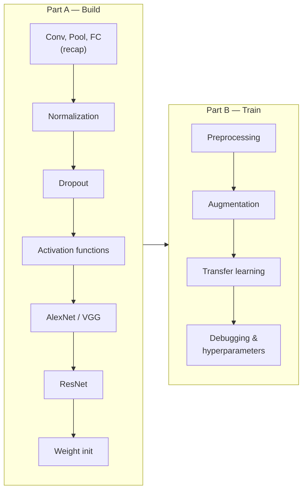

---

# Part A — Building a CNN

# 1. Quick recap: the three basic layers

Before adding anything new, remember the three blocks from Part 1.

| Layer | What it does | Has learnable weights? | Part 1 section |
|---|---|---|---|
| **Convolution** | Small filters slide over the input. At every position: multiply, add, add a bias. Each filter gives one activation map. 6 filters → 6 maps stacked (depth 6). | Yes | §17, §18 |
| **Pooling** | A small window (e.g. 2×2, stride 2) that keeps only the max (or average) of each patch. Makes height and width smaller. | **No** | §23 |
| **Fully connected (Linear)** | A normal matrix multiplication. Usually at the end, to turn features into class scores. | Yes | §16, §25 |

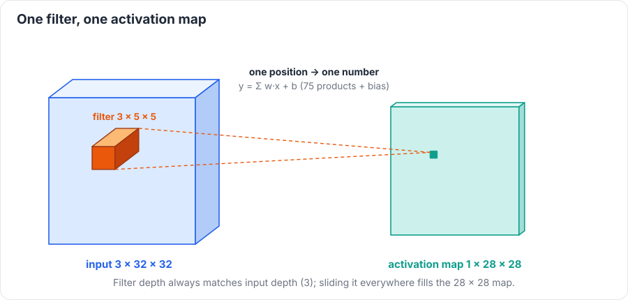

One important detail: **a filter is always as deep as its input.** If the input has 3 channels (RGB), every filter is 3 deep. If the input has 16 channels, every filter is 16 deep.

The rest of Part A adds **new layer types** on top of these three, and then shows how to stack everything into famous architectures.

---

# 2. Normalization layers

## 2.1 The problem: numbers drift

Data flows through many layers. Each layer multiplies and adds. After a few layers the numbers can **drift**:

- they can slowly grow until they are huge, or
- they can slowly shrink until they are almost zero.

Both are bad. Huge numbers make training unstable. Tiny numbers carry almost no information, and their gradients are tiny too, so learning stalls. (In section 7 we will literally watch this happen.)

A **normalization layer** is like a guardrail placed between layers. Whatever comes in, it puts the numbers back into a nice, standard range before passing them on.

## 2.2 The two-step recipe (the same for every normalization layer)

**Step 1: Normalize.** Take a group of numbers. Compute their mean $\mu$ (the average) and their standard deviation $\sigma$ (how spread out they are). Then:

$$
\hat{x} = \frac{x - \mu}{\sigma}
$$

- Subtracting $\mu$ moves the center to **0**.
- Dividing by $\sigma$ makes the spread **1**.

So after step 1, the group has mean 0 and standard deviation 1. (In code a tiny number $\epsilon$ is added, $\sqrt{\sigma^2 + \epsilon}$, so we never divide by zero.)

**Step 2: Scale and shift (learned).** Forcing *every* layer to be exactly "mean 0, spread 1" might be too strict. Maybe the next layer works better with a bigger spread, or a center at 2. So the layer has two **learnable** numbers, $\gamma$ (scale) and $\beta$ (shift):

$$
y = \gamma\,\hat{x} + \beta
$$

Gradient descent learns $\gamma$ and $\beta$ like any other weight. The beautiful part: if the network decides normalization was a bad idea, it can learn $\gamma = \sigma$ and $\beta = \mu$, which undoes step 1 exactly. So normalization can never make the network *less* powerful. It only makes it easier to train.

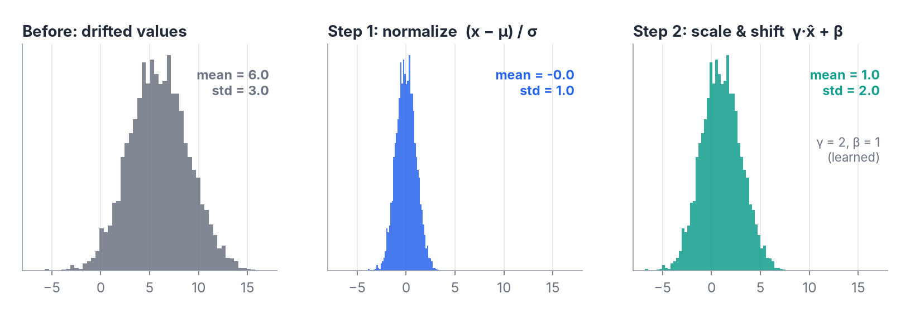

*Example numbers: a channel that has drifted to mean 6 and std 3. Step 1 brings it to mean 0, std 1. Step 2 (with learned γ = 2, β = 1) moves it to mean 1, std 2.*

### A tiny worked example

Four numbers come in: $[2, 4, 6, 8]$.

- Mean: $\mu = (2+4+6+8)/4 = 5$
- Differences from the mean: $[-3, -1, 1, 3]$
- Variance: $(9+1+1+9)/4 = 5$, so $\sigma = \sqrt{5} \approx 2.24$
- Step 1: $\hat{x} = [-3, -1, 1, 3] / 2.24 \approx [-1.34, -0.45, 0.45, 1.34]$ → mean 0, std 1 ✓
- Step 2 with $\gamma = 2$, $\beta = 1$: $y \approx [-1.68, 0.11, 1.89, 3.68]$

## 2.3 The four types: same recipe, different groups

In a CNN, a batch of data is a 4D tensor with shape $(N, C, H, W)$:

| Letter | Meaning | In our FashionMNIST batch after `conv1` |
|---|---|---|
| $N$ | number of images in the batch | 64 |
| $C$ | number of channels | 16 |
| $H, W$ | height and width | 28 × 28 |

All four normalization layers use the exact same two steps. **The only difference is which numbers are grouped together** to compute one $\mu$ and one $\sigma$:

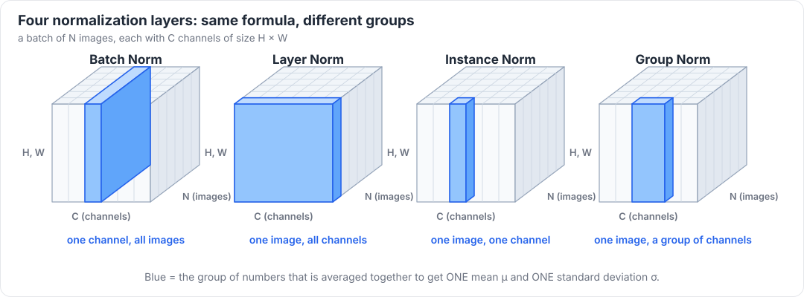

| Type | Numbers grouped together | Depends on other images in the batch? | Best used for |
|---|---|---|---|
| **Batch Norm** | one channel, across **all images** in the batch (and all pixels) | **Yes** | Standard CNN image classification, when the batch is big enough (≥ 16 or so) |
| **Layer Norm** | **all** channels and pixels of **one image** | No | Transformers, language models, RL, sequence models |
| **Instance Norm** | **one** channel of **one image** | No | Style transfer and image generation (it removes each image's own contrast/brightness) |
| **Group Norm** | a **small group** of channels of **one image** | No | Detection and segmentation, where images are huge and the batch is tiny (1–2 images) |

**How to remember it:** look at which axes are shaded.

- **Batch** Norm averages *across the batch*, which is why it needs a healthy batch size: with only 2 images, the "average" of a channel is very noisy.
- The other three only look *inside one image*, so they don't care about batch size at all.
- Group Norm sits in between Layer Norm (all channels = one group) and Instance Norm (each channel = its own group).

## 2.4 Batch Norm has a training mode and a testing mode

This catches many people. During **training**, Batch Norm computes $\mu$ and $\sigma$ from the current batch.

At **test time** we might predict on a single image. There is no "batch" to average over. So, during training, Batch Norm also keeps a **running average** of $\mu$ and $\sigma$ it has seen. At test time it uses those saved averages instead.

That is one big reason why you must call:

```python
model.train()   # Batch Norm uses the current batch's mean/std, and updates its running averages
model.eval()    # Batch Norm uses the saved running averages (and dropout turns off, see §3)
```

Your `evaluate_model` in `first_pytorch_training/evaluation.py` already calls `model.eval()`, so it will do the right thing once you add Batch Norm.

## 2.5 In PyTorch, and where to put it

Batch Norm usually goes **right after a conv layer, before the ReLU**:

```python
import torch.nn as nn

block = nn.Sequential(
    nn.Conv2d(1, 16, kernel_size=3, padding=1, bias=False),  # bias=False: see below
    nn.BatchNorm2d(16),     # one μ, σ, γ, β per channel → 16 of each
    nn.ReLU(),
)

# the other types, for a tensor with 16 channels:
nn.GroupNorm(num_groups=4, num_channels=16)   # 4 groups of 4 channels
nn.GroupNorm(num_groups=1, num_channels=16)   # = Layer Norm over (C, H, W)
nn.InstanceNorm2d(16)                          # one channel of one image
```

**Why `bias=False`?** Batch Norm subtracts the mean, which would cancel any constant bias the conv adds. Then $\beta$ adds its own shift anyway. So a conv bias right before Batch Norm is wasted parameters.

**How many learnable numbers does `BatchNorm2d(16)` add?** Only $\gamma$ and $\beta$ for each channel: $2 \times 16 = 32$. The running mean and variance are saved too, but they are not learned by gradient descent.

---

# 3. Dropout

## 3.1 What it does

Dropout is a layer that, **during training only**, randomly switches off some neurons (sets their output to 0) on every forward pass.

- It has **no learnable weights**.
- It has one setting you choose: the dropout probability $p$, usually 0.5 or 0.25.
- With $p = 0.5$, each neuron has a 50% chance of being switched off on each pass. A **new random choice** is made on every pass.

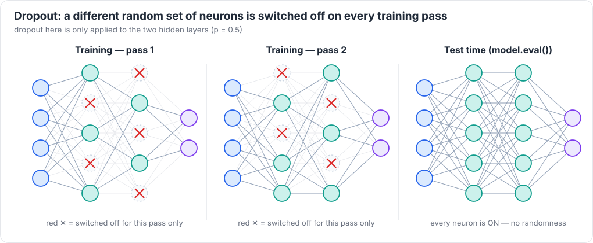

Dropout is a **regularizer**: a tool against overfitting (when a model memorizes the training data instead of learning general patterns).

## 3.2 Why would switching neurons off help?

**The lazy-network story.** Suppose a network recognizes cats using four features: ears, tail, fur, claws. Without dropout, it might get lazy and rely 99% on "ears". That's fragile: a photo where the ears are hidden would fool it.

With dropout, sometimes the "ears" neuron is switched off. The network is then **forced** to still recognize the cat from tail, fur or claws. Every feature has to be useful on its own. The network learns **redundant** features, which makes it more robust.

**The many-networks story.** Each random on/off pattern is a slightly different, smaller sub-network. Training with dropout is like training thousands of sub-networks at once, all sharing weights. At test time we use all of them together, a bit like asking a whole committee instead of one person.

**An honest note:** dropout is mostly **empirical**. Researchers found in real experiments that it clearly improves test accuracy. There is no neat proof that it must always work.

## 3.3 What happens in backpropagation

A switched-off neuron output 0. In the chain rule, its local gradient is multiplied by 0. So:

- **the gradient stops at a dropped neuron**, and the weights feeding into it are not updated on that step;
- only the active neurons learn on that step;
- on the next step a new random mask is drawn, so other neurons get their turn.

## 3.4 The test-time problem, and how it's fixed

At test time we want **steady, repeatable** predictions, so dropout is turned **off**: every neuron is active.

But that creates a problem. Look at the numbers:

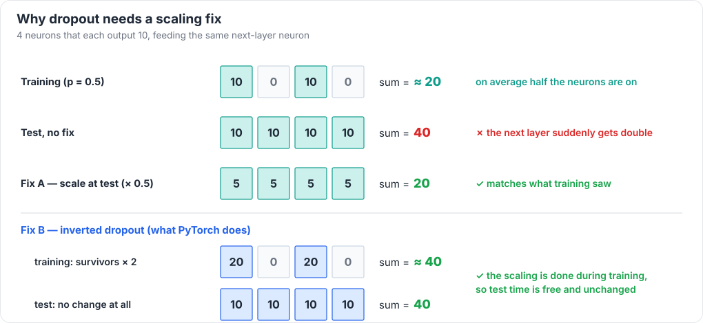

- **Training ($p = 0.5$):** 4 neurons each output 10. On average only 2 are on, so the next neuron is used to receiving a sum around **20**.
- **Test, no fix:** all 4 are on → it suddenly receives **40**, double what it learned on. Predictions break.

There are two fixes, and they give the same result:

**Fix A — scale at test time.** Multiply every output at test time by the **keep probability** $(1 - p)$. Here $1 - 0.5 = 0.5$: each 10 becomes 5, and the sum is 20 again. ✓

**Fix B — inverted dropout (what PyTorch does).** Do the scaling **during training instead**: divide the surviving neurons by $(1 - p)$. With $p = 0.5$ the survivors are multiplied by 2: two neurons output 20 each, and the sum is ~40. At test time nothing has to change: all four output 10, and the sum is 40. ✓

Fix B is better in practice: test time costs nothing extra, and `model.eval()` just switches the mask off.

> **⚠️ Watch out for what "p" means.** In PyTorch, `nn.Dropout(p=0.5)` means *p = probability of dropping*. Some papers and slides (including older CS231n notes) use *p = probability of keeping*. With p = 0.5 both are the same number, which hides the difference. With p = 0.2 they're not: drop 20% → keep 80% → scale by 1/0.8.

**Why the scaling equals "averaging all the sub-networks":** for a single linear layer, multiplying by the keep probability gives *exactly* the average output over all possible random masks, without running the model thousands of times. For deep networks with non-linearities it's a very good approximation, not an exact identity.

## 3.5 In PyTorch

```python
self.dropout = nn.Dropout(p=0.5)      # p = probability of DROPPING

def forward(self, x):
    ...
    x = self.flatten(x)
    x = self.dropout(x)                # only active in model.train()
    logits = self.linear(x)
    return logits
```

Dropout is most common **before fully connected layers** (AlexNet and VGG used it there). Inside conv layers people often use `nn.Dropout2d`, which drops whole channels instead of single pixels.

---

# 4. Activation functions

## 4.1 Why we need them at all

Conv and linear layers only multiply and add. Stacking 100 of them without anything in between is still just one big multiply-and-add: **one linear function**. (Part 1, §22, shows this with matrices.) An activation function placed after each layer bends the line, and that is what lets a deep network learn complicated shapes.

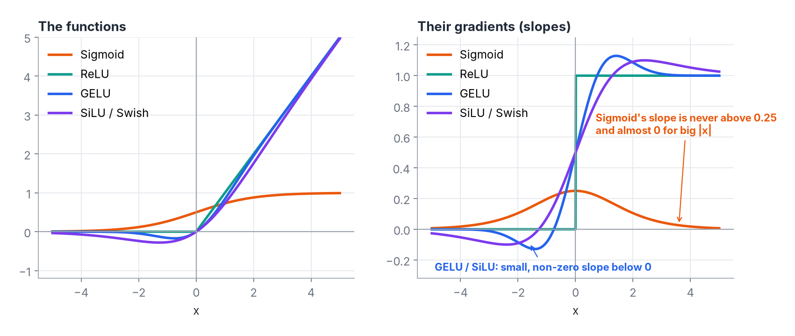

*Real computation: each function (left) and its gradient (right), computed with PyTorch autograd.*

## 4.2 Sigmoid: historic, avoid in hidden layers

$$
\sigma(x) = \frac{1}{1 + e^{-x}}
$$

It squashes any number into the range 0 to 1. Its big flaw is the **vanishing gradient**:

- For large positive or large negative $x$, the curve is **flat**, so its slope (gradient) is almost 0.
- Even at its steepest point ($x = 0$), the slope is only **0.25**.

Backpropagation **multiplies** these slopes layer by layer. After 10 sigmoid layers, even in the best case:

$$
0.25^{10} \approx 0.00000095
$$

The gradient reaching the first layers is about a millionth of what it was. Those layers basically stop learning.

## 4.3 ReLU: the classic CNN standard

$$
\text{ReLU}(x) = \max(0, x)
$$

- For positive $x$: output $x$, slope **exactly 1**. Multiplying by 1 again and again never shrinks the gradient, so **no vanishing gradient on the positive side**.
- For negative $x$: output 0, slope 0.
- Super cheap to compute (just a comparison).

Its weakness is the **"dying ReLU"**: if a neuron's input is negative for every training example, its gradient is always 0, so its weights never update. That neuron is "dead" forever. (Remember the dark feature maps in [`figures/README.md`](figures/README.md)? A map that is black for *every* image would be a dead filter.)

## 4.4 GELU and SiLU (Swish): the modern standard

Used in almost all modern Transformers and large language models.

$$
\text{GELU}(x) = x \cdot \Phi(x) \qquad\qquad \text{SiLU}(x) = x \cdot \text{sigmoid}(x)
$$

($\Phi$ is the bell-curve "cumulative" function: the probability that a standard normal number is below $x$.)

Look at the plots above:

- For large positive $x$ they behave like ReLU (output ≈ $x$).
- For large negative $x$ they behave like ReLU (output ≈ 0).
- **Near zero they curve smoothly** instead of having a sharp corner, and slightly below zero they have a **small, non-zero slope**. So a neuron that is slightly negative still gets *some* gradient and can recover. That fixes the dying-ReLU problem.

| Function | Use it for | Main issue |
|---|---|---|
| Sigmoid | output layer for yes/no probabilities only | vanishing gradient in hidden layers |
| ReLU | default for CNNs | dying neurons |
| GELU / SiLU | Transformers, modern CNNs | a bit more compute |

In PyTorch: `nn.ReLU()`, `nn.GELU()`, `nn.SiLU()`, `nn.Sigmoid()`.

---

# 5. Classic architectures: AlexNet and VGG

## 5.1 AlexNet (2012): the moment deep learning took off

AlexNet won the ImageNet challenge (1,000 classes, about 1.2 million training images) by a huge margin: about 15% top-5 error versus 26% for the next best entry. It had 5 conv layers and 3 fully connected layers, used **ReLU** and **dropout**, and was trained on **GPUs**. It proved that big CNNs trained on GPUs beat hand-designed features.

## 5.2 VGG (2014): one clean rule, repeated

VGG made CNN design simple and uniform:

- use **only 3×3 convolutions** (stride 1, padding 1, so the size never changes inside a stage),
- after a few convs, **max pool** to halve height and width,
- at the end, three fully connected layers: 4096 → 4096 → 1000.

```
[conv3-64  ×2] → pool → [conv3-128 ×2] → pool → [conv3-256 ×3] → pool
→ [conv3-512 ×3] → pool → [conv3-512 ×3] → pool → FC 4096 → FC 4096 → FC 1000
```

(This is VGG-16: 13 conv + 3 FC = 16 weight layers, about 138 million parameters.)

## 5.3 Why stack three 3×3 convs instead of one 7×7?

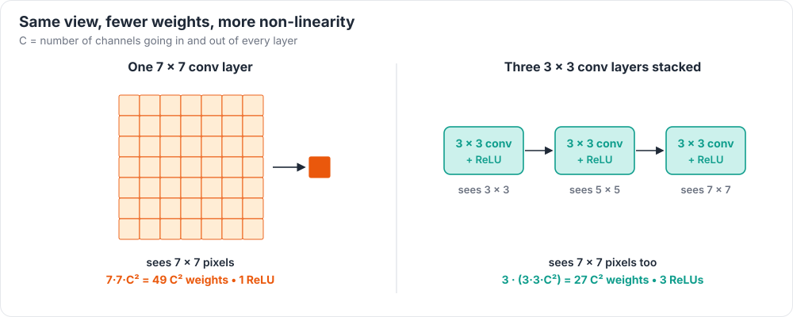

**Reason 1 — Same view of the image.** One 3×3 layer sees a 3×3 patch. Stack a second one: each of its outputs sees 3×3 of the first layer, which covers 5×5 of the input. A third one covers **7×7**, the same as a single 7×7 filter.

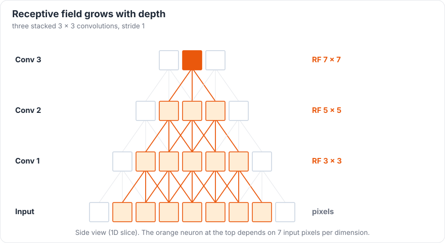

**Reason 2 — Fewer weights.** Say every layer has $C$ channels in and $C$ channels out.

- One 7×7 layer: each output channel needs a $7 \times 7 \times C$ filter, and there are $C$ of them: $7 \cdot 7 \cdot C \cdot C = 49C^2$ weights.
- Three 3×3 layers: $3 \times (3 \cdot 3 \cdot C \cdot C) = 27C^2$ weights.

$27 / 49 \approx 0.55$, so about **45% fewer weights** for the same view. With $C = 256$ that's 3.2 million versus 1.8 million.

**Reason 3 — More non-linearity.** Three layers means **three ReLUs** instead of one. More bends means the network can learn richer, more complex features.

**Bonus — why odd sizes like 3×3?** An odd filter has a true **center pixel**, and padding 1 on each side keeps the size exactly. A 4×4 filter has no center, and you'd need uneven padding.

---

# 6. ResNet and residual connections

## 6.1 The puzzle: deeper got worse

If 20 layers work well, 56 should work even better, right? Researchers tried it with plain CNNs (just conv layers stacked) and got a shock:

**The 56-layer network was worse than the 20-layer network: on test error AND on training error.**

| What we saw | Overfitting would look like | What actually happened |
|---|---|---|
| Training error | low | **higher** for 56 layers |
| Test error | high | higher for 56 layers |

So this **was not overfitting**. The 56-layer network couldn't even fit the training data well.

## 6.2 The thought experiment

A 56-layer network can do **everything** a 20-layer network can. Here's how:

1. Copy the 20 trained layers.
2. Make the extra 36 layers do **nothing**: output exactly their input. This is the **identity function**, $f(x) = x$.

That 56-layer network would score exactly as well as the 20-layer one. So a good solution **exists**. The problem is that **gradient descent can't find it**.

**Why not?** Learning "do nothing" is surprisingly hard for conv + ReLU layers. The weights start random, so the extra layers start out **scrambling** the good features coming from earlier layers instead of passing them through. Gradients also get weaker as they travel back through 50+ layers. The ResNet authors showed the problem shows up even when Batch Norm keeps the signals healthy, so the deeper reason is simply that this is a **hard optimization problem**: the optimizer gets stuck in poor solutions.

## 6.3 The fix: the residual (skip) connection

The idea: instead of asking two conv layers to produce the whole output $H(x)$, add a **skip connection**: a wire that copies the input $x$ around the two layers and **adds** it back.

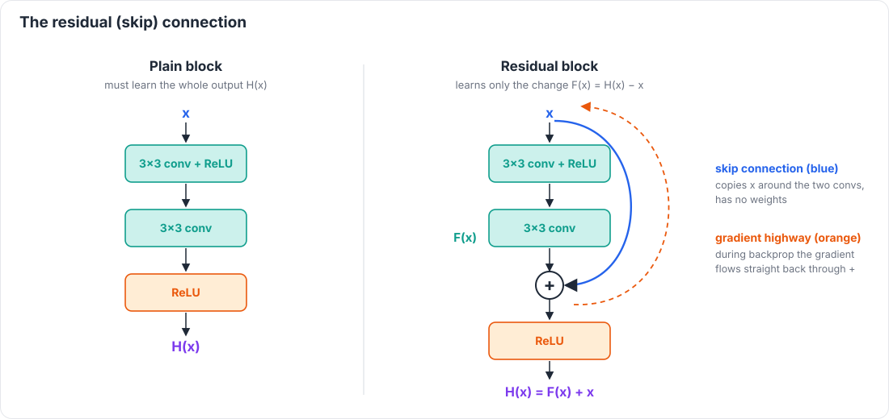

$$
H(x) = F(x) + x
$$

- $F(x)$, the **residual**, is what the two conv layers compute.
- The conv layers now only have to learn the **change** (the "delta") that should be applied to $x$:

$$
F(x) = H(x) - x
$$

**Everyday analogy:** editing a document. Plain block: "Rewrite the whole document from scratch." Residual block: "Here's the document; just write down the corrections." Writing only the corrections is much easier, and if no corrections are needed, you write nothing.

## 6.4 Why it works so well

**1. "Do nothing" becomes the easiest thing in the world.** If a block isn't needed, gradient descent just pushes its conv weights toward 0. Then $F(x) = 0$ and the output is $0 + x = x$: a perfect pass-through. That was exactly the solution plain networks couldn't find.

**2. Nothing gets erased.** Each skip wire carries the features from earlier blocks forward untouched. A badly initialized block can only *add* a small change; it can't destroy what came before.

**3. A gradient highway.** Look at the derivative of a residual block:

$$
\frac{\partial H}{\partial x} = \frac{\partial F}{\partial x} + 1
$$

That **"+ 1"** is the magic. Even if $\frac{\partial F}{\partial x}$ is tiny, the gradient still passes through the `+` with nothing subtracted. In a plain network, gradients through many layers are a product of many possibly-small numbers. In a ResNet, each block contributes $(\text{something} + 1)$, so there is always a direct path back to the first layers. That's why ResNets with 100–152 layers train smoothly (ResNet-152 won ImageNet 2015).

## 6.5 The shape rule

$F(x) + x$ is **element-wise addition**: number by number. So both tensors must have **exactly the same shape**.

- **Inside a stage:** 3×3 convs with stride 1 and padding 1 keep the size, and the channel count stays the same, so $F(x)$ and $x$ match. ✓
- **Between stages:** ResNet halves height and width and doubles the channels. Now $F(x)$ has a different shape than $x$. The fix: put a cheap **1×1 conv with stride 2** on the skip wire too, so it reshapes $x$ to match.

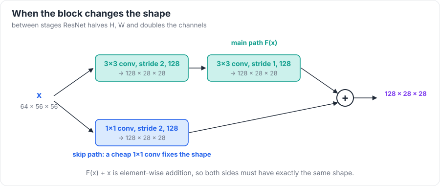

(Deeper ResNets, 50 layers and up, use a "bottleneck" block, 1×1 → 3×3 → 1×1, to save computation. Same skip idea.)

## 6.6 In PyTorch

```python
class ResidualBlock(nn.Module):
    def __init__(self, channels):
        super().__init__()
        self.conv1 = nn.Conv2d(channels, channels, 3, padding=1, bias=False)
        self.bn1   = nn.BatchNorm2d(channels)
        self.conv2 = nn.Conv2d(channels, channels, 3, padding=1, bias=False)
        self.bn2   = nn.BatchNorm2d(channels)
        self.relu  = nn.ReLU()

    def forward(self, x):
        out = self.relu(self.bn1(self.conv1(x)))   # F(x), first half
        out = self.bn2(self.conv2(out))             # F(x), second half
        out = out + x                               # the skip connection: F(x) + x
        return self.relu(out)
```

The only "new" line compared to a plain block is `out = out + x`.

---

# 7. Weight initialization

## 7.1 Why the starting numbers matter

Before training, every weight gets a random starting value. It seems like a small detail, but if those random numbers are **too small** or **too large**, the signal dies or explodes before training even starts.

## 7.2 The lecture's experiment (we ran it)

A 6-layer fully connected network, 4096 neurons per layer, ReLU after each layer. Weights are random normal numbers times a scale. We feed in random data and measure **how big the numbers are** (their standard deviation) at each layer.

```python
dims = [4096] * 7
x = np.random.randn(16, 4096)                 # 16 random inputs
for Din, Dout in zip(dims[:-1], dims[1:]):
    W = scale * np.random.randn(Din, Dout)    # try scale = 0.01, 0.05, and Kaiming
    x = np.maximum(0, x.dot(W))               # linear layer + ReLU
```

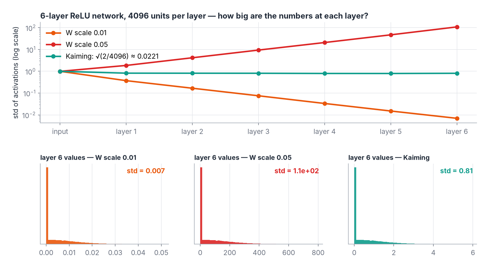

*Real experiment. Measured standard deviation at each layer:*

| Layer | input | 1 | 2 | 3 | 4 | 5 | 6 |
|---|---|---|---|---|---|---|---|
| scale 0.01 | 1.00 | 0.37 | 0.17 | 0.075 | 0.033 | 0.015 | **0.007** |
| scale 0.05 | 1.00 | 1.86 | 4.17 | 9.4 | 20.8 | 47 | **109** |
| Kaiming (≈ 0.0221) | 1.00 | 0.82 | 0.82 | 0.81 | 0.80 | 0.79 | **0.81** |

- **scale 0.01:** every layer shrinks the signal to about 45% of its size. After 6 layers it's 140 times smaller. In a deeper net it would be essentially zero: **dead signal, vanishing gradients**.
- **scale 0.05:** every layer multiplies the signal by about 2.25. After 6 layers it's 100 times bigger: **exploding** numbers.
- **Kaiming:** the size stays **steady** from layer to layer. That's what we want.

The difference between 0.01 and 0.05 looks tiny, but it gets multiplied 6 times (or 100 times in a deep network).

## 7.3 Where the Kaiming number comes from

We want to pick the weight spread so that the signal keeps the same size layer after layer. Three simple facts get us there.

**Fact 1 — adding things up multiplies the spread.** One neuron computes $z = w_1 x_1 + w_2 x_2 + \dots + w_n x_n$, a sum of $n$ random products. For independent random numbers, **variances add up** (variance = spread squared). So $n$ similar products give:

$$
\text{Var}(z) = n \cdot \text{Var}(w) \cdot \mathbb{E}[x^2]
$$

More inputs ($n$ bigger) means a bigger spread. That's why the right weight size depends on $n$.

**Fact 2 — ReLU throws away half.** ReLU sets all negative values to 0. If $z$ is centered at 0, half of it is thrown away, and the "size" $\mathbb{E}[x^2]$ that reaches the next layer is half of $\text{Var}(z)$:

$$
\mathbb{E}[\text{ReLU}(z)^2] = \tfrac{1}{2}\,\text{Var}(z)
$$

**Fact 3 — put them together.** Going from one layer's $z$ to the next layer's $z$:

$$
\text{Var}(z_{\text{next}}) = n \cdot \text{Var}(w) \cdot \tfrac{1}{2}\,\text{Var}(z) = \left(\frac{n}{2}\,\text{Var}(w)\right)\text{Var}(z)
$$

Every layer multiplies the variance by $\frac{n}{2}\text{Var}(w)$. To keep it steady, this multiplier must be exactly **1**:

$$
\frac{n}{2}\,\text{Var}(w) = 1 \quad\Longrightarrow\quad \text{Var}(w) = \frac{2}{n} \quad\Longrightarrow\quad \text{std}(w) = \sqrt{\frac{2}{n}}
$$

This is **Kaiming (He) initialization**. $n$ is called **fan-in**: the number of inputs to one neuron.

**Check with our experiment:** the per-layer multiplier for the std is $\sqrt{\tfrac{n}{2}} \times \text{scale} = \sqrt{2048} \times \text{scale}$:

| scale | $\sqrt{2048} \times$ scale | measured ratio between layers |
|---|---|---|
| 0.01 | 0.45 | 0.167 / 0.371 = 0.45 ✓ |
| 0.05 | 2.26 | 4.17 / 1.86 = 2.24 ✓ |
| 0.0221 | 1.00 | 0.815 / 0.82 = 0.99 ✓ |

**Why does Kaiming settle at 0.82 and not 1.0?** ReLU outputs are never negative, so their mean isn't 0 and their standard deviation is smaller than their overall size. What Kaiming keeps constant is the size of the signal $\mathbb{E}[x^2]$, and it does: the std just settles at a steady 0.82 (that is $\sqrt{1 - 1/\pi}$) instead of drifting.

## 7.4 Fan-in for conv layers

For a conv layer, one output number looks at a $k \times k$ patch across **all** input channels:

$$
n = k \times k \times C_{\text{in}}
$$

| Layer | fan-in $n$ | Kaiming std $\sqrt{2/n}$ |
|---|---|---|
| FC layer with 4096 inputs | 4096 | 0.0221 |
| Lecture's example: 3×3 conv, 6 input channels | $3 \cdot 3 \cdot 6 = 54$ | 0.192 |
| Our `conv2`: 3×3 conv, 16 input channels | $3 \cdot 3 \cdot 16 = 144$ | 0.118 |

## 7.5 In PyTorch

PyTorch already initializes every `Conv2d` and `Linear` automatically, but **not with Kaiming's $\sqrt{2/n}$**. Its default is a smaller variant: for our `conv2` it gives a std of about **0.048**, roughly 2.5× smaller than Kaiming's 0.118 (we measured it). For shallow networks like `MySimpleCNN` that's fine. For deep plain ReLU networks, set it explicitly:

```python
for m in model.modules():
    if isinstance(m, (nn.Conv2d, nn.Linear)):
        nn.init.kaiming_normal_(m.weight, nonlinearity="relu")   # std = sqrt(2 / fan_in)
        if m.bias is not None:
            nn.init.zeros_(m.bias)
```

(For tanh or no activation, the matching rule is **Xavier/Glorot**: $\text{Var}(w) = 1/n$, without the "2", because nothing is thrown away.)

**Normalization (§2) and good initialization solve the same problem from two sides.** Initialization makes the numbers start in a good range; normalization keeps them there during training.

---

# Part B — Training a CNN

# 8. Data preprocessing

Before an image enters the first layer, we **normalize each color channel** so the input starts at mean 0 and standard deviation 1. It's the same idea as §2, applied once to the raw data:

$$
\text{normalized pixel} = \frac{\text{pixel} - \mu_{\text{channel}}}{\sigma_{\text{channel}}}
$$

Each channel (R, G, B) gets its own $\mu$ and $\sigma$.

**Practical rules:**

1. **Using a pre-trained model? Use the statistics it was trained with.** For ImageNet models:
   ```python
   transforms.Normalize(mean=[0.485, 0.456, 0.406], std=[0.229, 0.224, 0.225])
   ```
   The pre-trained filters expect inputs in exactly that range.
2. **Always compute the statistics on the training set, then use those same numbers for validation and test images.** Never compute separate stats on the test set: the test set must be treated as unseen data.

**Our own pipeline:** `first_pytorch_training/dataset.py` uses `Normalize((0.5,), (0.5,))`. That maps pixels from [0, 1] to [−1, 1], which is a common, simple choice, but it is not the true mean and std of FashionMNIST. The real values are about **mean 0.286 and std 0.353** (we measured 0.287 / 0.352 on the test images; you should compute them on the training images). Using `Normalize((0.286,), (0.353,))` would give exactly mean 0, std 1. For a small network either works fine.

---

# 9. Data augmentation

## 9.1 The universal regularization pattern

Dropout (§3) and augmentation follow the **same two-step pattern**, and so does almost every regularization trick in deep learning:

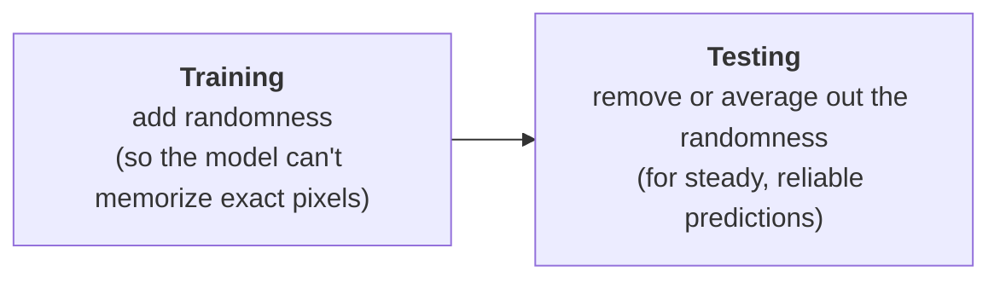

| Technique | Randomness during training | At test time |
|---|---|---|
| Dropout | random neurons switched off | all neurons on (scaled) |
| Data augmentation | random flips, crops, colors | no randomness (or average several fixed versions) |

## 9.2 What augmentation is

We randomly change each training image in ways that **do not change its label**. A flipped cat is still a cat. The model sees a slightly different version every epoch, so it can't memorize exact pixels and must learn the real pattern.

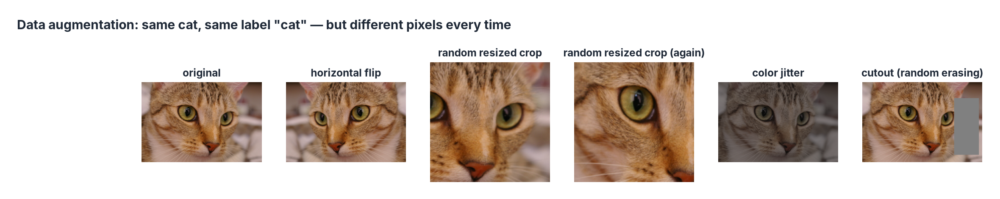

*Real transforms from `torchvision`, applied to one photo.*

## 9.3 Horizontal flips

Mirror the image left-to-right. Great for everyday objects: cats, cars and clothes look natural mirrored.

**But be careful:** never flip when it changes the meaning. Mirrored text is not valid text, so flips are wrong for OCR (reading text), and a mirrored "b" becomes a "d". Vertical flips are rarely used for photos, since upside-down cats are unusual (but they are fine for satellite or microscope images, where "up" doesn't exist).

For our FashionMNIST: horizontal flips are safe. A mirrored shoe is still a shoe.

## 9.4 Random resized crop: zoom, then cut

CNNs like ResNet need a **fixed input size**, like 224×224. Training uses two steps:

1. **Zoom:** pick a random size $L$ (for example between 256 and 480), and resize the image so its **shorter side** equals $L$.
2. **Cut:** cut out a random **224×224** square.

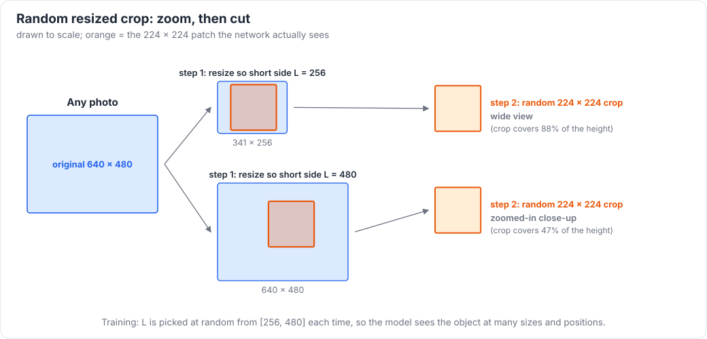

- **Small $L$ (256):** the crop covers almost the whole image → a **wide view**.
- **Large $L$ (480):** the crop covers less than half the image → a **zoomed-in close-up**.

So the model learns to recognize objects at many sizes and positions. (`torchvision.transforms.RandomResizedCrop` does a similar idea in one step: it crops a random area and resizes it to 224.)

## 9.5 Testing: one crop, or many (TTA)

At test time we want no randomness. Two options:

| Option | How | When |
|---|---|---|
| **Standard** | resize the shorter side to 256, take **one center** 224×224 crop | real-time apps, where speed matters |
| **Test-Time Augmentation (TTA)** | resize to several fixed sizes; at each, take 4 corner crops + 1 center crop, plus their flips; **average** all the predicted scores | competitions and offline benchmarks, where accuracy matters more than speed |

TTA usually gives a **1–2% accuracy boost**, at the cost of running the model many times per image.

## 9.6 Color jitter and cutout

- **Color jitter:** randomly change brightness, contrast, saturation and hue. The model learns to recognize objects under bad lighting or a different camera.
- **Cutout / random erasing:** cover a random rectangle with a gray block. The model learns to recognize an object even when part of it is hidden. This is the same "don't rely only on the ears" idea as dropout (§3.2), but applied to pixels.

## 9.7 In PyTorch

```python
from torchvision import transforms

train_transform = transforms.Compose([
    transforms.RandomResizedCrop(224),          # zoom + cut
    transforms.RandomHorizontalFlip(),          # 50% chance to mirror
    transforms.ColorJitter(0.4, 0.4, 0.4),      # brightness, contrast, saturation
    transforms.ToTensor(),
    transforms.Normalize([0.485, 0.456, 0.406], [0.229, 0.224, 0.225]),
    transforms.RandomErasing(),                 # cutout (works on tensors, so after ToTensor)
])

test_transform = transforms.Compose([           # no randomness
    transforms.Resize(256),
    transforms.CenterCrop(224),
    transforms.ToTensor(),
    transforms.Normalize([0.485, 0.456, 0.406], [0.229, 0.224, 0.225]),
])
```

**Important:** augmentation goes **only** in the training transform. Validation and test use the fixed, non-random version.

---

# 10. Transfer learning

## 10.1 The idea

Training a big CNN from scratch needs millions of images and lots of GPU time. Most of us have neither.

The good news: **the early layers of a CNN learn universal things.** Edges, colors, textures and simple shapes are useful for almost any image task. (We saw edge detectors appear in our own `conv1` in [`figures/README.md`](figures/README.md).) Only the last layers learn task-specific concepts like "golden retriever".

So we can take a model **already trained on a huge dataset** like ImageNet, keep what it learned, and only adapt it to our task.

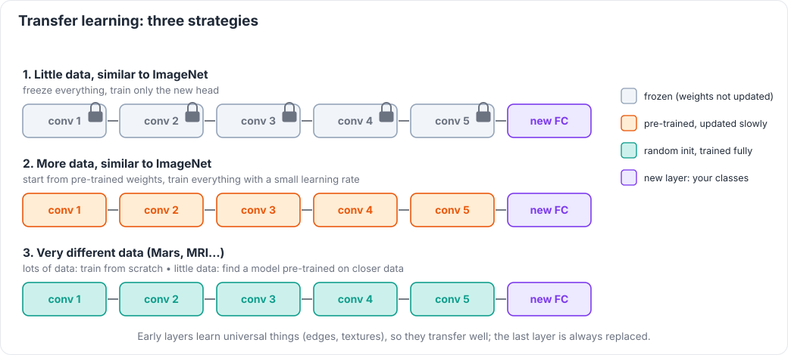

## 10.2 Which strategy to use

| Your situation | What to do |
|---|---|
| **Very little data, similar to ImageNet** (e.g. classifying dog breeds) | **Freeze** the whole pre-trained network (use it as a fixed feature extractor). Replace only the last 1000-class layer with a new one for your classes (Kaiming init), and train **only that layer**. |
| **More data, similar to ImageNet** | **Fine-tune everything:** start from the pre-trained weights, replace the last layer, and train **all** layers with a **smaller learning rate**, so you adjust the good weights instead of wrecking them. |
| **Very different data** (Mars terrain, medical MRI) | **Lots of data:** train from scratch, or start from pre-trained weights and compare. **Little data:** look for a model pre-trained on data closer to yours (e.g. a medical-imaging model). |

A modern, cheaper way to fine-tune big models is **LoRA**: instead of changing every weight, it learns small "low-rank" corrections to them, which needs much less memory.

## 10.3 In PyTorch

```python
import torch.nn as nn
from torchvision import models

# 1. load a ResNet-18 pre-trained on ImageNet
model = models.resnet18(weights=models.ResNet18_Weights.DEFAULT)

# 2. strategy 1: freeze everything
for param in model.parameters():
    param.requires_grad = False          # no gradients → these weights never change

# 3. replace the last layer (1000 ImageNet classes → our 10 classes)
model.fc = nn.Linear(model.fc.in_features, 10)   # new layer: trainable by default

# 4. give the optimizer only the trainable parameters
optimizer = torch.optim.Adam(model.fc.parameters(), lr=1e-3)

# strategy 2 (fine-tune everything): skip step 2, and use a small learning rate
# optimizer = torch.optim.Adam(model.parameters(), lr=1e-4)
```

Useful model libraries: `torchvision.models` and **timm** (PyTorch Image Models), which has hundreds of pre-trained models.

**Note for FashionMNIST:** ImageNet models expect 3-channel color images around 224×224. FashionMNIST is 1-channel 28×28, so you'd repeat the gray channel 3 times and resize. Small grayscale images are also quite different from ImageNet photos, so expect less benefit than on natural photos.

---

# 11. Debugging and choosing hyperparameters

The lecture gives a step-by-step engineering workflow for building a model.

## 11.1 Step 1 — Sanity check: overfit a tiny sample first

Before training on the full dataset, train on just **a few examples** (one batch or less) with regularization turned **off**. A working model **must** be able to memorize them: the training loss should go to (almost) **zero**.

If it can't memorize 16 images, something is broken, either **a bug in your code** or **a broken learning rate**, and training on 60,000 images won't fix that. This test takes seconds instead of hours.

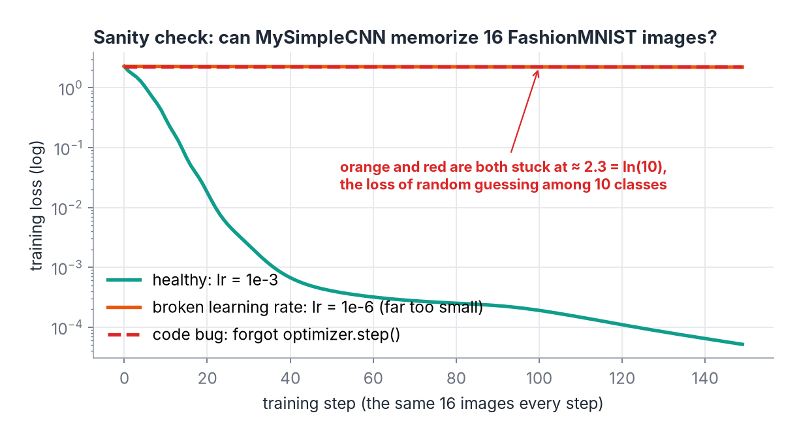

*Real experiment: our `MySimpleCNN` on the same 16 FashionMNIST images for 150 steps.*

| Run | Final loss | Accuracy on the 16 images | Verdict |
|---|---|---|---|
| healthy, lr = 1e-3 | 0.00005 | 100% | ✓ the pipeline works |
| learning rate far too small, lr = 1e-6 | 2.21 | 31% | ✗ broken learning rate |
| bug: forgot `optimizer.step()` | 2.28 | 6% | ✗ code bug |

**A useful number to remember:** with 10 classes, a model that guesses randomly has a cross-entropy loss of $\ln(10) \approx 2.30$. If your loss sits at 2.3 and won't move, the model hasn't learned anything yet.

*(We also tried learning rates that are far too large, 1.0 and even 100. With the Adam optimizer the model still memorized the 16 images, because Adam controls its own step size. With plain SGD a huge learning rate typically makes the loss explode, so "too high" is still a common failure.)*

## 11.2 Step 2 — Find the learning rate first

The learning rate is the most important hyperparameter, so tune it **before** anything else. Do a **coarse sweep**: try values spread across powers of 10, train each for about one epoch, and compare the training loss.

**Pick the one whose loss drops fastest and keeps dropping without blowing up.**

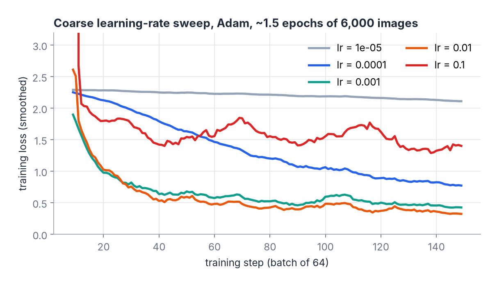

*Real experiment: `MySimpleCNN`, Adam, 150 steps of batch 64 on 6,000 FashionMNIST images.*

| Learning rate | Loss after 150 steps | Reading |
|---|---|---|
| 1e-5 | 2.11 | far too slow: barely moved from 2.3 |
| 1e-4 | 0.77 | learning, but slowly |
| 1e-3 | 0.43 | good |
| 1e-2 | 0.33 | good: fastest here |
| 1e-1 | 1.40 | too high: jumpy, and stuck high |

So the good range here is **1e-3 to 1e-2**. A finer search would then try values between those two.

## 11.3 Step 3 — Watch training vs validation curves

Plot training and validation accuracy (or loss) every epoch, as your `plot_losses` already does. The **gap** between the two curves tells you what to do next.

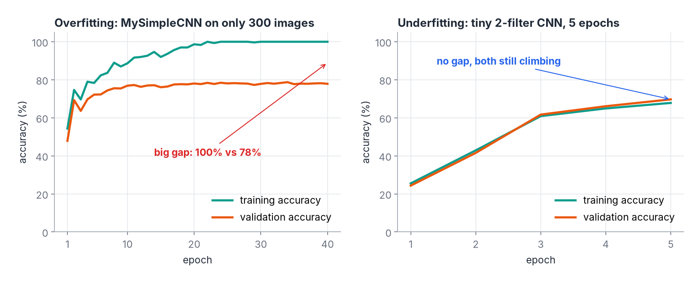

*Real experiments on FashionMNIST.*

**Left — Overfitting (big gap).** `MySimpleCNN` trained on only 300 images: training accuracy reaches **100%**, but validation stays at **78%**. It memorized the 300 images instead of learning general patterns. Fixes:
- more data, or **more data augmentation** (§9),
- **dropout** (§3),
- **weight decay** (a penalty on large weights: `torch.optim.Adam(..., weight_decay=1e-4)`).

**Right — Underfitting (no gap, both still climbing).** A tiny CNN with only 2 filters, trained for 5 epochs: training and validation are almost equal (**68% and 70%**), and both are still rising. The model hasn't learned enough yet. Fixes:
- **train longer**,
- use a **bigger model** (more filters, more layers).

| What you see | Diagnosis | What to do |
|---|---|---|
| train ≫ validation | overfitting | augmentation, dropout, weight decay, more data |
| train ≈ validation, both low, still rising | underfitting | train longer, bigger model |
| train ≈ validation, both high, flat | 🎉 good fit | done (or try a bigger model + regularization) |

## 11.4 Step 4 — Use random search, not grid search

When tuning **several** hyperparameters at once (say learning rate and dropout), there are two ways to choose which combinations to try.

- **Grid search:** pick 3 values for each and try every combination (3 × 3 = 9 runs).
- **Random search:** pick 9 combinations completely at random.

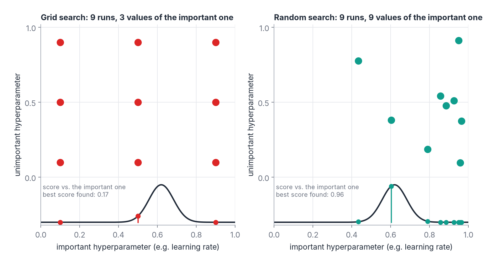

*Real simulation with a made-up score function in which only one hyperparameter matters.*

**Why random wins:** usually some hyperparameters matter a lot (like the learning rate) and others barely matter. In grid search, each value of the important one is repeated 3 times with different values of the unimportant one. Those repeats are wasted runs. Out of 9 runs, you only ever try **3** different learning rates.

Random search uses every run to try a **new** value of every hyperparameter, so 9 runs try **9** different learning rates. In this simulation, the grid's best score was 0.17 (it stepped right over the narrow sweet spot), while random search found 0.96. (One random run can be lucky or unlucky, but on average random search explores the important direction much better.)

**Tip:** sample the learning rate on a **log scale** (e.g. `10 ** random.uniform(-5, -1)`), not uniformly, because 1e-4 and 1e-3 are as different as 1e-2 and 1e-1.

---

# 12. Cheat sheet

| Topic | One-line summary |
|---|---|
| **Normalization** | Subtract the mean, divide by the std, then learn a scale γ and shift β. Batch Norm averages over the batch; Layer/Instance/Group Norm average inside one image. |
| **Batch Norm modes** | `model.train()` uses batch statistics; `model.eval()` uses the saved running averages. |
| **Dropout** | Randomly switch off neurons during training; PyTorch scales survivors by 1/(1−p), so test time needs no change. |
| **Sigmoid** | Max slope 0.25 → gradients vanish in deep nets. Use only for output probabilities. |
| **ReLU** | Slope 1 for positives, 0 for negatives. Fast, standard, but neurons can die. |
| **GELU / SiLU** | Smooth ReLU with a small slope below 0. Modern default in Transformers. |
| **VGG** | Only 3×3 convs. Three 3×3 = one 7×7 view, with 45% fewer weights and 3 ReLUs. |
| **ResNet** | $H(x) = F(x) + x$. Layers learn only the change; the "+1" in the gradient makes 100+ layers trainable. |
| **Skip shapes** | The two sides of `+` must match; use a 1×1 stride-2 conv on the skip when downsampling. |
| **Kaiming init** | std $= \sqrt{2/\text{fan-in}}$, fan-in $= k \cdot k \cdot C_{in}$ for conv. Keeps the signal steady through ReLU layers. |
| **Preprocessing** | Normalize per channel with **training-set** stats (or ImageNet stats for pre-trained models). |
| **Augmentation** | Label-preserving random changes, only during training. Flips, random resized crop, color jitter, cutout. |
| **TTA** | Average predictions over several fixed crops/flips at test time: +1–2% accuracy, slower. |
| **Transfer learning** | Little data → freeze and train a new head. More data → fine-tune all with a small LR. |
| **Debugging** | First overfit a tiny sample (loss → 0). Loss stuck at ln(10) ≈ 2.3 = no learning. |
| **Learning rate** | Tune it first, with a coarse log-scale sweep. |
| **Curves** | Big train/val gap → overfitting. No gap, both low and rising → underfitting. |
| **Search** | Random search beats grid search when only some hyperparameters matter. |

---

# 13. Practice questions

## Part A — Building

1. A batch has shape (8, 32, 14, 14). For **Batch Norm**, how many numbers are averaged to get one μ? For **Layer Norm**? For **Instance Norm**?
2. Why does Batch Norm behave differently in `model.train()` and `model.eval()`? What would go wrong at test time with a batch of 1 image if it didn't?
3. Why is a conv layer's `bias` usually set to `False` when Batch Norm comes right after it?
4. With `nn.Dropout(p=0.2)`, by what number does PyTorch multiply the surviving neurons during training? What happens at test time?
5. Explain in your own words why a 10-layer sigmoid network struggles to train, using the number 0.25.
6. What is a "dead" ReLU neuron, and how do GELU and SiLU avoid it?
7. Compute the number of weights (ignoring bias) for one 5×5 conv versus two stacked 3×3 convs, with 64 channels in and out. Do they see the same receptive field?
8. A 56-layer plain network has **higher training error** than a 20-layer one. Why is this *not* overfitting?
9. In a residual block, what do the conv layers have to learn if the best thing to do is "nothing"? Why is that easy?
10. Why does the "+ 1" in $\frac{\partial H}{\partial x} = \frac{\partial F}{\partial x} + 1$ help gradients reach early layers?
11. A residual block takes a 64 × 56 × 56 input, and its main path outputs 128 × 28 × 28. What must the skip connection do?
12. What is the Kaiming std for a conv layer with a 3×3 kernel and 32 input channels?

## Part B — Training

13. Why must test images be normalized with the **training** set's mean and std?
14. Give one task where horizontal flipping is a good augmentation and one where it is harmful.
15. In random resized crop with $L = 256$ versus $L = 480$, which gives a wide view and which a close-up? Why?
16. When would you use TTA, and when would you avoid it?
17. You have 500 X-ray images. Which transfer learning strategy would you try first, and why?
18. Your model's training loss stays at 2.30 on a 10-class problem even on 16 images. What does that number tell you? Name two possible causes.
19. Training accuracy is 99%, validation accuracy is 75%. Diagnose it and name three fixes.
20. Explain why 9 random-search runs usually explore the learning rate better than a 3 × 3 grid.

## Part C — Numerical

21. Normalize $[1, 3, 5, 7]$ (step 1 only). Then apply $\gamma = 3, \beta = -1$.
22. In the init experiment, the weight scale was 0.03 with 4096 inputs. By what factor does the std change per layer? After 6 layers?
23. With `nn.Dropout(p=0.5)` and 6 neurons each outputting 4: what is the expected sum the next layer receives during training (with PyTorch's scaling) and at test time?

<details>
<summary><b>Answers to Part C</b></summary>

**21.** μ = 4; differences = [−3, −1, 1, 3]; variance = (9+1+1+9)/4 = 5; σ ≈ 2.236.
x̂ ≈ [−1.342, −0.447, 0.447, 1.342]. Then y = 3x̂ − 1 ≈ [−5.025, −2.342, 0.342, 3.025].

**22.** Factor per layer = √(4096/2) × 0.03 = 45.25 × 0.03 ≈ 1.36. After 6 layers: 1.36⁶ ≈ 6.3 times bigger (it slowly explodes).

**23.** Training: on average 3 survive, each scaled by 1/(1−0.5) = 2 → 3 × 8 = 24. Test: all 6 on, unscaled → 6 × 4 = 24. Same expected sum ✓.

</details>

---

# 14. References

### Lecture

- [Stanford CS231n — Lecture 6 (Spring 2025)](https://www.youtube.com/watch?v=aVJy4O5TOk8&list=PLoROMvodv4rOmsNzYBMe0gJY2XS8AQg16&index=7), instructor Zane Durante.
- [Stanford CS231n course page](https://cs231n.stanford.edu/)

### Original papers (for going deeper)

- Ioffe & Szegedy (2015) — *Batch Normalization*
- Wu & He (2018) — *Group Normalization* (source of the four-cube picture)
- Srivastava et al. (2014) — *Dropout: A Simple Way to Prevent Neural Networks from Overfitting*
- Krizhevsky, Sutskever & Hinton (2012) — *ImageNet Classification with Deep Convolutional Neural Networks* (AlexNet)
- Simonyan & Zisserman (2014) — *Very Deep Convolutional Networks for Large-Scale Image Recognition* (VGG)
- He et al. (2015) — *Deep Residual Learning for Image Recognition* (ResNet)
- He et al. (2015) — *Delving Deep into Rectifiers* (Kaiming initialization)
- Bergstra & Bengio (2012) — *Random Search for Hyper-Parameter Optimization*

### PyTorch documentation

- [BatchNorm2d](https://docs.pytorch.org/docs/stable/generated/torch.nn.BatchNorm2d.html) · [GroupNorm](https://docs.pytorch.org/docs/stable/generated/torch.nn.GroupNorm.html) · [Dropout](https://docs.pytorch.org/docs/stable/generated/torch.nn.Dropout.html)
- [torch.nn.init (kaiming_normal_)](https://docs.pytorch.org/docs/stable/nn.init.html)
- [torchvision transforms](https://docs.pytorch.org/vision/stable/transforms.html) · [torchvision models](https://docs.pytorch.org/vision/stable/models.html)

---

**End of Part 2: Building and Training CNNs**

*Build it with care (normalize, regularize, initialize well). Train it with discipline (overfit a tiny sample, tune the learning rate first, read the curves).*

---

## Practice: learn it by doing

➡️ **[Part 2 Practice](part2-practice.md)**: Phases 8–17, hands-on experiments for every topic above (overfit a tiny batch, learning-rate sweep, initialization, Batch Norm, dropout, augmentation, ResNet, transfer learning). You write the code; the guide tells you what to build, save and look for.
