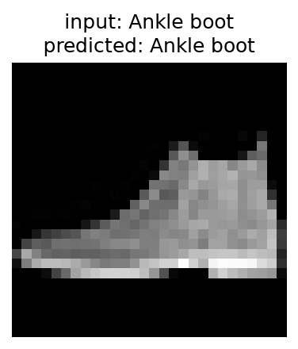
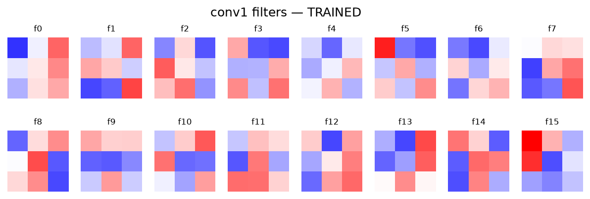
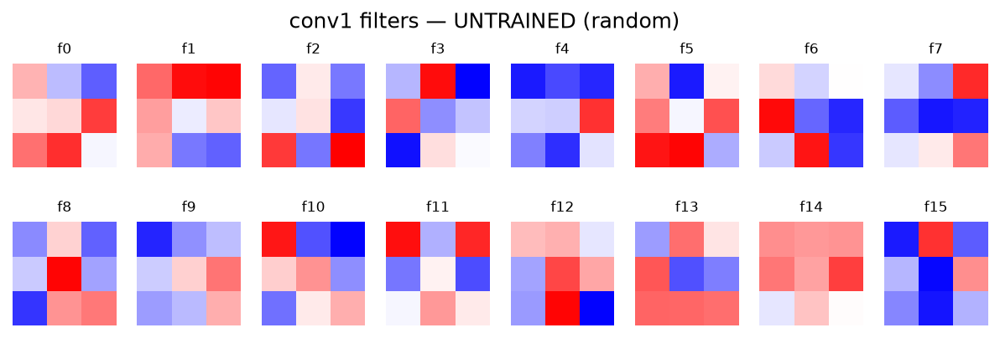
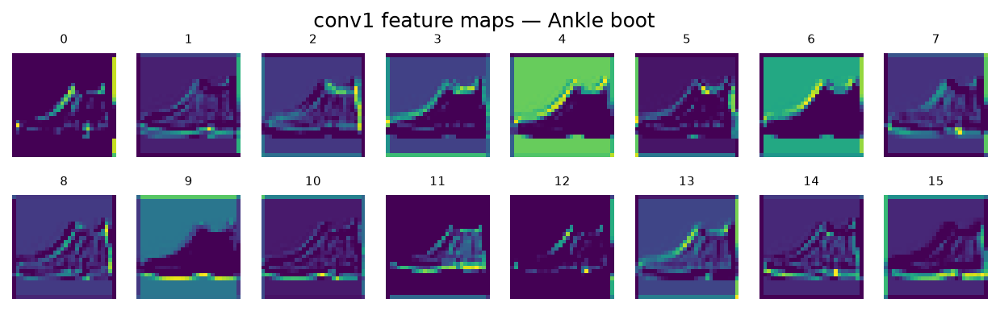
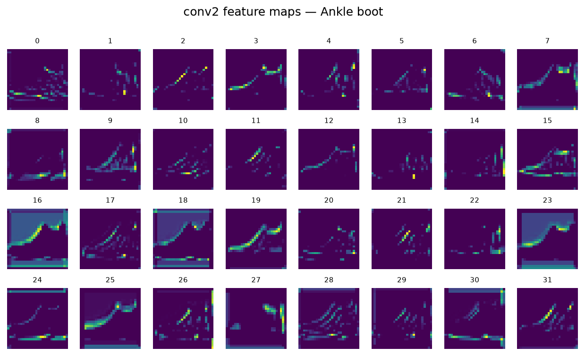

# Phase 7 — Visualizing CNN Learning

What did our trained CNN actually learn? Instead of looking only at the accuracy number, we opened up the trained model and looked inside it.

These figures were produced by [`../visualize_filters.py`](../visualize_filters.py) using the trained checkpoint from [`../training.py`](../training.py).

```bash
pixi run python 06-cnn/visualize_filters.py
```

---

## The experiment

We did **not** train anything new. We took the already-trained `MySimpleCNN` and looked at it in two ways:

1. **Its weights:** the 16 filters of the first conv layer, compared against a fresh, untrained `MySimpleCNN()`.
2. **Its response to one image:** we passed one test image through `conv1` and `conv2` and recorded what each filter reacted to.

### The model

```
input          1 × 28 × 28     (one grayscale image)
conv1 + ReLU  16 × 28 × 28     16 filters of 3×3   → 16 feature maps
conv2 + ReLU  32 × 28 × 28     32 filters of 16×3×3 → 32 feature maps
max pool      32 × 14 × 14
flatten       6272
linear        10               (one score per class)
```

### Key terms

| Term | Meaning |
|---|---|
| **Filter** | A small grid of learned numbers. It is a picture of the pattern it looks for. |
| **Feature map** | The output of one filter on one image: a 28×28 grid that is bright where the filter found its pattern and dark where it didn't. |
| **conv1 feature maps** | 16 maps that answer: *where are the simple patterns (edges) in the image?* |
| **conv2 feature maps** | 32 maps built from the conv1 maps, answering: *where are combinations of edges (parts of the object)?* |

---

## 1. The test image



The first image of the test set, `IMAGE_INDEX = 0`: an **ankle boot**.
The model predicted **Ankle boot**, which is correct. Everything below shows *how* it got there.

---

## 2. conv1 filters: trained vs untrained





Each square is one 3×3 filter. **Blue = negative weight, white = 0, red = positive weight.** All 16 share one color scale, so they can be compared fairly.

**Why compare with an untrained model?** It is our *control*. The untrained model has the same architecture with random starting numbers. Any difference between the two pictures is what training did.

### Observations

- A few trained filters show a clear structure:
  - **f9:** red top row, blue middle row → responds to a **horizontal edge**.
  - **f15:** red on the left, blue elsewhere → responds to a **vertical edge**.
- Overall, the trained and untrained filters look **fairly similar** at this size. A 3×3 filter has only 9 numbers, which is too few to look obviously "learned" to the eye.
- **Conclusion:** filter pictures are weak evidence for small 3×3 kernels. The feature maps below show much more.

---

## 3. conv1 feature maps: what layer 1 noticed



Each of the 16 small images is the ankle boot as seen by one conv1 filter. **Yellow = strong response ("my pattern is here"), dark purple = no response.**

### Observations

| Map(s) | What lights up | The filter detects |
|---|---|---|
| 0, 12 | the slanted top outline of the boot | diagonal edges |
| 2, 8 | the back of the heel | vertical edges |
| 9, 11 | the bottom of the sole | horizontal edges |
| 4, 6 | the empty background above the boot | "outside the object" / background |

- Every map still clearly looks like a boot; conv1 works close to the raw pixels.
- Different filters highlight **edges in different directions**. Nobody programmed this. Training discovered that edges are useful for telling clothing apart.

---

## 4. conv2 feature maps: what layer 2 noticed



conv2 never sees the photo. Its input is the 16 conv1 maps, and each conv2 filter looks at all 16 together.

### Observations

- The maps are much **sparser**: mostly dark, with a few bright parts. Each one reacts to a **specific part** of the boot, not to every edge:

| Map(s) | What lights up | Boot part |
|---|---|---|
| 2, 11, 21, 31 | only the diagonal slope at the front | the front slope |
| 3, 7, 19 | the top curve plus the back of the heel | the upper outline + heel |
| 0, 8, 24 | mostly the bottom | the sole |
| 16, 18, 23, 25 | the region above the boot | the shape of the background around the boot |

- Mostly-dark maps are normal: those filters look for parts this particular boot doesn't have.
- **Conclusion:** layer 2 combines layer 1's edges into **parts of the object**.

---

## 5. An artifact worth noticing: bright image borders

In several maps (e.g. conv1 maps 4 and 6, conv2 maps 16, 18, 23) the **edges of the picture** light up even though nothing is there.

**Why:** `dataset.py` normalizes pixels with `(p − 0.5) / 0.5`, so the black background becomes **−1**. Zero padding (`padding=1`) adds a border of **0**. The filters see a jump from −1 to 0 at the border and report it as an edge.

This is a side effect of padding plus normalization, **not** something the model sees in the boot.

---

## Summary

> Our CNN learned to see **edges first (conv1)**, then **parts of the object (conv2)**, and the final linear layer uses those parts to decide **"Ankle boot"**.

This is the feature hierarchy described in the chapter README (§25), now visible in our own trained model.

## Limitations

- **One image only.** These observations come from a single ankle boot. A filter that looks "dead" here may respond strongly to other classes.
- **3×3 filters are hard to read.** The weight pictures alone don't prove much; the feature maps carry the evidence.
- **No untrained feature-map comparison yet.** We compared filters but not feature maps between the trained and untrained model, and that comparison would be the stronger control.

## Next experiments

1. Change `IMAGE_INDEX` to show a trouser, a sandal and a T-shirt. Do the same filters light up on different parts of different objects?
2. Plot the **untrained** model's conv1 and conv2 feature maps for the same boot. We expect untrained conv2 maps to look scattered and unfocused.
3. Saliency map: use gradients with respect to the input pixels to see *which pixels* the final "Ankle boot" decision depends on most.
