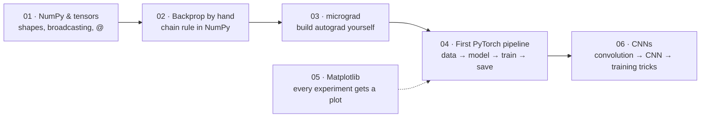

# dl-foundations

Deep learning from first principles, in NumPy and PyTorch — part of my Year One plan (RRC, IIIT Hyderabad).
Each chapter: concept → maths → small example → implementation → exercises → notes.

| # | Chapter | Plan days |
|---|---|---|
| 01 | [NumPy and Tensors](01-numpy-and-tensors/) | Day 001 |
| 02 | [Backpropagation by Hand](02-backprop-by-hand/) | Day 002 |
| 03 | [micrograd — an Autograd Engine](03-micrograd/) | Days 003–004 |
| 04 | [First PyTorch Training Pipeline](first_pytorch_training/) · [theory](first_pytorch_training/THEORY.md) | Day 005 |

| 05 | [Matplotlib Essentials](05-matplotlib/) | — |
| 06 | [Convolution to CNNs](06-cnn/) · [Part 2: Building and Training CNNs](06-cnn/building-and-training-cnns.md) · [filter visualization](06-cnn/figures/) | — |


## Learning path



Each chapter reuses the previous one: the shapes from 01 become the matrices in 02, whose chain rule is automated in 03, which PyTorch does for you in 04, which trains the CNNs in 06. Chapter 05 supplies the plots used everywhere.

## Setup

```bash
pixi install
pixi run python -c "import torch; print(torch.backends.mps.is_available())"
```

`common/` holds small helpers reused across chapters. Datasets go in `data/` and run outputs in each chapter's `outputs/`; both are git-ignored.

## Repository layout

```text
dl-foundations/
├── pixi.toml / pixi.lock      # environment (Python, PyTorch, NumPy, …) + tasks
├── pyproject.toml             # makes the shared code an installable (editable) package
├── common/                    # shared helpers, e.g. common/paths.py (DATA_DIR)
├── data/                      # datasets (git-ignored), e.g. data/FashionMNIST
├── 01-numpy-and-tensors/      # README + exercises
├── 02-backprop-by-hand/       # README + notes + exercise script + figures
├── 03-micrograd/              # README + micrograd.py
├── first_pytorch_training/    # chapter 04, an importable package (README + THEORY)
├── 05-matplotlib/             # README + exercises
└── 06-cnn/                    # README, Part 2 notes, CNN scripts, figures
```

**Why is chapter 04's folder named differently?** Later chapters import its code (`from first_pytorch_training.training import train_model_with_val`). A Python package name can't contain hyphens or start with a digit, so `04-first-pytorch-training` was renamed. The repo root is installed in editable mode (`[pypi-dependencies]` in `pixi.toml`), so those imports work from any folder.

## Running things

```bash
pixi run python -m first_pytorch_training.training   # chapter 04 training (or: pixi run mlp-train)
pixi run python 06-cnn/training.py                   # chapter 06 CNN training (or: pixi run cnn-train)
pixi run python 06-cnn/visualize_filters.py          # chapter 06 filter / feature-map figures
```

Saved figures that are worth keeping are copied into each chapter's `figures/` (tracked by git). Scratch output goes to `outputs/` (ignored).

