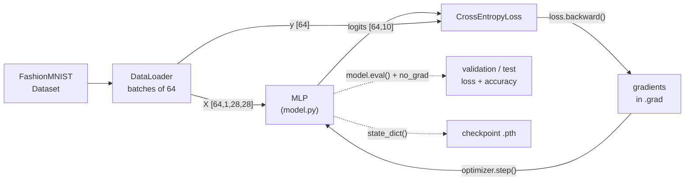
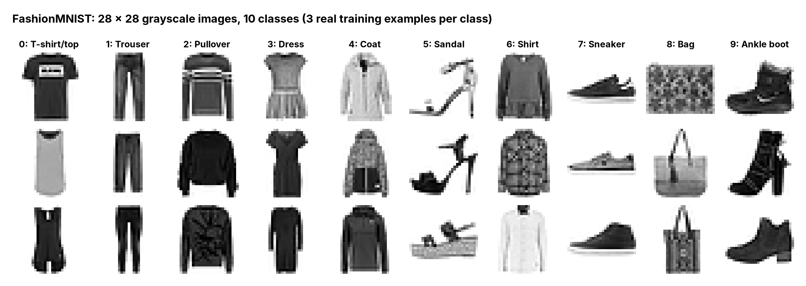
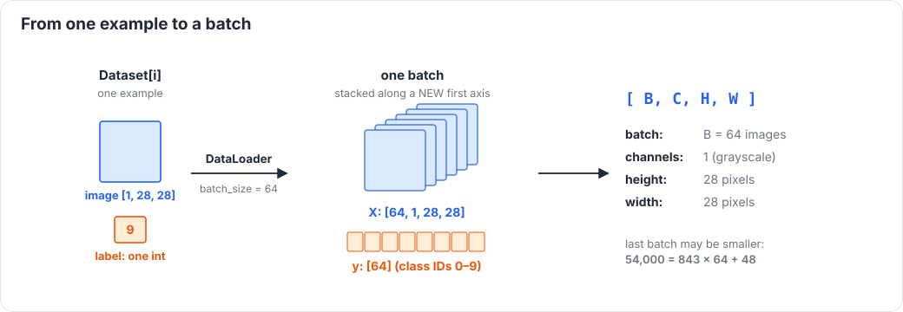
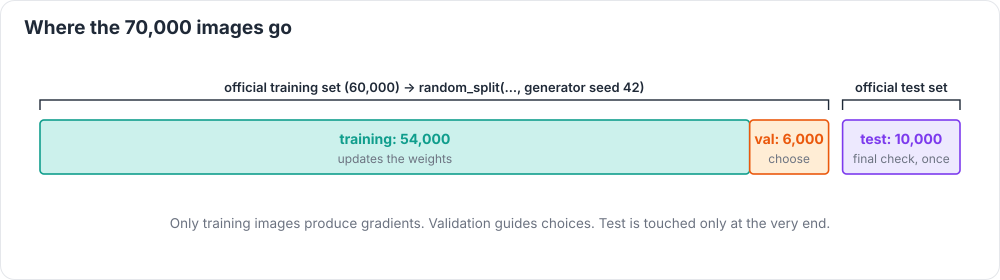
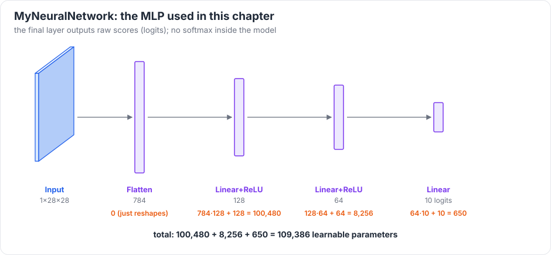
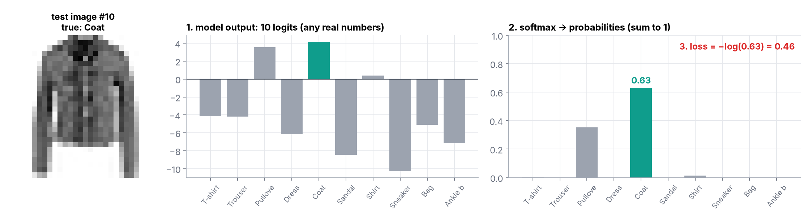
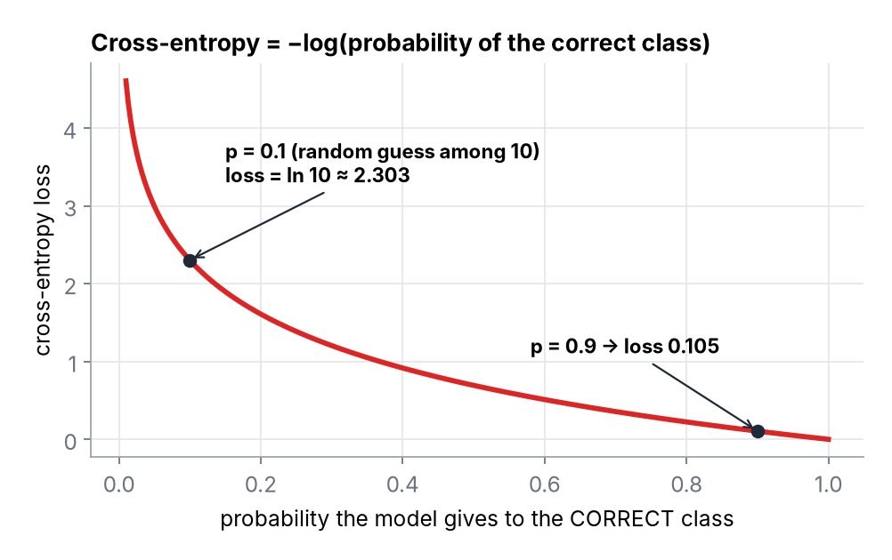
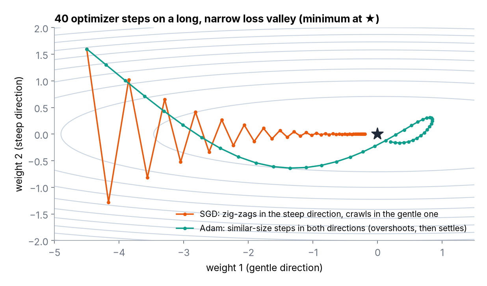
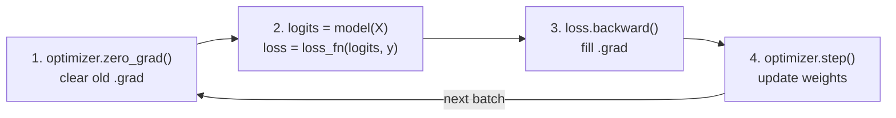

# 5.1 · Your First PyTorch Training Pipeline

> A theory-first guide to preparing data, defining a model, training it, evaluating it, and saving it for later use.

This chapter connects the autograd ideas from [Chapter 03 · micrograd](../03-micrograd/README.md) and [Chapter 04 · First PyTorch Training Pipeline](README.md) to a complete, small image-classification workflow. The running example is FashionMNIST: grayscale pictures of clothing, each 28 pixels high and 28 pixels wide, with one of ten labels.

The pipeline has four parts:

1. **5.1.1 — Datasets and DataLoaders:** represent examples and deliver them in batches.
2. **5.1.2 — `nn.Module`:** define the computation that turns a batch into class scores.
3. **5.1.3 — Optimization and evaluation:** calculate loss, backpropagate gradients, update parameters, and measure performance.
4. **5.1.4 — Saving, loading, and inference:** keep learned parameters and use a trained model later.

The code uses the public PyTorch and TorchVision APIs. The snippets can be combined into a script in the repository environment; the end-to-end example near the end shows how the pieces fit together.

The repository's environment is defined in the root `pixi.toml`. When you copy the end-to-end example into a Python file, run it from the repository root so `root="data"` points to the shared `data/` directory. The first run downloads FashionMNIST if it is not already present.

For example, save that code as `fashion_mnist_demo.py` in the repository root and run `pixi run python fashion_mnist_demo.py`.

## The whole problem in one picture

Supervised learning starts with examples and their known answers:

$$
\mathcal{D} = \{(x_i, y_i)\}_{i=1}^{N},
$$

where `x_i` is an input image and `y_i` is its integer class label. A model with parameters `θ` maps an image to scores. Training searches for parameters that make the correct class score high across the training examples:

$$
\theta^* \approx \arg\min_{\theta}
\frac{1}{N}\sum_{i=1}^{N} \ell(f_{\theta}(x_i), y_i).
$$

Here `fθ` is the neural network and `ℓ` is a loss function. In PyTorch, the dataset supplies `(x_i, y_i)`, the model computes `fθ(x_i)`, autograd calculates the derivative of the loss, and an optimizer changes `θ`.






---

## 5.1.1 — Datasets and DataLoaders

### Dataset: what is one example?

A dataset defines how to retrieve one example by index. For classification, one item is usually a pair:

```text
(input, target) = (image tensor, class ID)
```

For a grayscale FashionMNIST image, an individual transformed image has shape `[1, 28, 28]`: one channel, 28 rows, and 28 columns. The label is one integer from `0` through `9`.

The `Dataset` contract is simple:

- `__len__()` returns the number of examples.
- `__getitem__(index)` returns the example at that index.

TorchVision already implements this interface for FashionMNIST:

```python
import torch
from torchvision import datasets, transforms
from torch.utils.data import random_split

to_tensor = transforms.ToTensor()

full_train_data = datasets.FashionMNIST(
    root="data",
    train=True,
    download=True,
    transform=to_tensor,
)

test_data = datasets.FashionMNIST(
    root="data",
    train=False,
    download=True,
    transform=to_tensor,
)

train_data, val_data = random_split(
    full_train_data,
    [54_000, 6_000],
    generator=torch.Generator().manual_seed(42),
)

image, label = train_data[0]
print(image.shape, image.dtype, label)
# torch.Size([1, 28, 28]) torch.float32 9   # label varies by example
```

`ToTensor()` converts a PIL image or NumPy image into a floating-point tensor and scales the usual 8-bit pixel range from `[0, 255]` to `[0, 1]`. That scaling is a preprocessing choice; training and inference must use compatible preprocessing.

For a custom collection of files, you can write a `Dataset` yourself. This miniature example assumes `images` and `labels` have the same length:

```python
from torch.utils.data import Dataset

class ImageDataset(Dataset):
    def __init__(self, images, labels):
        self.images = images
        self.labels = labels

    def __len__(self):
        return len(self.labels)

    def __getitem__(self, index):
        return self.images[index], self.labels[index]
```

The dataset does not decide how examples are grouped into training steps. That is the `DataLoader`'s job.

### DataLoader: how examples reach a training step

Loading one example at a time is possible, but a neural network is usually trained on a **mini-batch**. A `DataLoader` retrieves samples, groups them, and optionally shuffles their order:

```python
from torch.utils.data import DataLoader

batch_size = 64

train_loader = DataLoader(
    train_data,
    batch_size=batch_size,
    shuffle=True,
)

val_loader = DataLoader(
    val_data,
    batch_size=batch_size,
    shuffle=False,
)

test_loader = DataLoader(
    test_data,
    batch_size=batch_size,
    shuffle=False,
)

images, labels = next(iter(train_loader))
print(images.shape, labels.shape)
# torch.Size([64, 1, 28, 28]) torch.Size([64])
```




The DataLoader stacks the individual examples along a new leading batch axis. With batch size `B`:

| Value | Shape | Meaning |
|---|---:|---|
| One image | `[1, 28, 28]` | Channels, height, width |
| A batch of images `X` | `[B, 1, 28, 28]` | `B` grayscale images |
| One label | `[]` (scalar) | One integer class ID |
| A batch of labels `y` | `[B]` | One class ID for each image |

If the dataset size is not divisible by `B`, the final batch is smaller unless `drop_last=True`. Code should not assume every batch has exactly the configured size.

`shuffle=True` randomizes the sample order each training epoch. This helps prevent the optimizer from repeatedly seeing examples in the same order. For validation and test sets, shuffling is unnecessary; `shuffle=False` also makes inspection easier. Randomness can be seeded when repeatable experiments are important.

### Training, validation, and test sets

These splits have different jobs:

- **Training set:** used to compute gradients and update parameters.
- **Validation set:** used during development to compare settings, choose a checkpoint, or decide when to stop.
- **Test set:** held aside for a final estimate after model choices are finished.

Do not tune a model repeatedly against the test set and then treat its score as an unbiased final estimate. That leaks information from the test set into model selection.




FashionMNIST supplies an official training partition and test partition. A validation set can be carved out of the training partition, for example with `random_split`; use a fixed generator seed if you need a repeatable split. The evaluation loop later in this guide can be used for either validation or test data.

### Common data mistakes

- **Missing batch dimension:** a single image is `[1, 28, 28]`; a batch is `[B, 1, 28, 28]`.
- **Wrong target type:** `CrossEntropyLoss` expects integer class IDs, usually `torch.int64`/`long`, not one-hot vectors.
- **Mismatched preprocessing:** use the same resize, scaling, channel order, and normalization at training and inference.
- **Shuffling the test set by habit:** it does not improve evaluation; keep order stable unless there is a specific reason to shuffle.
- **Leaking test examples into training:** only training examples should contribute gradients.

---

## 5.1.2 — Building a model with `nn.Module`

### A neuron is an affine transformation

A linear layer combines input features with learned weights and biases. For one example:

$$
z = Wx + b.
$$

PyTorch stores the weight matrix for `nn.Linear(in_features, out_features)` with shape `[out_features, in_features]`. For a batch whose examples are rows, the operation is:

$$
Z = XW^{\mathsf T} + b,
$$

where `X` has shape `[B, in_features]`, `W` has shape `[out_features, in_features]`, and `Z` has shape `[B, out_features]`. The bias has one value per output feature and is broadcast across the batch.

An affine transformation by itself is limited. An activation such as ReLU adds nonlinearity:

$$
\operatorname{ReLU}(z) = \max(0, z).
$$

Stacking linear layers without nonlinear activations is still equivalent to one linear transformation. The activation is what lets a multi-layer network represent more complex functions.

### Define the network as a Python class

Every custom PyTorch model subclasses `nn.Module`. Declare layers in `__init__`; describe how data flows through them in `forward`:

```python
import torch
from torch import nn

class FashionMNISTNet(nn.Module):
    def __init__(self):
        super().__init__()
        self.flatten = nn.Flatten(start_dim=1)
        self.layers = nn.Sequential(
            nn.Linear(28 * 28, 128),
            nn.ReLU(),
            nn.Linear(128, 64),
            nn.ReLU(),
            nn.Linear(64, 10),
        )

    def forward(self, x):
        x = self.flatten(x)
        return self.layers(x)  # raw class scores, called logits

model = FashionMNISTNet()
```

Calling `super().__init__()` initializes the `nn.Module` machinery. Assigning layers to `self` registers them, so PyTorch can find their parameters, move them between devices, switch their modes, and include their state in `state_dict()`.

Call the model as `model(images)`, rather than `model.forward(images)`. The regular call path runs PyTorch's hooks and module machinery around the forward pass.

### Track the shapes through the network

Let `B` be the batch size. A 28-by-28 image contains 784 pixel values, so `Flatten(start_dim=1)` combines the channel, height, and width axes while preserving the batch axis.

| Operation | Shape |
|---|---:|
| Input batch | `[B, 1, 28, 28]` |
| Flatten | `[B, 784]` |
| `Linear(784, 128)` + ReLU | `[B, 128]` |
| `Linear(128, 64)` + ReLU | `[B, 64]` |
| `Linear(64, 10)` | `[B, 10]` |




The final dimension has ten scores, one per FashionMNIST class. A forward pass can be inspected with:

```python
images, labels = next(iter(train_loader))
logits = model(images)
print(logits.shape)
# torch.Size([64, 10])
```

### Logits are scores, not probabilities

The model returns **logits**: unrestricted real-valued scores. The class with the largest logit is the model's predicted class:

```python
predicted_class = logits.argmax(dim=1)  # shape [B]
```

To turn logits into probabilities for display, apply softmax along the class dimension:

$$
p_k = \frac{e^{z_k}}{\sum_{j=1}^{10} e^{z_j}}.
$$

```python
probabilities = torch.softmax(logits, dim=1)  # shape [B, 10]
```

The probabilities for each example sum to approximately one. For training with `nn.CrossEntropyLoss`, pass logits directly; it combines a numerically stable log-softmax with the negative log-likelihood. Applying softmax first is both unnecessary and incorrect for this loss.

**A real example.** Below is test image #10 passed through a trained `MyNeuralNetwork` (the 5-epoch reproduction from the README). The model's two favourite classes are *Coat* and *Pullover*, which really do look alike at 28 × 28:



| Step | Coat (correct) | Pullover | Shirt | all others |
|---|---:|---:|---:|---:|
| 1. logits (raw scores) | 4.15 | 3.57 | 0.37 | between −10.3 and −4.1 |
| 2. softmax probabilities | **0.63** | 0.35 | 0.01 | ≈ 0.00 each |
| 3. cross-entropy loss | −log(0.63) = **0.46** | | | |

Notice how softmax **exaggerates gaps**: a logit difference of only 0.58 between Coat and Pullover becomes 0.63 vs 0.35, because softmax uses $e^z$ and $e^{0.58} \approx 1.8$. The prediction is correct (Coat), but the loss is still 0.46 because the model wasn't very sure.


### What `nn.Module` gives you

Parameters such as a linear layer's weights and biases are registered automatically. For example, `nn.Linear(784, 128)` has a weight of shape `[128, 784]` and a bias of shape `[128]`. The model exposes these through `model.parameters()` for an optimizer and through `model.state_dict()` for persistence.

`nn.Sequential` is useful when a portion of the model is just a straight ordered chain of layers. A custom `forward` is useful when the computation needs branching, skip connections, or intermediate logic. Both approaches use the same module and parameter-registration system.

---

## 5.1.3 — Optimization, training, and evaluation

### Loss: turn prediction quality into a number

For a ten-class problem, `nn.CrossEntropyLoss` expects logits `z` of shape `[B, 10]` and class labels `y` of shape `[B]`. For one example, its loss is:

$$
\ell(z,y) = -\log\left(\frac{e^{z_y}}{\sum_{k=1}^{10} e^{z_k}}\right).
$$

It is small when the correct class has high predicted probability and large when the model gives it very little probability. By default, `CrossEntropyLoss` averages the batch losses.

If all ten logits are equal, softmax assigns probability `0.1` to every class, so the loss for any target is `-log(0.1) = log(10) ≈ 2.303`. A confident correct prediction pushes the loss toward zero; a confident wrong prediction makes it large.



The whole loss is just this one curve applied to "the probability the model gave to the right answer". Push that probability toward 1 and the loss goes to 0. Give it almost nothing and the loss shoots up.


```python
loss_fn = nn.CrossEntropyLoss()
loss = loss_fn(logits, labels)
print(loss.shape)  # scalar: torch.Size([])
```

The target tensor contains class IDs, not probabilities:

```text
logits: [B, 10], floating point
labels: [B],      integer class IDs in 0..9
loss:   [],       one scalar average loss
```

### Backpropagation and the optimizer

Let `L(θ)` be the current batch loss. Autograd computes the gradient `∇θ L`, which says how changing each parameter would locally change the loss. Basic gradient descent updates parameters as:

$$
\theta \leftarrow \theta - \eta\,\nabla_{\theta}L,
$$

where `η` is the learning rate. The optimizer packages this update rule and may keep extra state. Stochastic gradient descent (SGD) uses the current batch's gradient; Adam also tracks moving averages of gradients and squared gradients.



*Real computation: 40 steps of PyTorch's own `torch.optim.SGD` and `torch.optim.Adam` (both lr 0.3) on a loss that is steep in one direction and gentle in the other.*

- **SGD** uses one step size for every weight. The steep direction makes it bounce side to side, while it creeps slowly along the gentle direction.
- **Adam** keeps, for each weight, a running average of its gradients (**momentum**: keep moving in a consistent direction) and of their squares (a per-weight **scale**). Dividing by that scale gives every weight a similar-sized step, whether its gradients are big or small. It can overshoot, as here, but it adapts automatically, which is why `Adam(lr=1e-3)` works well out of the box for many models.




In a training step, the essential order is:

1. Clear old gradients.
2. Run the forward pass and compute loss.
3. Call `loss.backward()` to calculate parameter gradients.
4. Call `optimizer.step()` to update parameters.

```python
optimizer = torch.optim.Adam(model.parameters(), lr=1e-3)

optimizer.zero_grad(set_to_none=True)
logits = model(images)
loss = loss_fn(logits, labels)
loss.backward()
optimizer.step()
```

`backward()` accumulates into each parameter's `.grad` buffer. That is why the old gradients must be cleared before the next batch. Forgetting to clear them makes gradients from earlier batches add to the current ones. The optimizer must be constructed after the model is moved to its target device.

### A reusable training loop

`model.train()` sets training behavior for modules such as dropout and batch normalization. The simple MLP above has neither, but using the mode switch makes the loop reusable. Inputs and labels must be moved to the same device as the model.

```python
def train_one_epoch(dataloader, model, loss_fn, optimizer, device):
    model.train()
    total_loss = 0.0
    total_correct = 0
    total_examples = 0

    for images, labels in dataloader:
        images = images.to(device)
        labels = labels.to(device)

        optimizer.zero_grad(set_to_none=True)
        logits = model(images)
        loss = loss_fn(logits, labels)
        loss.backward()
        optimizer.step()

        count = labels.size(0)
        total_examples += count
        total_loss += loss.item() * count  # undo the batch mean for accumulation
        total_correct += (logits.argmax(dim=1) == labels).sum().item()

    return total_loss / total_examples, total_correct / total_examples
```

The batch loss is already averaged over that batch. Multiplying it by the number of examples before accumulating lets us calculate the correct dataset-wide mean, even when the final batch is smaller.

The corresponding gradient-free evaluation loop is:

```python
def evaluate(dataloader, model, loss_fn, device):
    model.eval()
    total_loss = 0.0
    total_correct = 0
    total_examples = 0

    with torch.no_grad():
        for images, labels in dataloader:
            images = images.to(device)
            labels = labels.to(device)
            logits = model(images)
            loss = loss_fn(logits, labels)

            count = labels.size(0)
            total_examples += count
            total_loss += loss.item() * count
            total_correct += (logits.argmax(dim=1) == labels).sum().item()

    return total_loss / total_examples, total_correct / total_examples
```

`model.eval()` and `torch.no_grad()` do different jobs. Evaluation mode changes the behavior of modules that have train/eval behavior; no-grad mode stops autograd from building a backward graph for the computations in the block. Use both for ordinary evaluation and inference.

Accuracy is the fraction of examples whose highest-scoring class matches the label:

$$
\text{accuracy} = \frac{1}{N}\sum_{i=1}^{N}
\mathbf{1}[\arg\max_k z_{ik}=y_i].
$$

Loss and accuracy describe different things. Accuracy only records whether the top class was right; cross-entropy also responds to how much probability the model assigns to the correct class.

### Epochs and validation

An **epoch** is one pass over the training set. One epoch normally contains multiple batches and therefore multiple parameter updates. Repeat the training loop for several epochs, then evaluate on validation data:

```python
for epoch in range(num_epochs):
    train_loss, train_accuracy = train_one_epoch(
        train_loader, model, loss_fn, optimizer, device
    )
    val_loss, val_accuracy = evaluate(
        val_loader, model, loss_fn, device
    )
    print(
        f"Epoch {epoch + 1:02d}: "
        f"train loss {train_loss:.4f}, accuracy {train_accuracy:.3f}; "
        f"validation loss {val_loss:.4f}, accuracy {val_accuracy:.3f}"
    )
```

The **learning rate** determines the scale of parameter updates. Too large can make training unstable; too small can make learning very slow. A lower training loss is evidence the model is fitting the training examples, but validation behavior helps reveal whether those gains carry over to unseen data.

### Choosing a device

PyTorch tensors in one operation must live on a compatible device. On Apple silicon, MPS may be available; otherwise CPU is a safe fallback:

```python
if torch.backends.mps.is_available():
    device = torch.device("mps")
else:
    device = torch.device("cpu")

model = FashionMNISTNet().to(device)
optimizer = torch.optim.Adam(model.parameters(), lr=1e-3)
```

Move each batch with `.to(device)` inside the loop. A frequent error is keeping the model on MPS while the inputs remain on CPU (or vice versa). Some systems also offer CUDA; choose an available device deliberately rather than assuming one exists.

### Common training mistakes

- **Calling `optimizer.step()` before `loss.backward()`:** the optimizer has no fresh gradients to apply.
- **Not clearing gradients:** `.grad` accumulates by default.
- **Applying softmax before `CrossEntropyLoss`:** pass raw logits.
- **Using one-hot labels:** ordinary class-index targets should be integer IDs with shape `[B]`.
- **Forgetting `model.train()` / `model.eval()`:** dropout or batch normalization can behave incorrectly in the wrong mode.
- **Using only `model.eval()` for evaluation:** it does not disable autograd; also use `torch.no_grad()` (or `torch.inference_mode()` for inference).
- **Averaging batch means without weighting:** the final batch may be smaller; weight each mean by its batch size.
- **Mixing devices:** model, input, and target should be placed compatibly.
- **Confusing loss with error rate:** a cross-entropy value is not a percentage of wrong predictions.

---

## 5.1.4 — Saving, loading, inference, and checkpoints

### Model structure and learned state are separate

The Python class defines the architecture and forward computation. Training changes the model's **state**: learned weights and biases, plus any persistent buffers used by certain layers. `model.state_dict()` returns that registered state as a mapping of names to tensors.

Saving a state dictionary is the recommended way to preserve a model's learned parameters:

```python
from pathlib import Path

weights_path = Path("fashion_mnist_weights.pth")
torch.save(model.state_dict(), weights_path)
```

To load it, create the same architecture, load the state dictionary, and switch to evaluation mode:

```python
loaded_model = FashionMNISTNet().to(device)
state = torch.load(
    weights_path,
    map_location=device,
    weights_only=True,
)
loaded_model.load_state_dict(state)
loaded_model.eval()
```


**What's actually inside the state dict** of the chapter's `MyNeuralNetwork` (real output of `{k: v.shape for k, v in model.state_dict().items()}`):

| Key | Shape | What it is |
|---|---|---|
| `linear_relu_stack.0.weight` | `[128, 784]` | first Linear layer's weights |
| `linear_relu_stack.0.bias` | `[128]` | first Linear layer's biases |
| `linear_relu_stack.2.weight` | `[64, 128]` | second Linear layer (index 1 is the ReLU, which has no parameters) |
| `linear_relu_stack.2.bias` | `[64]` | |
| `linear_relu_stack.4.weight` | `[10, 64]` | output layer |
| `linear_relu_stack.4.bias` | `[10]` | |

The names come from the attribute names in your class (`linear_relu_stack`) plus the position inside `nn.Sequential`. That's why loading only works into a model built with the same structure and names.

The model architecture must match the saved parameter names and shapes. For instance, a saved first layer with shape `[128, 784]` cannot be loaded into a layer with a different hidden width. `map_location` maps saved tensors to the requested device while loading. The `.pth` and `.pt` suffixes are common conventions, not format requirements.

The state dictionary is not a self-contained Python model: it does not include the `FashionMNISTNet` class definition. Keep the code that defines the architecture available alongside the weights. Loading an arbitrary whole Python model with pickle is less portable and can execute code; for an ordinary model, prefer a state dictionary and `weights_only=True`.

### Inference: make predictions without training

Inference uses the model's current parameters to make a prediction; it does not call `backward()` or update weights. A single dataset image has shape `[1, 28, 28]`, so add a batch axis to make `[1, 1, 28, 28]` before passing it to the model:

```python
class_names = [
    "T-shirt/top", "Trouser", "Pullover", "Dress", "Coat",
    "Sandal", "Shirt", "Sneaker", "Bag", "Ankle boot",
]

image, true_label = test_data[0]       # image: [1, 28, 28]
image_batch = image.unsqueeze(0).to(device)  # [1, 1, 28, 28]

loaded_model.eval()
with torch.inference_mode():
    logits = loaded_model(image_batch)  # [1, 10]
    probabilities = torch.softmax(logits, dim=1)
    predicted_id = probabilities.argmax(dim=1).item()
    confidence = probabilities[0, predicted_id].item()

print("Predicted:", class_names[predicted_id])
print("Actual:   ", class_names[true_label])
print("Softmax score:", f"{confidence:.3f}")
```

`torch.inference_mode()` avoids autograd work and can enable additional inference optimizations. `model.eval()` changes layer behavior; inference mode controls gradient tracking. Neither one changes the learned weights. A softmax score is not automatically a calibrated probability that the prediction is correct.

### Weights for inference versus a checkpoint for resuming

Weights alone are enough to run predictions, but they are not enough to continue an optimizer exactly where it left off. Optimizers such as Adam maintain their own moving averages and step counts. A training checkpoint usually stores model state, optimizer state, the epoch, and useful metadata:

```python
checkpoint_path = Path("fashion_mnist_checkpoint.pth")

torch.save(
    {
        "epoch": epoch,
        "model_state_dict": model.state_dict(),
        "optimizer_state_dict": optimizer.state_dict(),
        "validation_loss": val_loss,
        "class_names": class_names,
    },
    checkpoint_path,
)
```

Resume by rebuilding the model and optimizer, then restoring both states:

```python
resumed_model = FashionMNISTNet().to(device)
resumed_optimizer = torch.optim.Adam(
    resumed_model.parameters(), lr=1e-3
)

checkpoint = torch.load(
    checkpoint_path,
    map_location=device,
    weights_only=True,
)
resumed_model.load_state_dict(checkpoint["model_state_dict"])
resumed_optimizer.load_state_dict(checkpoint["optimizer_state_dict"])
start_epoch = checkpoint["epoch"] + 1
```

This restores the model and optimizer state, but it does not guarantee a perfectly identical run after interruption. Exact reproducibility may also require saving random-number-generator states, scheduler state, mixed-precision scaler state, data-sampler position, and relevant environment details.

| Saved item | Best suited for | Why it matters |
|---|---|---|
| `model.state_dict()` | Inference or fine-tuning from learned weights | Stores model parameters and persistent buffers |
| Model + optimizer state | Resuming training | Preserves optimizer history as well as model values |
| Epoch and metrics | Tracking progress | Indicates where the run stopped and what it measured |
| Preprocessing and class metadata | Reproducing inference | Keeps input conventions and label mapping explicit |

Keep checkpoints from trusted sources. A weights-only state dictionary is safer and more portable than unpickling a whole model object.

---

## End-to-end example: fit one epoch and save weights

This compact example combines the same pieces. It downloads FashionMNIST into the repository's `data/` directory if needed, trains for one epoch, evaluates once on the official test split, and saves model weights. If you tune settings or choose among checkpoints, use validation data for those decisions and keep the test set for the final evaluation.

```python
from pathlib import Path

import torch
from torch import nn
from torch.utils.data import DataLoader, random_split
from torchvision import datasets, transforms


class FashionMNISTNet(nn.Module):
    def __init__(self):
        super().__init__()
        self.flatten = nn.Flatten(start_dim=1)
        self.layers = nn.Sequential(
            nn.Linear(784, 128),
            nn.ReLU(),
            nn.Linear(128, 64),
            nn.ReLU(),
            nn.Linear(64, 10),
        )

    def forward(self, x):
        return self.layers(self.flatten(x))


def train_one_epoch(loader, model, loss_fn, optimizer, device):
    model.train()
    total_loss = 0.0
    total_correct = 0
    total = 0

    for images, labels in loader:
        images, labels = images.to(device), labels.to(device)
        optimizer.zero_grad(set_to_none=True)
        logits = model(images)
        loss = loss_fn(logits, labels)
        loss.backward()
        optimizer.step()

        count = labels.size(0)
        total += count
        total_loss += loss.item() * count
        total_correct += (logits.argmax(dim=1) == labels).sum().item()

    return total_loss / total, total_correct / total


def evaluate(loader, model, loss_fn, device):
    model.eval()
    total_loss = 0.0
    total_correct = 0
    total = 0

    with torch.inference_mode():
        for images, labels in loader:
            images, labels = images.to(device), labels.to(device)
            logits = model(images)
            loss = loss_fn(logits, labels)
            count = labels.size(0)
            total += count
            total_loss += loss.item() * count
            total_correct += (logits.argmax(dim=1) == labels).sum().item()

    return total_loss / total, total_correct / total


if torch.cuda.is_available():
    device = torch.device("cuda")
elif torch.backends.mps.is_available():
    device = torch.device("mps")
else:
    device = torch.device("cpu")

transform = transforms.ToTensor()
full_train_data = datasets.FashionMNIST(
    root="data", train=True, download=True, transform=transform
)
train_data, val_data = random_split(
    full_train_data,
    [54_000, 6_000],
    generator=torch.Generator().manual_seed(42),
)
test_data = datasets.FashionMNIST(
    root="data", train=False, download=True, transform=transform
)
train_loader = DataLoader(train_data, batch_size=64, shuffle=True)
val_loader = DataLoader(val_data, batch_size=64, shuffle=False)
test_loader = DataLoader(test_data, batch_size=64, shuffle=False)

model = FashionMNISTNet().to(device)
loss_fn = nn.CrossEntropyLoss()
optimizer = torch.optim.Adam(model.parameters(), lr=1e-3)

train_loss, train_acc = train_one_epoch(
    train_loader, model, loss_fn, optimizer, device
)
print(f"train: loss={train_loss:.4f}, accuracy={train_acc:.3f}")
val_loss, val_acc = evaluate(val_loader, model, loss_fn, device)
print(f"validation: loss={val_loss:.4f}, accuracy={val_acc:.3f}")
test_loss, test_acc = evaluate(test_loader, model, loss_fn, device)
print(f"test:  loss={test_loss:.4f}, accuracy={test_acc:.3f}")

weights_path = Path("fashion_mnist_weights.pth")
torch.save(model.state_dict(), weights_path)
print(f"Saved weights to {weights_path.resolve()}")
```

To load the saved weights in a fresh process, define `FashionMNISTNet` again, instantiate it, and call `load_state_dict(torch.load(..., weights_only=True))`. Then call `.eval()` and run new batches under `torch.inference_mode()`.

## One training step, remembered

```text
Dataset → DataLoader → batch (images, labels)
    → model(images) → logits
    → loss_fn(logits, labels) → scalar loss
    → loss.backward() → parameter gradients
    → optimizer.step() → updated parameters
    → repeat for each batch and epoch
```

For evaluation, switch to `model.eval()`, skip backpropagation and optimizer updates, and accumulate loss and accuracy over validation or test batches. For inference, load the trained state, apply the same preprocessing, and produce predictions without changing parameters.

## References

- [Datasets & DataLoaders — PyTorch Learn the Basics](https://docs.pytorch.org/tutorials/beginner/basics/data_tutorial.html)
- [Build the Neural Network — PyTorch Learn the Basics](https://docs.pytorch.org/tutorials/beginner/basics/buildmodel_tutorial.html)
- [Optimizing Model Parameters — PyTorch Learn the Basics](https://docs.pytorch.org/tutorials/beginner/basics/optimization_tutorial.html)
- [Save and Load the Model — PyTorch Learn the Basics](https://docs.pytorch.org/tutorials/beginner/basics/saveloadrun_tutorial.html)
- [Saving and Loading Models — PyTorch Tutorials](https://docs.pytorch.org/tutorials/beginner/saving_loading_models.html)
